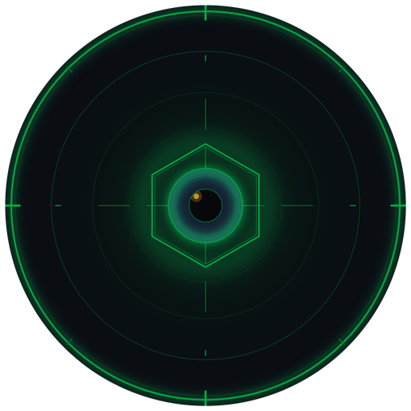
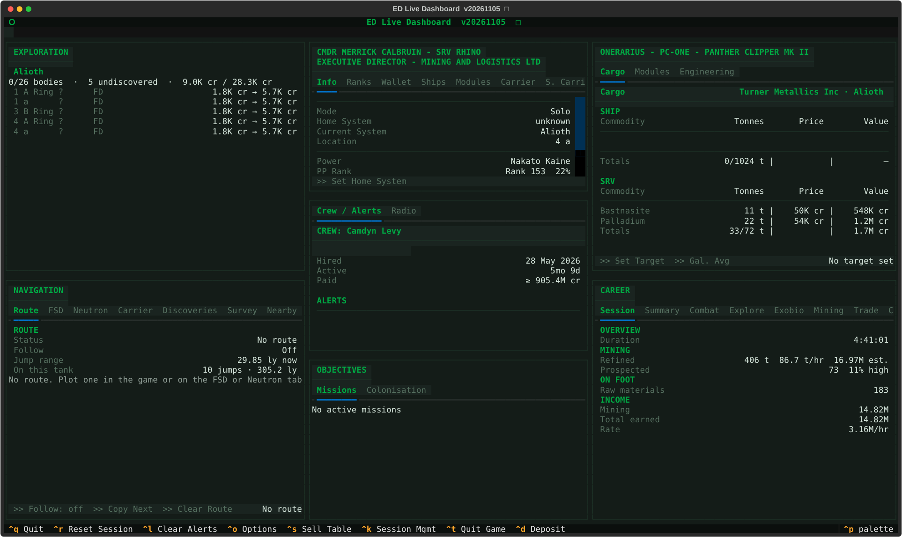
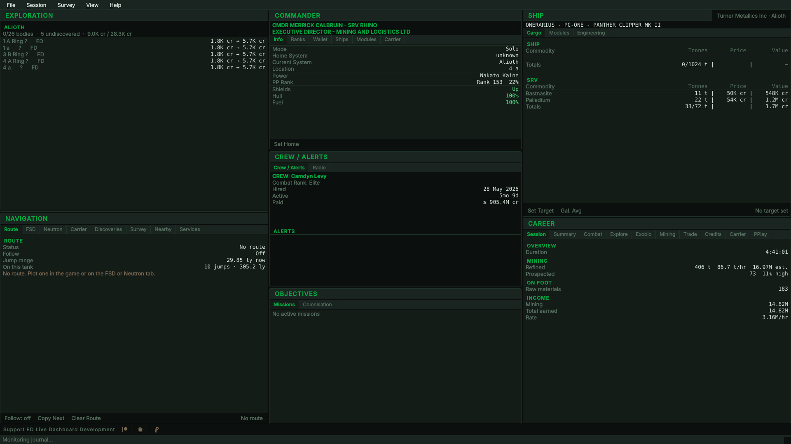
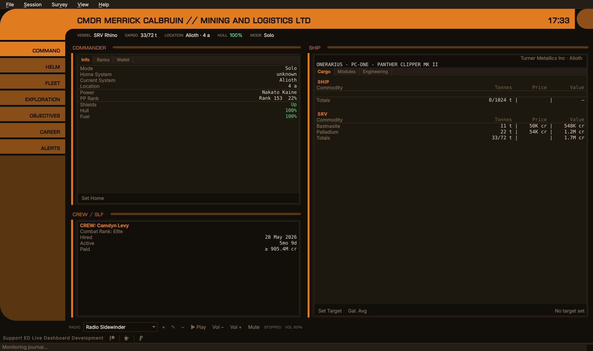
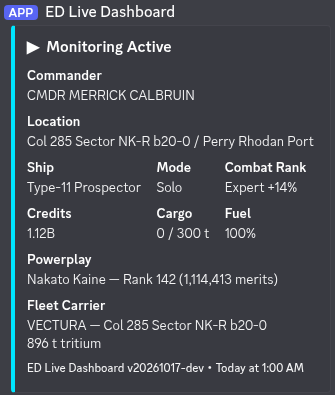

<div align="center">



# ED Live Dashboard
**Commander monitoring dashboard for Elite Dangerous**

[](https://www.elitedangerous.com)
[]()

[](https://github.com/indevlin/EDLD/releases)
[](https://github.com/indevlin/EDLD/stargazers)
[](https://github.com/indevlin/EDLD/network/members)
[](LICENSE)
[](https://play.google.com/store/apps/details?id=com.indevlin.edam)
[](https://discord.indevlin.com)

<ins>Career & real-time session tracking</ins></br>
Combat · Trade · Mining · Exploration · Missions · Exobiology · PowerPlay · On foot · Assets, and more

<ins>Integrations</ins></br>
FDev CAPI · EDDN · EDSM · EDAstro · Inara · Raven Colonial · Discord Webhooks

<ins>Multiple Interface Options</ins></br>
EDCARS · Desktop dashboard · Terminal dashboard · Terminal scroll · EDAM on your phone or tablet

</div>

## Overview

EDLD is a CMDR career and real-time session monitoring dashboard for Elite Dangerous, running on Linux, Windows and macOS. It tails your journal and presents the same dashboard four ways — EDCARS, a console-styled desktop window and the default; the desktop window with every window at once; a live terminal dashboard; or a scrolling feed — tracking everything you do across combat, trade, mining, exploration, missions, exobiology, PowerPlay and on foot.

Around the dashboard it can draw a stats overlay over the game for streaming, keep a dossier of your commander and fleet as a web page and Markdown files, share surface-mining finds with a squadron through a Google Sheet, and serve the dashboard to the EDAM app on a phone or tablet.

Every interface, and the EDAM app, is built from one model of each window and one set of components, so they show the same windows with the same data; only the rendering differs. Pick whichever suits the machine: the terminal dashboard over SSH, EDCARS on a second monitor beside the game, EDAM on a tablet.

Alerts fire when things go wrong: shields down, hull taking damage, fuel running low, fighter destroyed. Session statistics accumulate across all activity types in a tabbed panel that shows only what's relevant to your current session.

All game state flows through a unified `DataProvider` — CAPI when authenticated, journal events and local JSON files as fallback.

---

## Features

| | |
|--|--|
| 💥 **Combat Tracking** | Kills, bounties, combat bonds, deaths, and fighter losses with per-kill timing and faction tally |
| 🎯 **Objectives Window** | The mission board and colonization in one place — every active mission in a table for its type, with what it asks for, the time it has left and its reward, the massacre stack summarized by source faction with kills needed, missions done and value, construction sites with their outstanding requirements, the ore a mining mission asks for already in your hold or on your own carrier, and the survey's deposits in a filterable table |
| 📊 **Session Statistics** | Tabbed activity dashboard — Combat, Trade, Mining, Exploration, Missions, Exobiology, Odyssey (on foot, SRV, settlements, taxis), PowerPlay and Income — showing totals and /hr rates |
| 🖵 **Terminal Dashboard** | Full terminal dashboard with all panels. Runs on any machine with Python and a modern terminal |
| 🖥️ **Desktop Window** | The same dashboard as a native PySide6 window on Linux, Windows and macOS, with resizable columns, real menus, and full platform window controls |
| 🎛️ **EDCARS** | The default interface, for the desktop window and EDAM: a console with a header band that keeps the commander and squadron, vessel, cargo, location, fuel, hull, game mode and the local time in view, and a rail of sections — Command, Helm, Fleet, Exploration, Objectives, Career, Alerts — each one to three framed windows. An urgent alert pulses the Alerts pill, or switches to it. Four consoles to dress it in: EDCARS's own, ORDER (an Imperial fleet console), REBEL (a Rebel ops board) and ROGUE (an independent freighter's cockpit), each with a matching theme, on the desktop and on EDAM; Options and every dialog wear the console too ([guide](docs/EDCARS.md)) |
| 🛡️ **Alerts** | Shield drops, hull damage, fighter loss, ship destruction, fleet-carrier jumps scheduled, canceled and completed, its jump cooldown over and an upkeep it cannot cover, and an expired Frontier login. Auto-clear on login and docking, plus a manual clear button. Each alert type has its own level: off, local only, Discord, or Discord with a ping |
| ⛽ **Fuel Monitoring** | Warn and critical thresholds for fuel percentage and estimated time remaining |
| 🚨 **Security & Cargo Events** | Cargo scans, police scans, security attacks, low-value cargo notices |
| ⚠️ **Inactivity Warnings** | Alerts on kill rate drop or extended period without kills |
| ✕ **Session Management** | Optional, opt-in auto-quit of the game on configured triggers — a fighter lost in a fight, low fuel, low hull (the SRV's while driving), or too long at a RES without a kill. **Solo mode only**; runtime toggle with Ctrl+K ([guide](docs/guides/SESSION_MANAGEMENT.md)) |
| 💵 **Lifetime Financial Ledger** | Journal-derived earnings and spending by category, voucher reconciliation (issued vs redeemed), and carrier-bank flow — built from 27 credit-moving event types because in-game Statistics fields like `Trading.Goods_Sold` are unreliable. Money the game pays without logging it, such as PowerPlay care packages, is found by reconciling the balance and shown as **Unknown Credits** ([how](docs/CONFIGURATION.md#how-income-is-counted)) |
| 📁 **Commander Dossier** | A web page and Markdown files about the commander, kept up to date: the fleet with every ship's fitting — stored ships included — and service record, stored modules, engineering, fleet carrier, ring hotspots by refinement rate, surface deposits, and on-foot kit. Themed to match the dashboard, self-contained, location and balances left out unless included ([guide](docs/DOSSIER.md)) |
| 📦 **Cargo** | The Ship window's first tab: the hold sorted cheapest-per-tonne first so the jettison candidate leads, under Commodity / Tons / Price / Value headings, followed live from `Cargo.json` so it stays right even when the journal lags. Stolen goods flagged, limpets set apart, Spansh target-market price comparison, and the SRV's tonnage alongside when one is out |
| 💱 **Sell Table** | Ctrl+S in either interface: what the market being quoted pays for every commodity, most valuable first, opening on a Mineable tab with All Items behind it. Written out alongside it as Markdown and HTML for use outside the app. Carrier markets are ignored throughout, and prices no NPC will honor are left out |
| 🗃️ **Commodity Catalog** | Every commodity ever seen in `Market.json`, recorded once with its id, names and category, and re-recorded whenever its galactic average drifts. Market.json is overwritten on the next dock; this is not |
| ⚗️ **Engineering** | The Ship window's third tab: materials across Raw, Manufactured and Encoded categories, plus Odyssey ShipLocker contents |
| 🚀 **Assets Tabs** | Full fleet overview in the Commander window — wallet with At-Risk holdings and net worth, stored ships with loadouts, stored modules, and a tab each for a fleet carrier and a squadron carrier, shown only when you own one |
| 🧑 **Commander Window** | Identity, squadron, home location, PowerPlay standing and ship condition — hull, shields and fuel on the default Info tab — with every rank's progression on the Ranks tab and the full asset tabs alongside. Adapts to SRV, on-foot and fighter states |
| 📊 **Career / Session Window** | This session's output on the first tab — what each activity produced, with every earning stream tallied in one Income section — then lifetime figures across Combat, Explore, Exobio, Mining, Trade, Credits, Carrier and PowerPlay. A session starts and ends with the game itself ([what counts](docs/CONFIGURATION.md#what-a-session-is)); reset it by hand with Ctrl+R |
| 📈 **Career Summary** | Lifetime headline figures from every Career tab in one place, built from the same shared model as the session view so both read identically at their own scope |
| 🔧 **Ship Window** | The vessel's name, ident and type heading three tabs — Cargo, Modules and Engineering. Modules are sorted by power priority then by health ascending, so anything needing repair surfaces first. Built for neutron hopping |
| 🔭 **Exploration Window** | Honk / scan / map state and each body's current and max-if-mapped cartographic value, with that body's exobiology — signals, sampled flora, clonal-distance aid and predicted genera — nested directly beneath it. Every body ever scanned is kept in a local catalog, built from your whole journal history, which the career exploration figures come from |
| 🧭 **Navigation & Route Follower** | The Route tab shows the route being flown — where you are on it, jumps and distance left, and every system ahead with its star class (scoopable, neutron, white dwarf) and leg length, any leg longer than the ship can jump marked. Ranges come from the ship's own drive — its figures, the fuel in the tank and the cargo aboard — with how many jumps the tank has left, and the plot forms start from the system you are in at that range. Plain FSD routes are planned jump by jump with the ship's drive and fuel, by Spansh's exact plotter: where to refuel, which stars can be scooped, what is left in the tank at each stop. Neutron-boosted routes use the drive's own supercharge, and fleet-carrier routes plan tritium per jump, all through Spansh — in the Navigation window. A system just discovered, which no database knows yet, is plotted from the nearest known one. With Follow on, arriving in a system copies the next one on the route to the clipboard, ready to paste into the galaxy map; Copy Next does it by hand. Follows whichever is newer, EDLD's route or the one plotted in game. A route is checked as it is plotted — permit-locked systems, a tank that runs dry with no scoop, stretches with no scoopable star, in the game's own routes too — with the time left at this session's pace; leaving it, or changing ship, plots it again from where you are |
| 🗺️ **Survey Routes and Finders** | Road to Riches, Exomastery, Earth-like, ammonia and terraformable worlds, trade runs and a sweep through systems you choose, planned by Spansh and followed like any route: arriving at a stop says what is still to map, sample, buy or sell there, from your own journal. Nearby lists every reported system within a radius — done, partly scanned or star only, with what you have done there — and Services finds the nearest station or fleet carrier with a service, the Deep Space Support Array's carriers included. Discoveries keeps your unsold first discoveries, watched on Spansh for anyone else scanning them before you sell, the rescan list a death leaves, and your firsts. System fields take a paste from the game PC's clipboard |
| 📣 **Callouts** | Said as it happens, with a chime: an undiscovered system, a world first mapped, ground no one has set foot on; a genus new to your codex in this region; a sample run left unfinished before it is lost, and the moment you are clear of earlier samples, on foot or flying low; a prospected rock with a mineral you watch, a motherlode, the hold nearly full, and the ring you drop into with your own yields in rings of its type; undocking with a limpet controller and no limpets, each type of controller switched on its own; a chime on targeting a system — never reported, unscanned or done. The Mining tab adds how long until the hold is full, each hotspot's hit rate, and those yields; the Carrier tab, its jump cooldown and the next upkeep |
| 🤖 **Automation** | Opt-in, through your own keybindings — keys, and mouse buttons while the pointer is over the game — and only while the game has the focus: honk on arriving in a system you have never honked, plot the galaxy map to the next stop after a supercharge, and the Helm panel: those two and the game's own controls — flight, the ship, combat, the pips, the maps — as buttons, grouped, in EDCARS, along the foot of the Dashboard on the desktop and in the terminal, and on EDAM. **Check bindings** lists what each feature presses, what it is bound to, and what to change ([guide](docs/AUTOMATION.md)) |
| 💾 **Journal Backups** | A compressed copy of every journal, kept in EDLD's data folder, and the jumps EDSM's flight log is missing sent from them on request |
| 👥 **Crew / Alerts Window** | NPC crew roster and ship-launched fighter status with correct variant identification, sharing a window with the alert feed beneath it — the two are rarely busy at once. A Radio tab sits behind it, and any new alert brings Crew / Alerts back to the front |
| 📻 **Radio** | Radio Sidewinder, Hutton Orbital Radio and Radio Skvortsov in the Crew / Alerts window's Radio tab, in both interfaces — station list, play/stop, volume and mute, with the song title where the station sends one. Add, edit and delete stations from the tab itself (globally or for the current profile), or by hand in `[Radio]`. Never starts on its own |
| 💰 **At-Risk Holdings Tracker** | Persistent cross-session tracker for unredeemed bounties, combat bonds, trade vouchers, cartography, and exobiology. Survives session resets, zeroed on death |
| 🛡️ **Unified Data Provider** | Single source of truth for all game state — CAPI › journal › Status.json |
| 🔐 **CAPI Authentication** | OAuth2 to Frontier's Companion API for authoritative fleet roster, market prices, fleet carrier finance, and squadron identity |
| 🌐 **Data Contributions** | Opt-in journal uploading to EDDN, EDSM, EDAstro, and Inara, sent at every dock and undock, jump, ship or vehicle change, death and loadout change |
| 🏗️ **Colonization Tracking** | Construction site resource requirements, delivery progress, and Raven Colonial integration (experimental) — in the Objectives window's second tab. A site you stop tracking, or have not delivered to in seven days, is cleared |
| 🎨 **Themes** | Twelve built-in color themes (Elite Dangerous orange; EDLD default, dark, green, blue, purple, red, yellow and light; and ORDER, REBEL and ROGUE, made for EDCARS's consoles) plus a documented template for custom themes — all render in both the terminal and desktop interfaces, and on a paired EDAM device |
| 🔌 **Components and Profiles** | Every feature is a self-contained component in `components/`, with its data kept per commander. Named config profiles override any setting for one commander or one machine, selected with `-p` or automatically by commander name |
| 🔍 **Search Modals** | Searchable pickers for home location and Spansh target market, in both interfaces |
| ⛏️ **Surface Mining Survey** | Planetary deposits recorded automatically as you work them — position joined from `Status.json`, because the game emits no event that carries one. Bodies surveyed from their DSS signal count, deposits confirmed by driving onto them, depletion kept as a dated history rather than a deletion or an amount. Ctrl+D adds or edits the deposit underfoot, resolved by proximity, with free-text notes for the next commander |
| 🛰️ **Shared Survey Sheet** | Publish deposits to a Google Sheet and read back what other commanders found, so the compass points at sites you have never seen. Server-side deduplication on a stable deposit id, local observation always wins over the sheet, and a bad row is retired by flagging rather than deleting. Needs no Google Cloud project — one pasted script, a URL and a token — and the sheet upgrades itself in place from its own menu. An optional [dashboard template](sheets/README.md#the-dashboard) gives the sheet a filterable, sortable, HUD-themed view for those reading it rather than running EDLD (experimental) |
| 🎥 **Streamer Stats Overlay** | The subset of the dashboard worth putting on camera, drawn over the game itself. Three zones across the top plus docked columns down each side, panels contributed by the components that own the data, each choosing career figures, session figures, or career with the session in parentheses. Visibility tweaks — outlined text, backing panels, solid text, a contrast floor and emphasised values — keep it readable over any scene, in any theme. It can step aside in combat, while docked or on foot. Linux/X11, and Windows (experimental) ([guide](docs/STREAMER_STATS_OVERLAY.md)) |
| 📱 **Server Mode for EDAM** | `edld -s`, or **Options → Server**, serves the dashboard to the EDAM Android app, which draws EDCARS as the desktop does in landscape: every tab of every window, from the one model the desktop draws, with its tables, colors and buttons — Follow, Copy Next, Set Target, Set Home — and the Navigation window's plot and survey forms, run by EDLD. Pairing by QR code, TLS 1.3 with pinned keys on both sides, optional NAT-PMP/UPnP and DuckDNS, a `--headless` mode for running as a service, and a smaller EDLD-server download with no dashboards ([guide](docs/SERVER.md)) |
| 🔔 **Update Notifier** | Background check for new tagged releases on GitHub; notice surfaced in the terminal, the TUI, and the desktop window |

<div align="center">

<br><em>Terminal Dashboard (<code>--dasht</code>) — green theme, live session in progress</em>
<br>

<br><em>Desktop window, Dashboard layout (<code>--dashg</code>) — green theme, live session in progress</em>
<br>

<br><em>EDCARS, the default interface — default theme, Command section</em>
</div>

---

## Installation

**→ Full instructions: [INSTALL.md](INSTALL.md)**

### Linux (Arch)
```bash
sudo pacman -S python-psutil
pip install discord-webhook textual miniaudio --break-system-packages
./install.sh
```

### Linux (Debian / Ubuntu)
```bash
sudo apt install python3-psutil
pip install discord-webhook textual miniaudio --break-system-packages
bash install.sh
```

### Linux (Fedora)
```bash
sudo dnf install python3-psutil
pip install discord-webhook textual miniaudio --break-system-packages
bash install.sh
```

> `psutil` has C extensions requiring system libraries — install it via your distro's package manager, not pip. See [INSTALL.md](INSTALL.md) for details.

The Streamer Stats Overlay needs a **running compositor** on Linux for
transparency — `picom` or equivalent. Window managers that do not composite,
i3 among them, do not start one. Without it the overlay paints an opaque panel
instead, which is readable but solid; EDLD detects which case applies and says
so in `--overlay-probe`. The overlay is supported on X11 and is experimental on
Windows; Wayland cannot host it at all, because a Wayland client cannot request
always-on-top or place itself absolutely.

`install.sh` offers to install PySide6 for the desktop window, which EDCARS, the
default interface, needs. Decline it if you only use the terminal interfaces —
it is the largest dependency by far and nothing else needs it; without it, a
plain `./edld.py` opens the terminal dashboard and says why. Set `EDLD_INSTALL_GUI=yes` or `=no` to answer ahead of
time in a scripted install.

### Windows and macOS

Download the binary for your platform from the
[Releases page](https://github.com/indevlin/EDLD/releases) and run it. No Python
install is required; everything is bundled.

The builds open EDCARS by default. On its first run the Windows build adds a
Start-menu folder, **EDLD**, with a shortcut for each interface — EDCARS,
Dashboard, Terminal dashboard and Terminal text — and keeps them pointing at
itself if you move or update it (`--remove-shortcuts` takes them away). From a
shell, the same flags work on every platform, and `--selftest` reports whether
each interface loads.

Verify a download against the release's `.sha256` file — see
[docs/SIGNING.md](docs/SIGNING.md).

---

## Quick Start

```bash
git clone https://github.com/indevlin/EDLD.git
cd EDLD
bash install.sh

./edld.py                    # EDCARS, the desktop window (default)
./edld.py --dashg            # desktop window, Dashboard layout (or --gui)
./edld.py --dasht            # terminal dashboard (or --tui)
./edld.py --term             # plain scrolling output (or --text)
./edld.py -p MyProfile       # named config profile
./edld.py -s --dasht         # terminal dashboard, and serve the EDAM app
./edld.py --shortcuts        # add a launcher entry for each interface
./edld.py --headless -s      # no interface at all, for running as a service
./edld.py --selftest         # check every interface and optional part loads
./edld.py --version          # print the version
```

Every flag is in the [command-line reference](docs/CONFIGURATION.md#command-line-arguments).

| Interface | Flags | `[UI] Interface` |
|---|---|---|
| EDCARS — the desktop window as a console (default) | `--edcars` | `edcars` |
| Dashboard — the desktop window, every window at once | `--dashg`, `--gui` | `gui` |
| Terminal dashboard | `--dasht`, `--tui` | `textual` |
| Terminal text — the scrolling event log | `--term`, `--text` | `terminal` |
| No interface, for running as a service | `--headless` | `headless` |

Without a flag EDLD opens the interface you last chose — in **Options →
Appearance → Interface**, or by starting one with its flag or shortcut — and
EDCARS until you have chosen one. Either way it is kept in `[UI] Interface`. `--mode` takes the same ids, and
the old `--terminal` still works. Server mode is not an interface: switch it on
in **Options → Server** and it runs beside whichever one opens, so one launcher
per interface covers it.

If no `config.toml` exists, EDLD writes one — `example.config.toml`, every setting at its default with what it does — and prints its location on startup. A blank `JournalFolder` finds the game's own journal folder on Windows and under Steam/Proton on Linux; set it for anywhere else.

### Keys

The same bindings work in the terminal dashboard and the desktop window. The
desktop window carries all of them on its menus as well.

| Key | Action |
|-----|--------|
| `Ctrl+S` | Sell table — what this market pays, most valuable first. Press again or `Esc` to close |
| `Ctrl+O` | Options |
| `Ctrl+R` | Reset the session counters |
| `Ctrl+L` | Clear the alert feed |
| `Ctrl+K` | Arm or disarm session management ([guide](docs/guides/SESSION_MANAGEMENT.md)) |
| `Ctrl+T` | End the game session immediately |
| `Ctrl+D` | Add or edit the surface deposit you are parked on — which it is depends on where you are standing ([guide](docs/SURFACE_SURVEY.md)) |
| `Ctrl+G` | Push pending deposits to the shared survey sheet |
| `Ctrl+Q` | Quit EDLD |
| `Ctrl+P` | Command palette (terminal dashboard only) |
| `F11` | Full screen (desktop window only) |
| `Ctrl+1`…`Ctrl+7` | EDCARS: Command, Helm, Fleet, Exploration, Objectives, Career, Alerts (desktop window only) |

---

## Config file location

`config.toml` lives in EDLD's data directory, with everything else EDLD keeps:

| Platform | Data directory |
|---|---|
| Linux | `~/.local/share/EDLD/` (`$XDG_DATA_HOME/EDLD` if set); `~/.config/EDLD` is a symlink to it |
| Windows | `%LOCALAPPDATA%\EDLD\` |
| macOS | `~/Library/Application Support/EDLD/` |

Each commander's data — the dossier included — is under `commanders/<FID>/`
there, and data that is the same whoever finds it, such as the surface survey,
under `data/`.

---

## Discord Integration

1. In Discord: **Edit Channel → Integrations → Webhooks → New Webhook**
2. Copy the webhook URL into `config.toml`:

```toml
[Discord]
WebhookURL = 'https://discord.com/api/webhooks/...'
UserID = 123456789012345678
```

`UserID` enables `@mention` pings on level-3 alerts. Find yours via Discord's Developer Mode (right-click your username).

<div align="center">

<br><em>Startup embed posted to Discord when monitoring begins</em>
</div>

---

## Documentation

| Document | Contents |
|----------|----------|
| [CHANGELOG.md](CHANGELOG.md) | Version history |
| [INSTALL.md](INSTALL.md) | Full installation instructions |
| [Configuration](docs/CONFIGURATION.md) | All config keys, notification levels, CLI flags, profiles, data integrations (EDDN, EDSM, EDAstro, Inara, Raven Colonial), what counts as a session, and how cargo, markets and income are counted |
| [Privacy Policy](docs/PRIVACY.md) | Every outside service EDLD can talk to, what it sends, and when — and what never leaves your machine |
| [Terminal Output](docs/TERMINAL_OUTPUT.md) | Startup banner, event line format, sigil/tag reference, periodic summary |
| [Theming](docs/THEMING.md) | Built-in themes, custom theme creation |
| [EDCARS](docs/EDCARS.md) | The console style for the desktop window and EDAM: sections, header, alerts, settings |
| [Surface Mining Survey](docs/SURFACE_SURVEY.md) | Recording planetary deposits, the add/edit form, and sharing a survey with a squadron |
| [Survey Sheet Setup](sheets/README.md) | The Apps Script receiver, sharing access with a squadron, and the dashboard template |
| [Commander Dossier](docs/DOSSIER.md) | The documents EDLD writes about a commander: where they are, what they show, what is left out |
| [Streamer Stats Overlay](docs/STREAMER_STATS_OVERLAY.md) | The in-game overlay: panels, placement, appearance, and diagnostics |
| [Automation](docs/AUTOMATION.md) | Auto honk, the next route stop after a supercharge, the Helm panel, and setting up key presses |
| [Server Mode](docs/SERVER.md) | Serving the EDAM mobile app: starting it, pairing, reaching EDLD from away, security, and the protocol |
| [Start-up](docs/STARTUP.md) | How EDLD starts in a second or two: the journal index, the career scan's checkpoint, and the last session shown while the journals load |
| [Mission Bootstrap](docs/MISSION_BOOTSTRAP.md) | How EDLD reconstructs mission state on startup |
| [Roadmap](docs/ROADMAP.md) | Active, near-term, and deferred work |
| [Exploration / Exobiology plan](docs/EXPLORATION_EXOBIOLOGY_PLAN.md) | Historical: how the body data layer was designed |
| [Release Signing](docs/SIGNING.md) | How to verify release artifacts |
| [Building](docs/BUILDING.md) | Running from source, building binaries, relinking against your own Qt |
| [Licensing](docs/LICENSING.md) | MIT, and how the LGPL obligations for Qt are met |

### Guides

| Guide | Description |
|-------|-------------|
| [Linux Setup](docs/guides/LINUX_SETUP.md) | Elite Dangerous on Linux with Steam, Proton, Minimal ED Launcher, and EDLD |
| [Dual Pilot](docs/guides/DUAL_PILOT.md) | Two accounts simultaneously with independent journals and tool instances |
| [Remote Access](docs/guides/REMOTE_ACCESS.md) | EDLD dashboard on a second machine as a thin client |
| [Session Management](docs/guides/SESSION_MANAGEMENT.md) | Optional Solo-only auto-quit on low fuel/hull or SLF loss — why it is Solo-only, how to enable and use it |

---

## Community

Questions, bug reports, ideas and screenshots are welcome on the Indevlin
Discord, home of every Indevlin app: **[discord.indevlin.com](https://discord.indevlin.com)**.
EDAM, the Android companion, is on [Google Play](https://play.google.com/store/apps/details?id=com.indevlin.edam).

---

## License

EDLD is released under the [MIT License](LICENSE) — use it, fork it, sell it,
embed it in something proprietary. Keep the copyright notice.

Its dependencies carry their own terms. The one that constrains redistribution
is Qt: the desktop interface uses **PySide6 under the LGPL v3**, so a binary
you distribute must ship the license texts and let recipients relink against
their own Qt. Both obligations are already met by the official builds.

| | |
|--|--|
| [LICENSE](LICENSE) | The MIT license covering EDLD itself |
| [docs/LICENSING.md](docs/LICENSING.md) | How each LGPLv3 condition is met, and what to do if you fork and distribute binaries |
| [THIRD-PARTY-NOTICES.md](THIRD-PARTY-NOTICES.md) | Every dependency, its license, and whether it is bundled |
| [licenses/](licenses/) | Full GPL and LGPL texts, shipped inside every binary and release archive |

The terminal interfaces depend only on permissively licensed packages; a build
carrying just `--dasht` and `--term` has no LGPL obligations at all.

---

## Attribution and disclaimer

**ED Live Dashboard (EDLD) is an unofficial community tool.**

Elite Dangerous is a trademark of Frontier Developments plc. This project is
not affiliated with, endorsed by, or supported by Frontier Developments plc.
Please do not imply otherwise in a fork.

EDLD reads the journal files the game writes to your local filesystem, in the
documented format Frontier publishes for exactly this purpose. It does not
modify the game, inject code, or read process memory. Its only contact with
Frontier's servers is through the Companion API, using your own credentials and
only when you choose to connect. The one thing it can do to the game is end it,
and only if you turn session management on — never outside Solo.

The community services it can send data to — EDDN, EDSM, EDAstro, Inara, Raven
Colonial, Spansh — and the radio stations it can play are run by others and are
not affiliated with EDLD. Every upload is off until you turn it on;
[docs/PRIVACY.md](docs/PRIVACY.md) lists what goes where.

EDLD is provided as is, without warranty of any kind, as the
[MIT License](LICENSE) says.

---

<div align="center">

*Fly safe out there, CMDR.*


**ED Live Dashboard** · by CMDR MERRICK CALBRUIN

</div>
