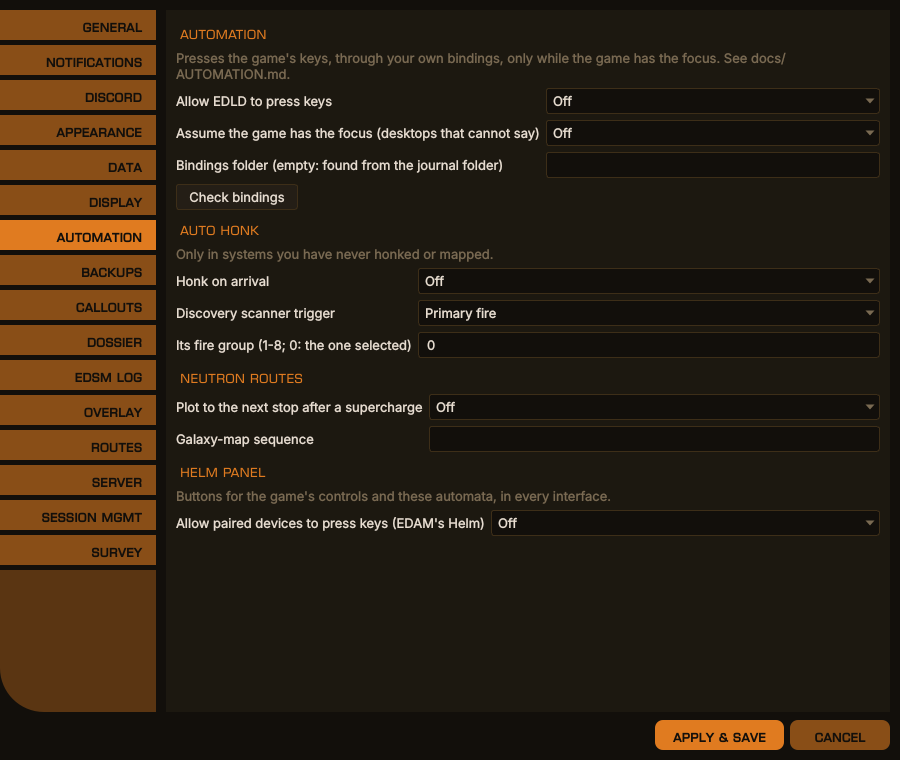
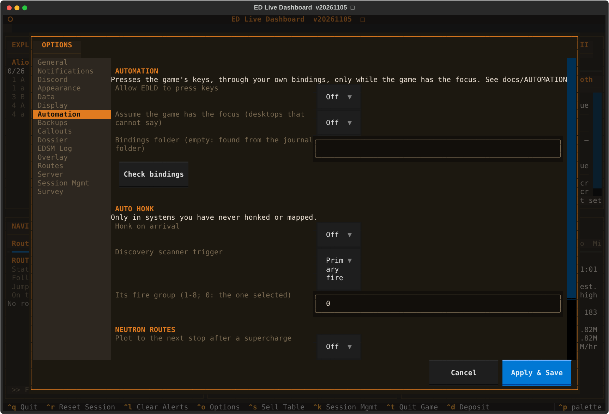
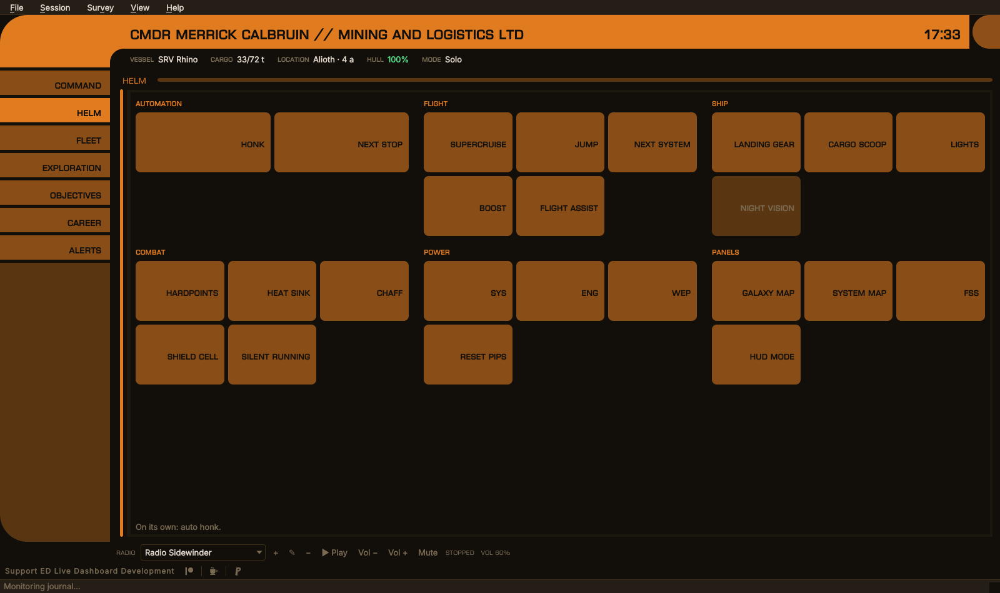

# Automation — auto honk, the next route stop, and the Helm panel

EDLD can press a few of the game's keys for you: the discovery scanner on
arriving somewhere new, the galaxy map's route to the next stop after a
supercharge, and the buttons on the Helm panel — on the desktop, in the
terminal and on EDAM. All of it is off until you turn it on, under
**Options → Automation**.

It presses keys the way a keyboard does, and mouse buttons the way a mouse
does, through your own bindings, and only while the game's window has the
focus. A key meant for the game never lands in
another program: if the game is not in front, nothing is pressed, and EDLD says
why.

<div align="center">

<br><em>Options → Automation, desktop window</em>
</div>

<details>
<summary>The same in the terminal dashboard</summary>
<p align="center"></p>
</details>

## Setting up

### Bindings

EDLD reads the bindings you use from the game's own files, in
`Options/Bindings` under the game's local application data. On Windows that is
found by itself. Under Proton it is found beside your journals, when the
journal folder is the game's own Saved Games folder inside the prefix. If it is
not found, set **Bindings folder** to it, for example:

```
~/.local/share/Steam/steamapps/compatdata/359320/pfx/drive_c/users/steamuser/AppData/Local/Frontier Developments/Elite Dangerous/Options/Bindings
```

Keyboard keys and mouse buttons 1 to 5 can be pressed; where an action has
both, the key is used. A mouse button is pressed only while the pointer is
over the game's window as well, because a click goes to the window under the
pointer, not to the one in front. An action bound only to a controller or a
joystick cannot be pressed: the game names the particular device, and nothing
EDLD could make would pass for it. Such an action needs a key or a mouse
button in one of its two columns on the game's Controls page — usually the
empty one; where both are taken, as for a trigger on the pad and on the mouse,
the mouse one already works.

The game's own presets (Keyboard and Mouse, a stock controller) are not
stored there: save a custom copy under Options → Controls in the game, and
EDLD reads that.

**Check bindings** reports the folder read and whether keys can be pressed at
all, then every binding each automation presses — auto honk's trigger, and
Cycle Next Fire Group when you named a fire group; each step of the galaxy-map
sequence; the Helm panel's controls — with what it is bound to and, for one EDLD
cannot press, what to change:

```
Auto honk
  ✓ Secondary Fire: Mouse 2 — pressed only while the pointer is over the game
  ✗ Cycle Next Fire Group is bound only to controller X+RB — give it a key or
    mouse button in its empty column in the game's Controls
```

### Pressing keys on Linux

EDLD makes a virtual keyboard with the kernel's uinput, which the game reads
under Proton on X11 or Wayland like any keyboard, and — the first time a
mouse button is needed — a virtual mouse the same way, which never moves the
pointer. Your user needs write access
to `/dev/uinput`, once:

```sh
sudo tee /etc/udev/rules.d/60-edld-uinput.rules <<'EOF'
KERNEL=="uinput", GROUP="input", MODE="0660", OPTIONS+="static_node=uinput"
EOF
sudo usermod -aG input "$USER"
sudo udevadm control --reload-rules && sudo udevadm trigger
```

Log out and back in for the group to take effect. Some distributions load
uinput only on demand; `echo uinput | sudo tee /etc/modules-load.d/uinput.conf`
loads it at boot.

To know which window has the focus, EDLD asks the X server through `xdotool`
or `xprop`, and for a mouse button where the pointer is, through `xdotool`. A
pure Wayland desktop cannot be asked; there, **Assume the game has the focus**
lets automation run, and it is then up to you to keep the game in front, and
the pointer over it.

### Pressing keys on Windows

Nothing to set up: EDLD sends hardware scan codes, which the game reads where
it ignores ordinary key messages, and mouse buttons as mouse input. If the game runs as administrator, EDLD must
too, or Windows drops the keys.

Typing — a system name into the galaxy map's search — assumes a US keyboard
layout, the one the game's key names describe.

## Auto honk

**Honk on arrival** holds the discovery scanner's trigger after a jump into a
system you have never honked or mapped, by your own journals. It waits until
the ship is in supercruise with no panel open, selects the scanner's fire
group if you named one, holds the trigger for six and a half seconds, and
puts the fire group back. Selecting a fire group needs Cycle Next Fire Group
on a key or mouse button; with the scanner in the group you fly in, set its
fire group to 0 and that binding is never used.

It does nothing in a fight, while the drive is charging, with a panel or map
open, or once you have honked yourself; it gives up a minute after arriving.

| Setting | |
|---|---|
| Discovery scanner trigger | Primary or secondary fire |
| Its fire group | 1–8 as the game numbers them; 0 uses the group selected |

## The next stop after a supercharge

On a route EDLD plotted with stops several jumps apart — a neutron route —
**Plot to the next stop after a supercharge** opens the galaxy map after you
supercharge at a neutron star or white dwarf, types the next stop, plots to
it, closes the map, and checks that the game's route now ends there. If it
does not, it closes the map and says so.

The galaxy map is driven by a short script, because its layout has changed
between game versions. Blank uses the built-in one:

```
GalaxyMapOpen; focus 6; wait 1.5; UI_Up; UI_Select; wait 0.5; type;
Key_Enter; wait 2.5; UI_Right; UI_Select*1.5; route 8; GalaxyMapOpen
```

| Step | Does |
|---|---|
| `GalaxyMapOpen`, `UI_Select`, … | presses that binding |
| `UI_Select*1.5` | holds it for 1.5 s |
| `Key_Enter` | presses that key itself, bound or not |
| `wait 1.5` | waits |
| `focus 6` | waits for the game to report the galaxy map open (GuiFocus 6) |
| `type` | types the system's name |
| `route 8` | waits up to 8 s for the route to end at the system; fails otherwise |

Try it in a quiet moment with the game in a window you can watch; if the
search box is not where the script expects, change the steps before `type`.

## The Helm panel

The Helm panel puts the automations and the game's own controls on buttons,
grouped by what they are for:

| Group | Buttons |
|---|---|
| Automation | **Honk** — what auto honk does, now, in supercruise or normal space; **Next stop** — plot the galaxy map to the next stop of the route EDLD plotted |
| Flight | Supercruise, Jump, Next system (target the next system in the route), Boost, Flight assist |
| Ship | Landing gear, Cargo scoop, Lights, Night vision |
| Combat | Hardpoints, Heat sink, Chaff, Shield cell, Silent running |
| Power | SYS, ENG, WEP (a pip each), Reset pips |
| Panels | Galaxy map, System map, FSS, HUD mode |

<div align="center">

<br><em>The Helm section of EDCARS; Night vision is bound to nothing EDLD can press</em>
</div>

Where it is:

- **EDCARS** gives it a section of its own, second on the rail (`Ctrl+2`),
  with the buttons as large as the section allows.
- **The Dashboard**, in the desktop window and the terminal, runs it along
  the foot of the window while automation is on: on a wide screen every group
  in one row, two rows of buttons each; on a narrower one the groups wrap.
  **Options → Appearance → Dashboard: Helm panel** turns it off
  (`[UI] HelmPanel`).
- **EDAM** has a Helm section in EDCARS, and a Helm page in the Dashboard's
  drawer — with **Allow paired devices to press keys** on as well. A device
  is sent only the controls bound to a key or a mouse button, and can press
  only those; it cannot type, hold or press anything else. With none, its
  Helm section says why. See [SERVER.md](SERVER.md) for the protocol.

On EDLD's own panel every control is shown; one that cannot be pressed —
automation off, or bound only to a controller — is grayed, and its tooltip
says what it is bound to and what to change. The line under the buttons says
what the last press came to, or what the automation is set to do on its own.

A button that cannot do its job now says why: Honk, for one, needs the ship
in flight — not docked, landed, in the SRV, on foot or at the main menu — and
names which of those it found.

A click in EDLD's window takes the focus from the game, so a button there
first brings the game to the front — on Windows directly, on an X11 desktop
with `xdotool` or `wmctrl` — waits for it to take the focus, and then
presses. Where the desktop cannot say which window is in front (pure
Wayland), EDLD does not press from its own window at all, **Assume the game
has the focus** notwithstanding: the key would land in EDLD. EDAM works
there. A control bound to a mouse button is pressed only with the pointer
over the game, which, after a click in EDLD's window, it usually is not.

## When something does not happen

Each time a sequence stops or is skipped, it says why, at the level set for `Automation` under
Notifications: the game not in front, the pointer elsewhere, a binding only a controller
can press — named, with what it is bound to — `/dev/uinput` not
writable, a panel open, a fight. The diagnostic log has the rest.
