# EDLD Configuration Reference

> ✅ = **Hot-reloadable** — takes effect within ~1 second of saving `config.toml`
> ❌ = **Restart required** — when changed in Options, EDLD restarts automatically

---

## `[Settings]`

| Key | Default | Hot | Description |
|-----|---------|:---:|-------------|
| `JournalFolder` | `""` | ❌ | Path to your Elite Dangerous journal directory. Blank finds the game's own: `Saved Games\Frontier Developments\Elite Dangerous` on Windows, and the same inside the Steam/Proton prefix on Linux |
| `UseUTC` | `false` | ✅ | Use UTC timestamps instead of local time |
| `WarnKillRate` | `20` | ✅ | Alert when average kills/hour drops below this value |
| `WarnNoKills` | `20` | ✅ | Alert after this many minutes without a kill |
| `WarnNoKillsInitial` | `5` | ✅ | Before the session's first kill: alert after this many minutes at a combat site — a RES, nav beacon or conflict zone — without one. `0` turns it off |
| `BountyValue` | `false` | ✅ | Show credit value on each kill line |
| `BountyFaction` | `false` | ✅ | Show victim faction on each kill line |
| `PirateNames` | `false` | ✅ | Show pirate pilot names in kill and scan messages |
| `ExtendedStats` | `false` | ✅ | Show running kill counts and per-faction tallies |
| `MinScanLevel` | `1` | ✅ | Minimum scan stage required to log an outbound scan (0 = all) |
| `PrimaryInstance` | `true` | ❌ | Set to `false` on secondary/remote instances to suppress uploads to EDDN, EDSM, EDAstro and Inara, and the overlay — monitoring, alerts, and the dashboard remain fully active |
| `FullStackSize` | `20` | ✅ | Mission stack size that triggers the "stack full" announcement |
| `WarnCooldown` | `15` | ✅ | Minutes between repeated inactivity / kill-rate alerts |
| `TruncateNames` | `30` | ✅ | Maximum character length for pilot/faction names in output |

<div align="center">
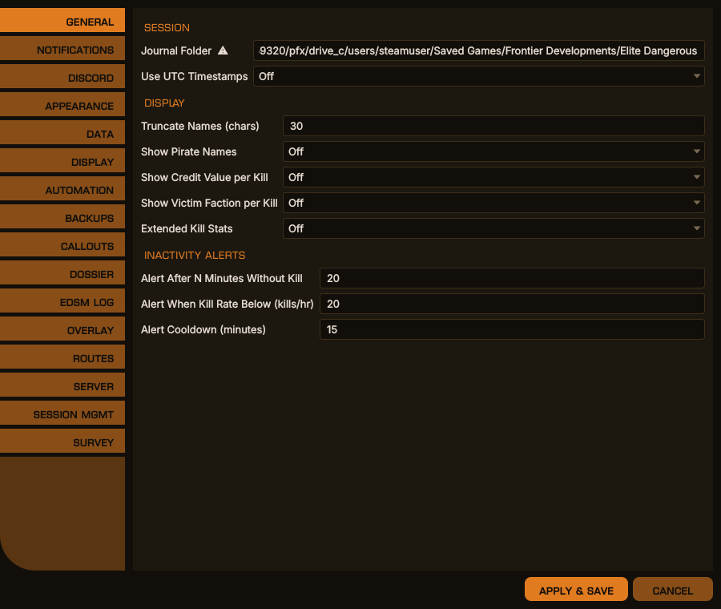
<br><em>Options → General, desktop window</em>
</div>

<details>
<summary>The same in the terminal dashboard</summary>
<p align="center">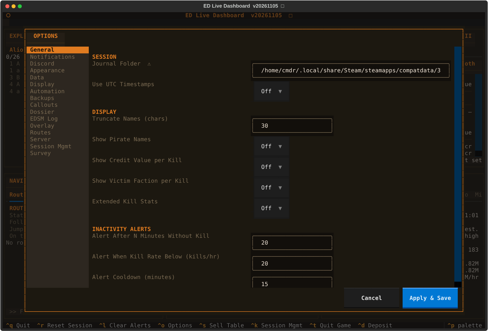</p>
</details>

---

## `[Discord]`

| Key | Default | Hot | Description |
|-----|---------|:---:|-------------|
| `WebhookURL` | `''` | ❌ | Discord webhook URL |
| `UserID` | `0` | ❌ | Your Discord user ID for `@mention` pings on level-3 events |
| `Identity` | `true` | ❌ | Use EDLD's name and avatar on the webhook |
| `Timestamp` | `true` | ❌ | Append a timestamp to each Discord message |
| `ForumChannel` | `false` | ❌ | Enable forum channel thread support |
| `ThreadCmdrNames` | `false` | ❌ | Use commander name as forum thread title |
| `PrependCmdrName` | `false` | ✅ | Prefix every Discord message with your commander name |

<div align="center">
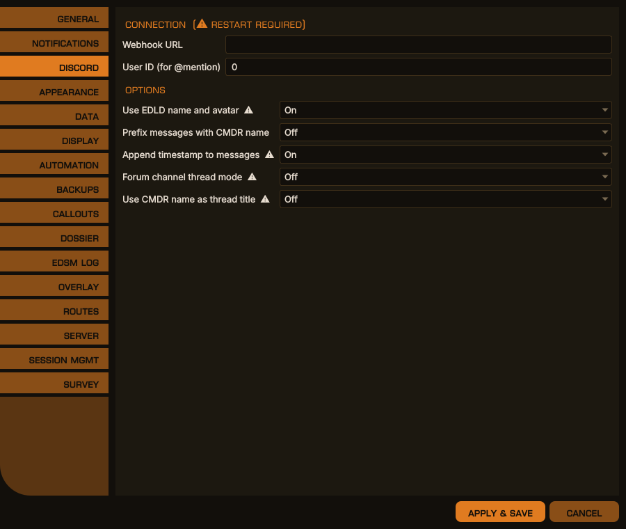
<br><em>Options → Discord, desktop window</em>
</div>

<details>
<summary>The same in the terminal dashboard</summary>
<p align="center">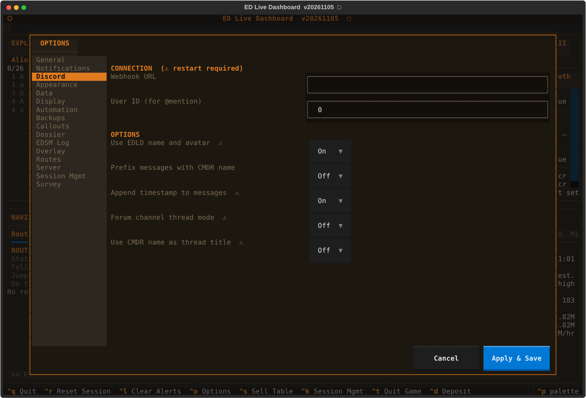</p>
</details>

---

## `[UI]`

| Key | Default | Hot | Description |
|-----|---------|:---:|-------------|
| `Interface` | `"edcars"` | ❌ | What EDLD opens when started without an interface flag: `edcars` (the desktop window as a console, default — see [EDCARS.md](EDCARS.md)), `gui` (the desktop window, every window at once), `textual` (terminal dashboard), `terminal` (plain scrolling output) or `headless`. Set by Options → Appearance → Interface, and by starting an interface by name — its flag, `--mode`, or its launcher shortcut — so a plain launch opens whichever was chosen last. `--headless` is never recorded: a service would otherwise leave the next desktop launch with no window. `-s` names no interface, so on its own it opens this one and records nothing. Edited where it is read from: the active profile's `UI.Interface` if the profile sets one, otherwise `[UI]`. Headless can only be set by hand. Replaces the older `Mode` and `Style` keys, which are converted on first start: `Mode = "textual"`, the old default, becomes EDCARS; `gui` keeps the layout `Style` gave it; `terminal` and `headless` are kept |
| `Theme` | `"default"` | ❌ | Theme name (`elite-orange`, `default`, `default-dark`, `default-green`, `default-blue`, `default-purple`, `default-red`, `default-yellow`, `default-light`, `order`, `rebel`, `rogue`, or a custom theme) — changing this in Options triggers an automatic restart |
| `EdcarsAlerts` | `"pulse"` | ✅ | EDCARS only, on a new urgent alert: `pulse` the Alerts pill, or `switch` to the Alerts section as well. Sent to EDAM, which does the same |
| `Console` | `"edcars"` | ❌ | EDCARS only: the console it is drawn as — `edcars`, `order` (an Imperial fleet console), `rebel` (a Rebel ops board) or `rogue` (an independent freighter's cockpit). The layout is the same in all four; the band, the pills, the frames and the faces differ. Each of the last three has a theme of its own name. Set by Options → Appearance; used from the next start. Sent to EDAM in the header's `console` |
| `HelmPanel` | `true` | ✅ | The Dashboard layouts, desktop and terminal: show the Helm panel along the foot while `[Automation] Enabled` is on ([AUTOMATION.md](AUTOMATION.md#the-helm-panel)). EDCARS always has it, as a section |

All the interfaces render the same windows from the same components and share
one config, one set of per-commander data, and one window layout, so you can
switch between them freely. `edcars` and `gui` require PySide6; see
[INSTALL.md](../INSTALL.md).

### Window layout

Which window sits where is not part of `config.toml`. It lives in
`windows.json` in the commander's data directory, and the usual way to change
it is Options → Display, which writes the file for you. `example.layout.json`
in the repository root shows the format and the shipped default.

Slots are addressed `<column><position>` — `A`/`B`/`C` left to right, numbered
top to bottom. Each window has a size class and may only occupy a slot of the
same class:

| Class | Slots | Windows |
|-------|-------|---------|
| Large | `A1`, `A2`, `C1`, `C2` | Exploration / Exobiology, Navigation, Ship, Career / Session |
| Center | `B1`, `B2`, `B3` | Commander, Crew / Alerts, Objectives, Mining |

There are eight windows and seven slots. Mining has no slot by default; choose
it for a center slot to show it in place of the window that was there. EDCARS
gives it a section of its own.

Left and right columns mirror each other — two large windows apiece — and the
center column is three equal windows. Any window may occupy any slot of its
own class.

Anything invalid — an unknown window, a class mismatch, the same window twice —
is dropped on load and the slot falls back to its default, so a hand-edited
file cannot leave the dashboard unable to draw.

Several windows no longer exist in their own right, having been folded into the
window they belonged with:

| Was | Now |
|-----|-----|
| Assets | Wallet / Ships / Modules / Carrier / S. Carrier tabs on **Commander** |
| Exobiology | nested under each body in **Exploration** |
| Massacre Mission Stack | the Missions tab in **Objectives** |
| Colonization | the Colonization tab in **Objectives** |
| Cargo | the Cargo tab in **Ship** |
| Engineering | the Engineering tab in **Ship** |
| Ship Health | renamed **Ship**; hull, shields and fuel moved to Commander's Info tab |
| Alerts, Crew / SLF | merged into **Crew / Alerts** |
| Session | the Session tab in **Career / Session** |

A `windows.json` written before version 2 describes a window set that no longer
exists, and the slot grid changed shape with it. Rather than leave a
half-populated grid, such a file is replaced with the current defaults and
rewritten once, on the next launch.

<div align="center">
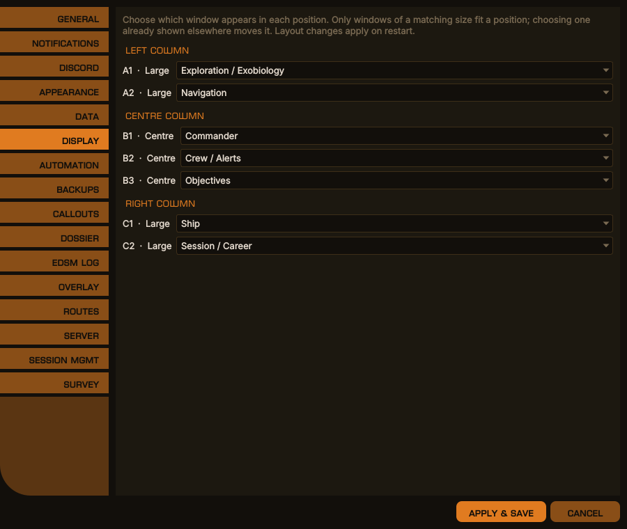
<br><em>Options → Display, desktop window</em>
</div>

<details>
<summary>The same in the terminal dashboard</summary>
<p align="center">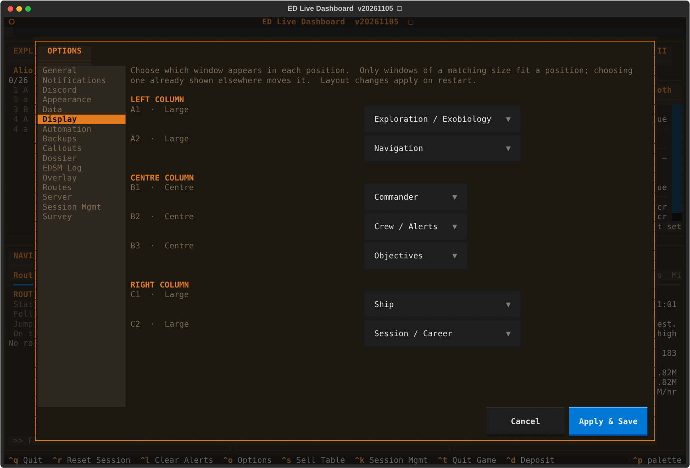</p>
</details>

---

## `[LogLevels]`

All entries are hot-reloadable. Controls terminal, Discord, and dashboard output independently per event type.

| Level | Behavior |
|-------|-----------|
| `0` | Disabled entirely |
| `1` | Local only (no Discord) |
| `2` | Local + Discord |
| `3` | Local + Discord + `@mention` ping |

| Key | Default | Event |
|-----|---------|-------|
| `RewardEvent` | `2` | Each kill — bounty or combat bond |
| `FighterDamage` | `2` | Fighter hull damage (every ~20%) |
| `FighterLost` | `3` | Fighter destroyed |
| `ShieldEvent` | `3` | Ship shield dropped or raised |
| `HullEvent` | `3` | Ship hull damaged |
| `Died` | `3` | Ship destroyed |
| `CargoLost` | `3` | Cargo stolen — lost while being shot at or interdicted, with the cargo panel shut and no pirate's demand standing. Your own jettison is a terminal line; one that pays off a pirate says so |
| `LowCargoValue` | `2` | Pirate declined to attack (insufficient cargo) |
| `PoliceScan` | `2` | Security vessel scanned your ship |
| `PoliceAttack` | `3` | Security vessel is attacking you |
| `FuelStatus` | `1` | Routine fuel level report |
| `FuelWarning` | `2` | Fuel level below warning threshold |
| `FuelCritical` | `3` | Fuel level below critical threshold |
| `MissionUpdate` | `2` | Mission accepted, completed, redirected, or removed |
| `AllMissionsReady` | `3` | All active massacre missions ready to turn in |
| `CarrierJumpScheduled` | `3` | Fleet or squadron carrier jump scheduled — carrier, destination and countdown |
| `CarrierJumpCancelled` | `3` | A scheduled carrier jump was canceled |
| `CarrierJumpComplete` | `2` | Carrier arrived at its destination |
| `MeritEvent` | `0` | Individual merit gain from a kill |
| `InactiveAlert` | `3` | No kills for the configured time period (`WarnNoKills`, or `WarnNoKillsInitial` before the first) |
| `RateAlert` | `3` | Kill rate below the configured threshold |
| `InboundScan` | `1` | Incoming cargo scan from a pirate |
| `PeriodicKills` | `2` | Kill count in the quarter-hour summary |
| `PeriodicFaction` | `0` | Per-faction kill breakdown in the quarter-hour summary |
| `PeriodicCredits` | `2` | Credits earned in the quarter-hour summary |
| `PeriodicMerits` | `2` | PowerPlay merits in the quarter-hour summary, when pledged |
| `CapiAuthRequired` | `3` | Your Frontier login for the Companion API has expired and needs signing in again — CAPI features stop until you do |
| `RouteWarning` | `2` | A route through permit-locked systems, a tank that runs dry with no scoop, a dry stretch ahead, a target that is not the next system, a re-plot after leaving the route |
| `SurveyArrival` | `1` | Arriving at a survey stop: what is left to map, sample, buy or sell there |
| `ExploTarget` | `1` | A targeted system no one has ever reported |
| `FirstsWatch` | `2` | An undiscovered system, a world first mapped, ground no one has set foot on; and a body among your unsold first discoveries that someone else has since scanned |
| `MiningCallout` | `1` | A prospected rock with a mineral you watch, a motherlode, the ring dropped into |
| `MiningWarning` | `2` | The hold nearly full and full; undocking with no limpets aboard |
| `ExobioCallout` | `1` | A genus new to your codex in this region; clear of earlier samples |
| `ExobioWarning` | `2` | Leaving a body with a sample run unfinished |
| `CarrierUpkeep` | `3` | The carrier's balance short of the upkeep due within two days |
| `Automation` | `1` | What auto honk, the next-stop plot, journal backups and the EDSM gap fill did |

<div align="center">
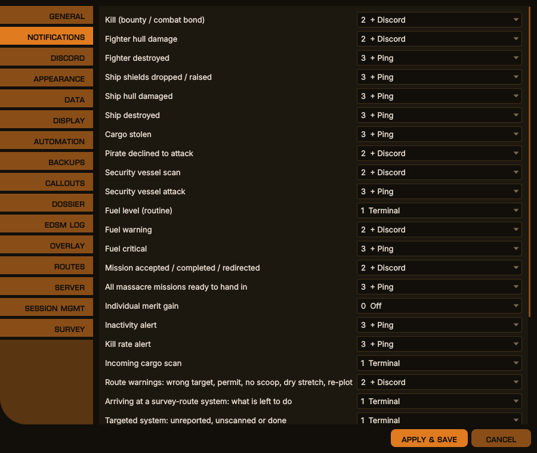
<br><em>Options → Notifications, desktop window</em>
</div>

<details>
<summary>The same in the terminal dashboard</summary>
<p align="center">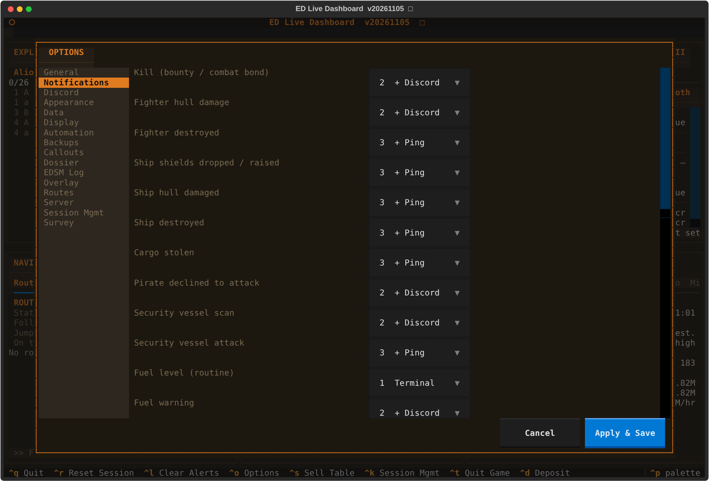</p>
</details>

---

## Command Line Arguments

```
python edld.py [-p PROFILE] [-t] [-d]
               [--edcars | --dashg | --gui | --dasht | --tui | --term | --text | --headless]
               [--mode MODE] [-s] [--pair] [--paired] [--unpair ID]
               [--shortcuts] [--remove-shortcuts] [--version] [--selftest]
               [--overlay-probe] [--overlay-doctor] [--overlay-selftest]
```

| Flag | Description |
|------|-------------|
| `-p`, `--config_profile` | Load a named config profile |
| `-t`, `--test` | Re-route Discord output to terminal instead of sending to webhook |
| `-d`, `--trace` | Print verbose debug and trace output to terminal |
| *(none)* | What `[UI] Interface` says — EDCARS unless you have changed it |
| `--edcars` | EDCARS: the desktop window as a console — requires PySide6 |
| `--dashg`, `--gui` | The desktop window, Dashboard layout — requires PySide6 |
| `--dasht`, `--tui` | Terminal dashboard |
| `--term`, `--text` | Plain scrolling event output (`--terminal`, its old name, still works) |
| `--headless` | No interface and no terminal output, for running as a service; diagnostics go to the log file |
| `--mode MODE` | The same by id: `edcars`, `gui`, `textual`, `terminal` or `headless` |
| `-s`, `--server` | Also serve paired EDAM devices, for this run — see [SERVER.md](SERVER.md). `[Server] Enabled` (Options → Server) does it for every run, whichever interface opens |
| `--shortcuts` | Add, or refresh, a launcher shortcut for each interface — Windows Start menu or Linux application menu — then exit |
| `--remove-shortcuts` | Remove them, then exit. On Windows this also stops the binary adding them again until `--shortcuts` is run |
| `--pair` | Show a one-time pairing code and QR code for a device, then exit |
| `--paired` | List paired devices, then exit |
| `--unpair ID` | Remove a paired device by the ID `--paired` shows, then exit |
| `--version` | Print the version and exit |
| `--selftest` | Report whether each interface can be loaded, then exit |
| `--overlay-probe` | Report whether this machine can show the overlay, then exit |
| `--overlay-doctor` | Explain why the overlay is or is not drawing, then exit |
| `--overlay-selftest` | Draw a fixed test frame for 20 seconds, then exit |

There is no option to redirect terminal output: trace lines, plugin errors and
unhandled exceptions go to `<data dir>/logs/error[_<profile>]_<YYYYMMDD>.log`,
opened only when something is written to it.

The interface flags are mutually exclusive, and passing one alongside a
conflicting `--mode` is an error rather than a silent resolution.

### Launcher shortcuts

There is one per interface — **EDLD EDCARS**, **EDLD Dashboard**, **EDLD Terminal
dashboard** and **EDLD Terminal text** — each passing that interface's first
flag. Server mode and config profiles add none: the server is a setting
(`[Server] Enabled`) that runs beside whichever interface opens, and the profile
is picked from the commander's name.

| Platform | Where | Made by |
|---|---|---|
| Windows binary | Start menu → **EDLD** | the binary itself, on its first run and whenever it has moved or been updated |
| Linux | `~/.local/share/applications/edld-*.desktop`; the terminal ones open in a terminal | `install.sh`, or `edld --shortcuts` |
| macOS | — the app bundle is the launcher | — |

EDLD-server gets one, **EDLD-server**, its terminal event log. On Windows the
terminal shortcuts open a console window of their own.

`--version` and `--selftest` both answer before any config, journal or
component work, so they run on a machine that has never started the game. The
release workflow uses them to verify each published binary.

### Environment variables

| Variable | Effect |
|----------|--------|
| `EDLD_KEEP_STDERR=1` | Keep stdout and stderr attached in the dashboards and the desktop window |
| `SSL_CERT_FILE` | Override the CA bundle used for HTTPS verification |
| `EDLD_INSTALL_GUI=yes\|no` | Answer `install.sh`'s PySide6 prompt ahead of time |
| `EDLD_SHORTCUTS=no` | Stop `install.sh` adding the application-menu entries |

The dashboards normally route stdout and stderr to `/dev/null` so terminal
noise cannot corrupt the display. A startup failure is recorded in the
diagnostic log regardless; `EDLD_KEEP_STDERR=1` is for the rarer case where
something fails before the log exists.

Packaged builds ship their own CA bundle, because a frozen binary's OpenSSL
looks for certificates where the build machine kept them. `SSL_CERT_FILE` is
respected if you set it — point it at your own root if you are behind a
TLS-inspecting proxy. The startup log records which store is in use.

When a new release is available on GitHub, EDLD displays a notification at startup (terminal), in the title bar (terminal dashboard), or in a bar below the menu (desktop window). Updating is manual — take the new source or binary from the [releases page](https://github.com/indevlin/EDLD/releases), and re-run `install.sh` if you run from source.

---

## `[Radio]`

Stations for the Radio tab in the Crew / Alerts window, in both the terminal dashboard and the desktop window. **[HOT]** — the station list follows the file within a second of saving, with no restart.

Each station is two keys joined by an Id of your choosing:

| Key | Meaning |
|---|---|
| `Name_<Id>` | What the station list shows. Optional — the Id is shown if it is missing |
| `Url_<Id>` | The stream address, `http://` or `https://`. A `.m3u` or `.pls` playlist address also works; its first stream is played |

The Id is a TOML bare key: letters, digits, `_` and `-`, no spaces. It only has to pair the two lines up. Stations are listed in the order they appear, defaults first.

Three stations ship as defaults:

```toml
[Radio]
Name_RadioSidewinder = "Radio Sidewinder"
Url_RadioSidewinder  = "https://radiosidewinder.out.airtime.pro:8000/radiosidewinder_b"
Name_HuttonOrbital   = "Hutton Orbital Radio"
Url_HuttonOrbital    = "https://quincy.torontocast.com/hutton"
Name_RadioSkvortsov  = "Radio Skvortsov"
Url_RadioSkvortsov   = "https://cast1.torontocast.com:3225/stream"
```

### Adding, editing and deleting from the Radio tab

The **+**, **✎** and **−** beside the station list do this for you, in both interfaces.

<div align="center">
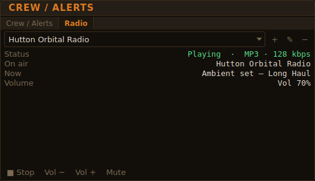
<br><em>The Radio tab, playing, desktop window</em>
</div>

<details>
<summary>The same in the terminal dashboard</summary>
<p align="center">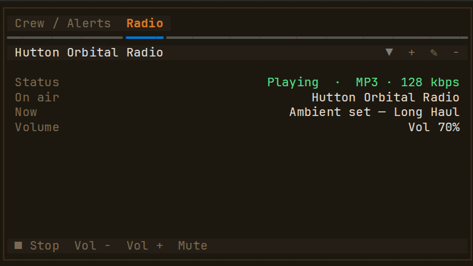</p>
</details>

**+** opens a form for the station's name and stream address, and where to keep it:

- **Global — every profile** (preselected) adds the pair to `[Radio]`.
- **Current profile** adds it to the profile loaded now, as `Radio.Name_<Id>` / `Radio.Url_<Id>` lines under `[EDP1]`, or inside `[EDP1.Radio]` if your file already has that table. It is unavailable when no profile is loaded.

The Id is made from the name — "Lave Radio" becomes `LaveRadio` — with a number added if that Id is already used anywhere in the file. A name already in the list, or an address that is not `http(s)://` with a host name, is refused with the reason.

**✎** edits the selected station's name and stream address. The station keeps its Id, so it stays selected and stays the remembered station. The change is saved where the station already lives — the current profile if the profile defines it, otherwise `[Radio]` — and the form says which. Editing a default station writes its keys into `[Radio]`, where they override the default and are not put back at startup. If the station is playing, a new address is tuned in straight away and a new name shows under On air at once; a name-only change does not interrupt the stream. The same checks as adding apply, except that a station's own name is not a clash with itself.

**−** deletes the selected station after asking. The confirmation says exactly what will change:

- a station you added is removed from `[Radio]`, and from the current profile if it is defined there;
- a **default** station has its `Url_` blanked instead of deleted, because deleted default lines are put back at startup (see below);
- a station that is playing is stopped first.

All three edit `config.toml` in place, changing only the station's own lines — your comments, spacing and every other setting are left exactly as they were. Before anything is written the result is parsed back and compared with what was intended; if the file is laid out in a way the editor cannot change safely, it says so and leaves the file untouched, and you can make the edit by hand as below.

### Adding your own station by hand

Add a pair to `[Radio]` to have it everywhere:

```toml
[Radio]
Name_LaveRadio = "Lave Radio"
Url_LaveRadio  = "https://example.org:8000/stream"
```

Or add it to a profile to have it only when that profile is loaded, using the same dotted keys as any other profile setting:

```toml
[EDP1]
Radio.Name_MyStation = "My Station"
Radio.Url_MyStation  = "https://example.org:8000/stream"
```

A profile can also rename a default (`Radio.Name_HuttonOrbital = "Hutton"`) or point it somewhere else.

### Hiding a station

Set its URL to an empty string, globally or in a profile:

```toml
[EDP1]
Radio.Url_RadioSkvortsov = ""
```

Deleting a default station's lines from `[Radio]` does not remove it: like every other default, EDLD adds missing keys back to the section at startup. An empty URL is kept as you wrote it.

### What plays

Streams must be **MP3, Ogg Vorbis or FLAC**. That covers most Icecast and SHOUTcast stations, including all three defaults. **AAC, AAC+ and Opus** stations, and HLS (`.m3u8`) streams, are refused with a message saying which format they are, rather than playing silence. To check a station before adding it:

```bash
curl -sI 'https://example.org:8000/stream' | grep -i content-type
```

`audio/mpeg`, `audio/ogg`, `application/ogg` and `audio/flac` will play.

### Behavior

- **Nothing plays until you press Play.** The last station you chose is selected again at the next launch, but not started.
- Choosing another station while one is playing switches to it.
- Volume steps by 5%. Volume, mute and the last station are remembered in `radio.json` in the EDLD data directory, not in `config.toml`, so adjusting them never rewrites your config.
- A station that is hidden or has its URL changed while it is playing is stopped.
- Any new alert brings the Crew / Alerts tab back to the front. The radio keeps playing.
- The song title is shown where the station sends one (most do).
- An entry that cannot be used — a `Name_` with no `Url_`, a URL that is not `http(s)://`, a key that is neither — is listed under **Config** in the Radio tab, not dropped silently.
- Playback needs the `miniaudio` package. It is installed by `install.sh` and bundled in the release binaries; if it is missing, the Radio tab says so and everything else works normally.

---

## Config Profiles

Profiles let you override any setting for a specific commander or purpose. Define them as named sections in `config.toml`:

```toml
[MyProfile]
Settings.JournalFolder = "/path/to/alternate/journals"
Discord.WebhookURL = 'https://discord.com/api/webhooks/...'
Discord.UserID = 123456789012345678
UI.Theme = "default-green"
```

Load explicitly with `-p MyProfile`, or name the profile after your commander name for automatic selection at startup.

Multiple profiles coexist in the same config file — useful for multi-account setups:

```toml
[EDP1]
Settings.JournalFolder = "/home/user/games/ED-Logs/EDP1"
Discord.WebhookURL = 'https://discord.com/api/webhooks/...'

[EDP2]
Settings.JournalFolder = "/home/user/games/ED-Logs/EDP2"
Discord.WebhookURL = 'https://discord.com/api/webhooks/...'
```

---

## Notes

- **Fuel alerts** trigger on *either* the percentage threshold *or* the estimated time-remaining threshold — whichever fires first.
- **Duplicate suppression** caps repeated identical Discord messages at 5 before switching to a suppression notice, preventing notification floods.
- **Journal path (Linux/Proton):** varies — use `find ~/ -name "Journal*.log"` to locate it.

---

## How the hold is read

Nothing here is configurable. It is written down because when the cargo
manifest disagrees with the game, the reason is almost always one of these two.

**Journals are read in filename order, not by modification time.** Elite names
them with an ISO timestamp, so they sort chronologically on their own.
Modification times do not survive a copy, a sync, or a search-and-replace
across the directory, and EDLD once rebuilt a hold from journals four months
stale because the four newest by mtime were the four it had touched last.

**The hold itself is followed from `Cargo.json`, not inferred from events.**
Journal events name a count and nothing else once the hold is large, so the
manifest is reconstructed by replaying the recent journals and then taking
`Cargo.json` — which the game rewrites whenever the hold changes — as the
current word. That file is polled every two seconds alongside `Market.json`,
so the manifest stays right even when the journal lags.

It is applied strictly by vessel. `Cargo.json` describes whichever hold last
changed, ship or SRV, and the two are never mixed.

**A journal that stops growing while the game runs** costs everything the
event stream carries — the game mode, the location, the session — even though
the hold keeps updating. That is worth knowing because the usual cause is
outside the game: a rotation, a sync, or an in-place edit of a file the game
has open. Replacing such a file leaves the game writing to a handle that no
longer has a name, and everything after that moment is invisible on disk.

---

## Market files

Three files are written into the commander's data directory — the same place
as `cargo.json` and the window layout — and rewritten whenever the game writes
a new `Market.json`. Nothing here is configurable; they are listed so you know
where to find them and what they mean.

| File | Contents |
|------|----------|
| `data/cargo.commodities.csv` | Every commodity ever seen in a market |
| `data/cargo.commodities.md` | The sell table, as Markdown |
| `data/cargo.commodities.html` | The sell table, as a standalone HTML page |

### The catalog

`Market.json` is a snapshot of one station and is overwritten the next time you
dock, so the galactic average it carries for each commodity is visible while
you are standing there and gone afterwards. The CSV keeps a running record
instead: one row per commodity, written once and rewritten whenever its
`MeanPrice` drifts.

```
name,id,name_localised,category,category_localised,mean_price,first_seen,last_updated,updates
gold,128049154,Gold,metals,Metals,47113,2026-09-12T04:11:22Z,2026-09-12T04:11:22Z,0
```

Rows are keyed on `name`, the internal symbol, and the file is sorted by `id`
so successive versions diff cleanly. `updates` counts how many times the price
has moved since `first_seen`, which is the closest thing here to a volatility
figure.

A commodity is recorded even when the market reports a `MeanPrice` of 0 —
identity is worth having wherever it turns up — but a zero never overwrites a
price already on file, so a carrier visit cannot flatten the catalog. Such a
row heals itself the first time the commodity appears at a station market.

### The sell table

The Markdown and HTML files are two renderings of what you would be shown by
pressing **Ctrl+S**: a heading naming the market being quoted, and a
two-column table of commodity against price, most valuable first. The HTML is
standalone — no stylesheet to keep beside it — and follows your reader's light
or dark preference.

<div align="center">
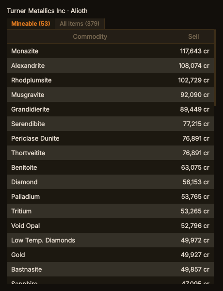
<br><em>The sell table, with example prices, desktop window</em>
</div>

<details>
<summary>The same in the terminal dashboard</summary>
<p align="center">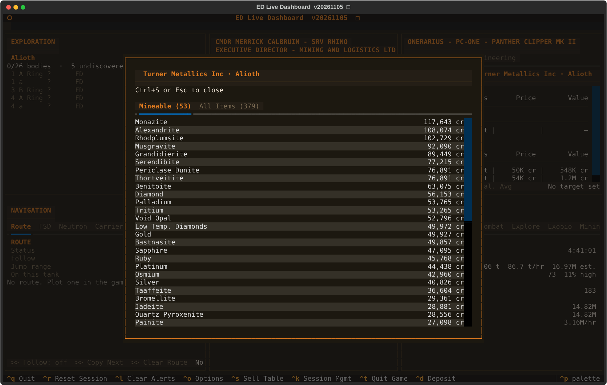</p>
</details>

Which market gets quoted is resolved the same way the Cargo panel prices your
manifest, so the panel and these files can never name different markets: a
Spansh target market when one is set and loaded, the station you are docked at
otherwise, and the galactic average when there is neither.

Two things are deliberately left out.

**Carrier markets.** Fleet and squadron carriers are player-run, mobile, and
rewritten without notice, so docking at one leaves the files and the popup
describing whatever was quoting beforehand. The catalog still records a
carrier's commodities; its prices just never reach the sell table.

**Prices no NPC will pay.** Stations list carrier-only commodities and quote a
sell price for them that nobody in the galaxy will honor — the Titan Maw
tissue samples list at over 470,000 cr at an ordinary starport. The tell is
that they carry no galactic average, so any commodity the catalog has never
seen an average for is left out of the table. This is not a demand filter: a
station with nothing on order still pays, and filtering on demand would hide
most of what is worth carrying.

---

## What a session is

Everything on Career's Session tab and every session figure on the overlay
counts from the start of the current play session. A session starts at the
`LoadGame` the game writes when a mode is picked, and ends with `Shutdown`
(quit to desktop), with an exit to the main menu, or — when the game crashed
and wrote neither — at the last event in its journal.

What comes next decides whether the next play is the same session:

- **Back within 15 minutes** — a bounce through the main menu, or a relaunch
  after a crash — and the session carries on.
- **Longer than that**, and the old session is over. EDLD decides at the
  launch, when the game opens its new journal, not when a mode is picked: the
  game can sit at the main menu for hours, and until then the session figures
  are cleared and the clock stands at zero. The new session counts from its
  `LoadGame`.

`Ctrl+R` resets the session by hand, and survives a restart of EDLD.

## How income is counted

The session's Income section and the career Credits section count credits
from the journal: what a market paid, a voucher redeemed, a mission rewarded,
cartographic and organic data sold, and so on. Only money that reached the
balance counts — a bounty voucher is income when it is redeemed, not when it
is issued, because it can still be lost.

### Unknown Credits

Some income is never written to the journal. Claiming a PowerPlay care
package at a Power contact — 250,000 cr below rank 100, 500,000 cr above,
plus credits for any materials that would not fit — logs nothing; the money
just appears in the balance. EDLD finds such money by reconciliation and
reports it as **Unknown Credits**, without guessing what it was.

- **This session:** the balance the game writes to `Status.json` is compared
  with every journal event that moves credits (`core/credit_flows.py`).
  When both have been quiet for ten seconds and the balance has risen by
  more than the journal explains, the difference is added under Unknown
  Credits. The journal is written in batches, so a line can arrive after the
  comparison; if it explains money already reported, that much is taken back.
- **Career:** at each `LoadGame` the game states the balance outright, so the
  career ledger compares it with the previous `LoadGame` of the same
  commander plus everything logged between them.

Only rises are counted. A fall the journal does not explain is a cost EDLD
does not recognize, which is not income. Anything under a thousand credits is
rounding and is ignored. The career figure covers every journal on disk, so
it also holds whatever else the game ever paid without logging it; a journal
file that is missing makes the next load's balance look like income too.

## Data Contributions (opt-in)

All data contribution features are **opt-in** and disabled by default.  They are configured in their own `[SECTION]` blocks and all require a restart when changed (❌).  Settings can be managed in the **Data** tab of Options.

<div align="center">
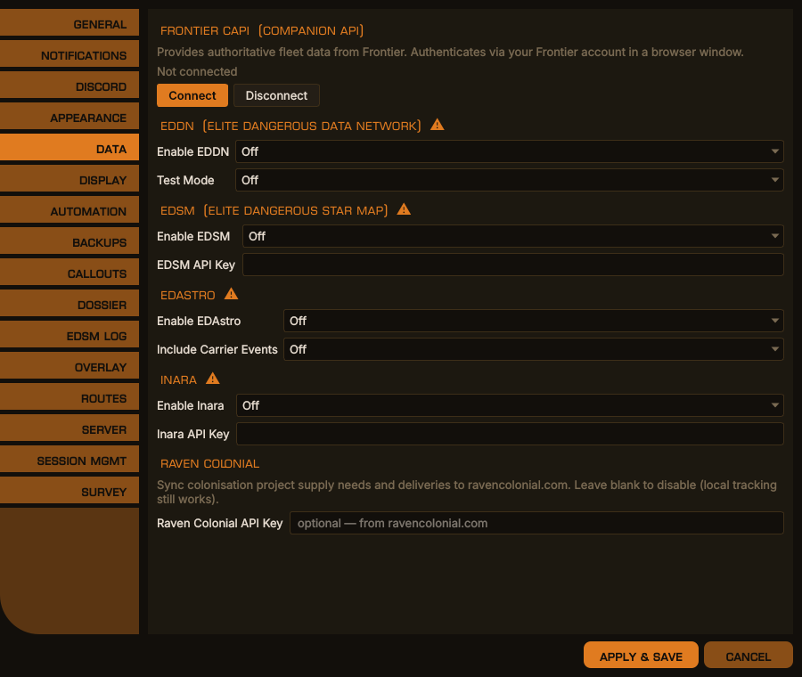
<br><em>Options → Data, desktop window</em>
</div>

<details>
<summary>The same in the terminal dashboard</summary>
<p align="center">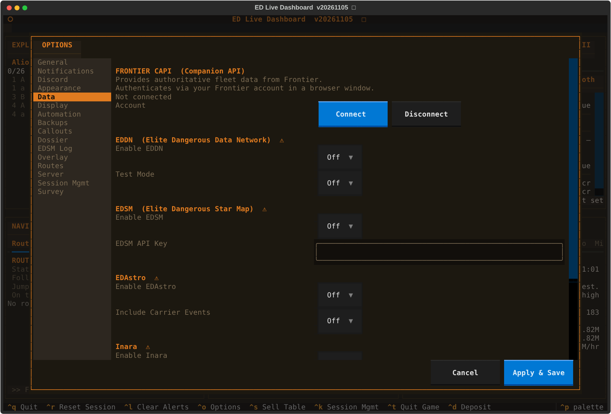</p>
</details>

If you run EDLD on multiple machines reading the same journal share (e.g. a remote monitor over NFS), set `PrimaryInstance = false` in `[Settings]` on the secondary machine to prevent duplicate uploads.  See `[Settings]` above.

The commander name sent to EDSM and Inara is the one in your journal; there is no setting for it.

**Restarting EDLD does not upload anything twice.** At startup EDLD reads the current journal from its first line, to know what has happened this game session. Each uploader remembers the time of the last journal event it handled — `<uploader>.sent.json` in the commander's data folder — and does not send anything from that read-through up to that time again. Started after the game, EDLD still sends what happened before it started.

**When uploads are sent.** EDSM, EDAstro and Inara collect events and send them together; EDDN sends each message as it is made. The collected events go out at every dock and undock — stations, fleet carriers and surface ports alike — when the FSD starts a hyperspace jump and on arrival, on a carrier jump, at a ship purchase or swap, when an SRV (Scarab, Nomad or Rhino) or fighter launches, docks or is destroyed, at death, and whenever the loadout changes (a module bought, sold, stored, retrieved or swapped). Each service's own rate limit still applies; Inara's is the slowest.

**Nothing is dropped while a service is unreachable.** Uploads that fail are kept in `<uploader>.queue.jsonl` in the same folder and tried again every few minutes, and at the next start.

---


---

## CAPI Integration

EDLD can connect to Frontier's Companion API (CAPI) to retrieve authoritative
fleet data, market prices, carrier state, and squadron information.

### Enabling CAPI

Use **File → CAPI Authentication** to complete the OAuth2 flow. You will be
redirected to Frontier's login page in your browser. On success, tokens are

### What CAPI provides (vs journal-only)

| Data | CAPI enabled | CAPI disabled |
|------|-------------|---------------|
| Fleet roster | Authoritative — Frontier server | Most recent `StoredShips` event |
| Sold ship exclusion | Automatic | May show sold ships until next dock |
| Stored ship hull % | ✓ | ✗ |
| Stored ship rebuy cost | ✓ | ✗ |
| Current ship loadout | ✓ (immediate) | ✓ (from journal) |
| Stored ship loadout | ✓ (from journal, CAPI-validated) | ✓ (from journal, unvalidated) |
| Market prices | ✓ (live on dock) | From `Market.json` |
| Squadron identity | ✓ | ✗ |
| Community Goals | ✓ | ✗ |

### Persisted CAPI data

After each poll, raw endpoint responses are written to
fleet data is available immediately without waiting for a re-poll:

| File | Source | Updated |
|------|--------|---------|
| `capi_profile.json` | `/profile` | Every dock |
| `capi_market.json` | `/market` | Every dock (outfitting station) |
| `capi_shipyard.json` | `/shipyard` | Every dock (outfitting station) |
| `capi_fleetcarrier.json` | `/fleetcarrier` | Every dock |
| `capi_communitygoals.json` | `/communitygoals` | Every dock, 5-min cooldown |

### Poll frequency

CAPI is polled on every dock event and 10 seconds after startup. Per-endpoint
cooldowns prevent over-polling: profile/carrier 30s, market/shipyard 60s,
community goals 300s.

Frontier requests no more than 1 query per minute in normal use. EDLD respects
this by batching all endpoint polls on dock rather than polling continuously.

### `[EDDN]`

Contributes exploration, market, outfitting, and shipyard data to the [Elite Dangerous Data Network](https://eddn.edcd.io) — the shared relay used by EDSM, Inara, and most third-party tools.

| Key | Default | Description |
|-----|---------|-------------|
| `Enabled` | `false` | ❌ Enable EDDN uploads |
| `UploaderID` | `""` | ❌ Anonymous uploader tag shown in EDDN messages — defaults to your commander name if blank |
| `TestMode` | `false` | ❌ Send to `/test` schemas only (development use) |

---

### `[EDSM]`

Uploads your flight log and discoveries to [edsm.net](https://www.edsm.net).  Requires a free EDSM account.  Generate your API key at **EDSM → Settings → API Key**.

| Key | Default | Description |
|-----|---------|-------------|
| `Enabled` | `false` | ❌ Enable EDSM uploads |
| `ApiKey` | `""` | ❌ Your EDSM API key |

Events are batched and sent at the moments listed under [When uploads are sent](#data-contributions-opt-in), and at login.  A discard list is fetched from EDSM at startup so only requested events are sent.

---

### `[EDAstro]`

Uploads exploration, Odyssey organic scan, and fleet carrier data to [edastro.com](https://edastro.com).  No account or API key required — uploads are anonymous.

| Key | Default | Description |
|-----|---------|-------------|
| `Enabled` | `false` | ❌ Enable EDAstro uploads |
| `UploadCarrierEvents` | `false` | ❌ Include `CarrierStatus` and `CarrierJumpRequest` events — note that these reveal your carrier's location to EDAstro |

An event-interest list is fetched from EDAstro at startup so only the events EDAstro wants are sent.

---

### `[Inara]`

Uploads your flight log, ranks, credits, missions, and ship loadout to [inara.cz](https://inara.cz). Requires a free Inara account. Generate your API key at **inara.cz → Settings → API**.

| Key | Default | Description |
|-----|---------|-------------|
| `Enabled` | `false` | ❌ Enable Inara uploads |
| `ApiKey` | `""` | ❌ Your Inara API key |

Inara allows two requests a minute; EDLD's uploads and its community-goal fetch share that allowance. If Inara answers "Too much requests" it has paused the key for an hour — usually because another tool is updating the same profile — and EDLD keeps the events and sends nothing until the hour is up, a restart included, rather than prolonging the pause.

---

### `[Colonisation]`

Syncs colonization construction supply needs and commander contributions to [Raven Colonial](https://ravencolonial.com) — a community tool for tracking colonization projects. Local tracking of resource requirements and delivery progress works without an API key.

> **Note:** Colonization support is experimental and under active development.

| Key | Default | Description |
|-----|---------|-------------|
| `ApiKey` | `""` | Your Raven Colonial API key — obtain from ravencolonial.com → Account Settings. Leave blank to disable API sync; local tracking is always active |

The API key can be set at runtime via **Options → Data → Raven Colonial API Key** without restarting EDLD.

---

### Data contributions inside profiles

Each of these sections can be scoped to a profile like any other setting, as
dotted keys under the profile's own header:

```toml
[EDP1]
EDDN.Enabled       = true
EDSM.Enabled       = true
EDSM.ApiKey        = "your-api-key-here"
EDAstro.Enabled    = true
Inara.Enabled      = true
Inara.ApiKey       = "your-api-key-here"
```

The older `[EDP1.EDDN]` sub-table form still loads, and EDLD rewrites it into
this form the first time it reads the file, line by line, keeping every
comment.

---

## Session Management — `[SessionMgmt]`

> ⚠️ **Solo mode only.** Session management terminates the Elite Dangerous game process when a trigger fires. It is **hard-gated to Solo play** — it will never act in Open or Private Group, because force-quitting in multiplayer is combat-logging under Frontier's rules. The gate is enforced at the point of termination, so even a manual activation is refused outside Solo.

Disabled by default and entirely opt-in. Every key is hot: a change applies
within a second of saving, with no restart. When enabled, EDLD watches the configured triggers and quits the game — locally via process termination, or on a remote host via SSH — when one is met. See the [Session Management guide](guides/SESSION_MANAGEMENT.md) for usage, the Ctrl+K runtime toggle, and the armed/idle indicator.

| Key | Default | Description |
|-----|---------|-------------|
| `Enabled` | `false` | Master enable. With this off, every trigger is inert |
| `QuitOnSLFDead` | `false` | Quit when your ship-launched fighter is destroyed in a fight — not when it is left out of range or behind by a jump (see [Session Management](guides/SESSION_MANAGEMENT.md#triggers)) |
| `QuitOnLowFuel` | `false` | Quit when main-tank fuel drops to or below the percentage threshold |
| `QuitOnLowFuelPercent` | `20` | Fuel percentage at or below which the fuel trigger fires |
| `QuitOnLowFuelMinutes` | `0` | If non-zero, also require estimated burn-time remaining to be at or below this many minutes before the fuel trigger fires (more conservative). `0` disables the time condition |
| `QuitFuelSCGraceSeconds` | `60` | Suppress fuel quits while in supercruise and for this many seconds after exiting it |
| `QuitOnLowHull` | `false` | Quit when the hull drops to or below the hull threshold — the SRV's while you are driving one, since an SRV lost with cargo aboard is a loss too |
| `QuitOnLowHullThreshold` | `10` | Hull percentage at or below which the hull trigger fires |
| `RemoteKillHost` | `""` | SSH host on which to terminate the game (for a remote/secondary monitor instance). Blank terminates locally |
| `RemoteKillUser` | `""` | SSH user for `RemoteKillHost`. Blank uses the current user |
| `QuitOnNoKillsMinutes` | `0` | Minutes without an NPC kill **while dropped in a Resource Extraction Site** before the session is quit. `0` disables. Solo-only and RES-only — see the guide |

Like any section, these can be scoped to a profile — handy for enabling termination on one commander only, or for keeping a remote monitor inert:

```toml
[SessionMgmt]
Enabled = false

[EDP1]
SessionMgmt.Enabled              = true
SessionMgmt.QuitOnLowFuel        = true
SessionMgmt.QuitOnLowFuelPercent = 15
```

---

## Settings documented with their features

Three sections are covered in full beside the feature they configure:

| Section | Where |
|---|---|
| `[SurfaceSurvey]` | [SURFACE_SURVEY.md — Settings](SURFACE_SURVEY.md#settings) |
| `[Overlay]` and `[OverlayPanels]` | [STREAMER_STATS_OVERLAY.md — Settings](STREAMER_STATS_OVERLAY.md#settings) |

---

## Routes — `[Navigation]`

| Key | Default | Description |
|-----|---------|-------------|
| `AutoReplot` | `true` | Plot an FSD or neutron route again from where you are, to the same destination, when you leave it or change ship |
| `WarnWrongTarget` | `true` | Say when the system targeted is not the next on EDLD's route (one further along is taken as deliberate) |
| `CheckPermits` | `true` | Look every plotted route's systems up on Spansh for permit locks |
| `SurveyArrival` | `true` | On arriving at a survey stop, say what is left to do there |

On the **Routes** tab in Options.

<div align="center">
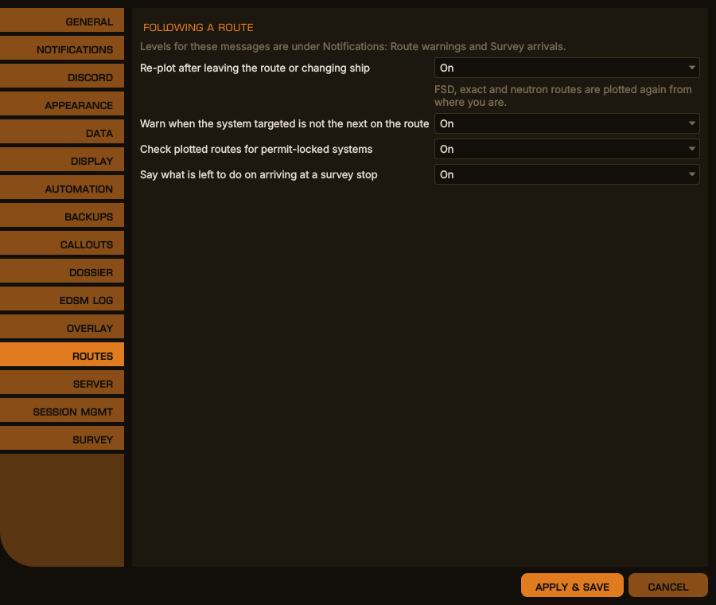
<br><em>Options → Routes, desktop window</em>
</div>

<details>
<summary>The same in the terminal dashboard</summary>
<p align="center">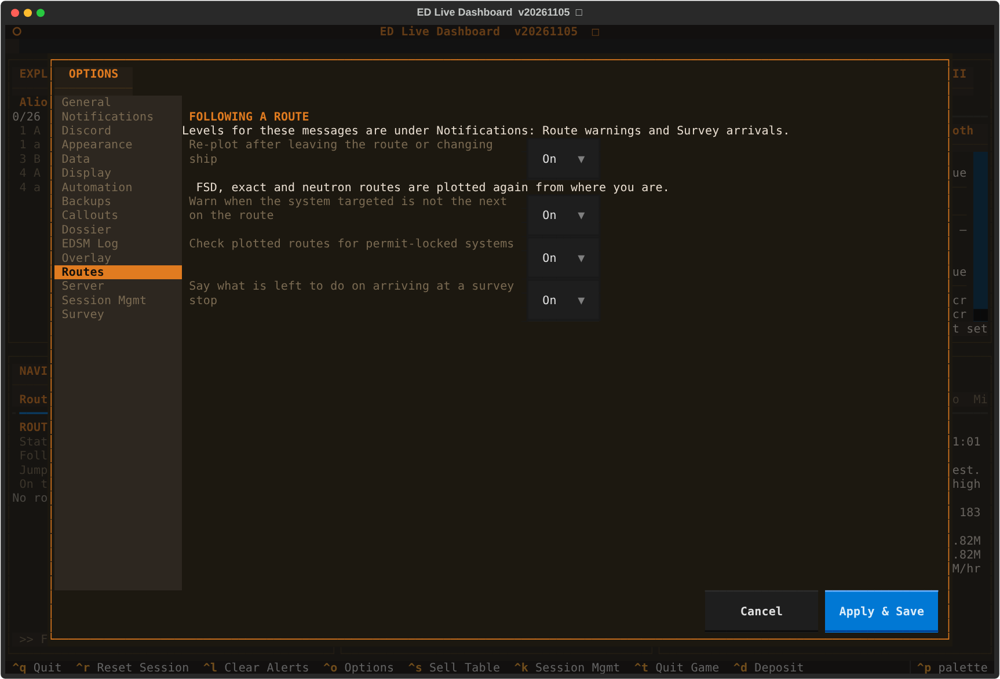</p>
</details>

## Callouts — `[Callouts]`

| Key | Default | Description |
|-----|---------|-------------|
| `Sounds` | `true` | Play a short chime with callouts |
| `Volume` | `70` | Their volume, percent |
| `TargetSound` | `true` | A chime on targeting a system: never reported, not fully scanned, or done |
| `FirstsWatch` | `true` | Undiscovered systems, first mappings, untrodden ground |
| `CodexCallout` | `true` | Genera new to your codex in the region |
| `UnfinishedRun` | `true` | Warn on heading for supercruise from a body with a sample run unfinished |
| `SafeToSample` | `true` | Say when you are far enough from every earlier sample for the next |
| `ProspectorMinerals` | `"Platinum, Painite, …"` | Minerals a prospected rock is called out for |
| `ProspectorPercent` | `20` | …at this share of the rock or more |
| `Motherlodes` | `true` | Call out a rock with a core |
| `HoldWarning` | `true` | Say when the hold is 90% full, and full |
| `RingCallout` | `true` | On dropping into a ring: its type, reserves, hotspots, and your yields in rings of that type |
| `LimpetReminder` | `true` | Warn on undocking with a limpet controller fitted and no limpets aboard — once per ship until it next leaves with limpets. A ship with no controller is never reminded |
| `LimpetProspector`, `LimpetCollection`, `LimpetMining`, `LimpetOperations`, `LimpetRescue`, `LimpetXeno`, `LimpetUniversal`, `LimpetRepair`, `LimpetFuelTransfer`, `LimpetHatchBreaker`, `LimpetDecontamination`, `LimpetRecon`, `LimpetResearch` | `true` | Which types of controller count: prospector, collector, the mining, operations, rescue, xeno and universal multi-limpets, repair, fuel transfer, hatch breaker, decontamination, recon and research. One switch per type, whatever its size and class |

How loud each is, and whether it reaches Discord, is its level under `[LogLevels]`.

<div align="center">
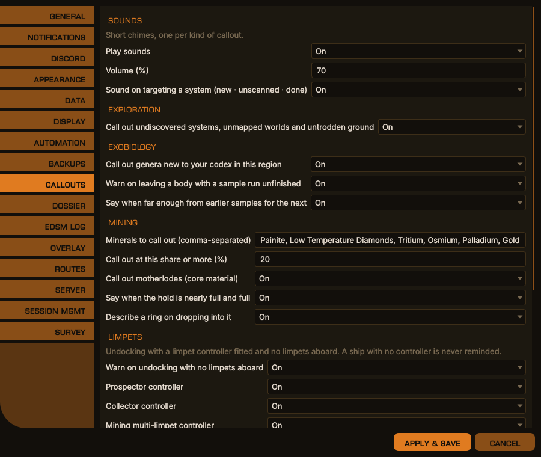
<br><em>Options → Callouts, desktop window</em>
</div>

<details>
<summary>The same in the terminal dashboard</summary>
<p align="center">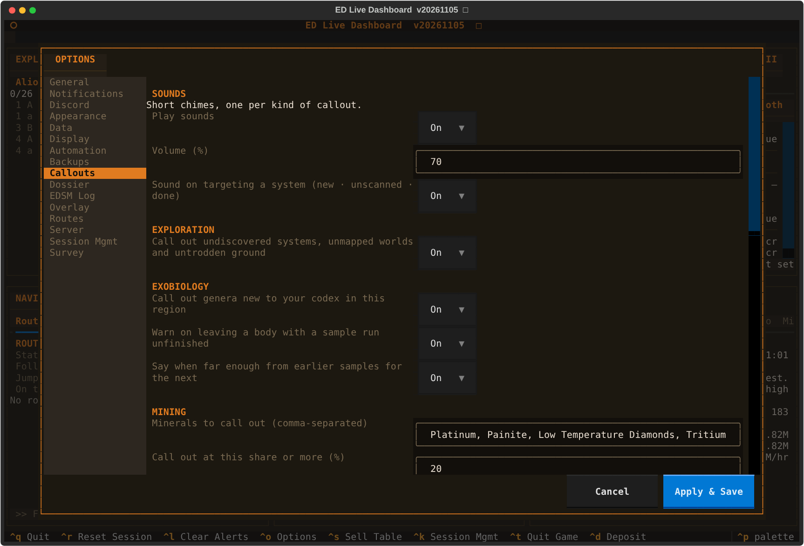</p>
</details>

## Journal backups — `[Backups]`

| Key | Default | Description |
|-----|---------|-------------|
| `Enabled` | `true` | Copy every new or grown journal, compressed, at startup, hourly, and when the game shuts down |
| `Folder` | `""` | Where; blank is `journal-backups` in EDLD's data folder |

Copies are never deleted. **Back up now** on the Backups tab runs one at once.

<div align="center">
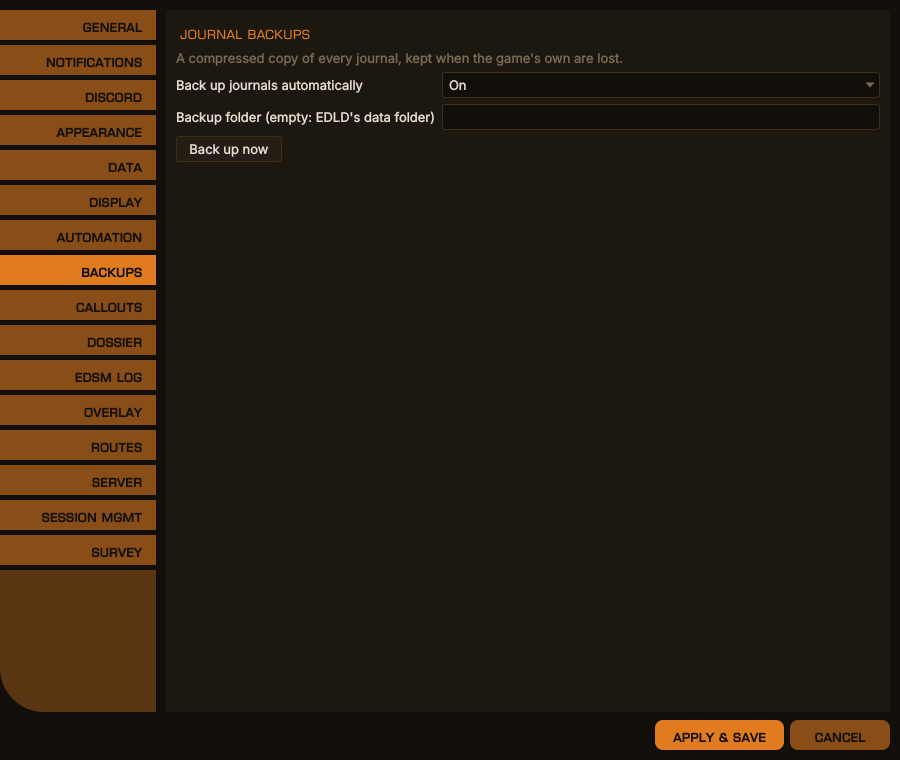
<br><em>Options → Backups, desktop window</em>
</div>

<details>
<summary>The same in the terminal dashboard</summary>
<p align="center">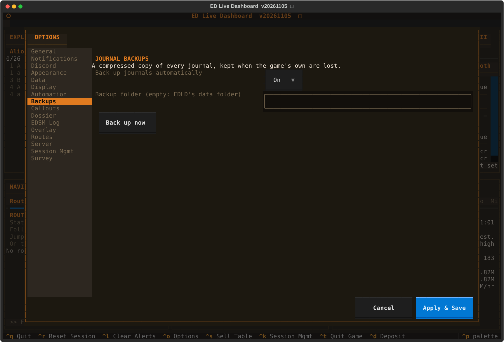</p>
</details>

## EDSM flight log — `[EDSMGaps]`

| Key | Default | Description |
|-----|---------|-------------|
| `Days` | `30` | How far back **Find and fill gaps** looks |

The button compares the jumps in your journals with EDSM's flight log and
sends EDSM the ones it lacks, through the EDSM uploads (which must be on).

<div align="center">
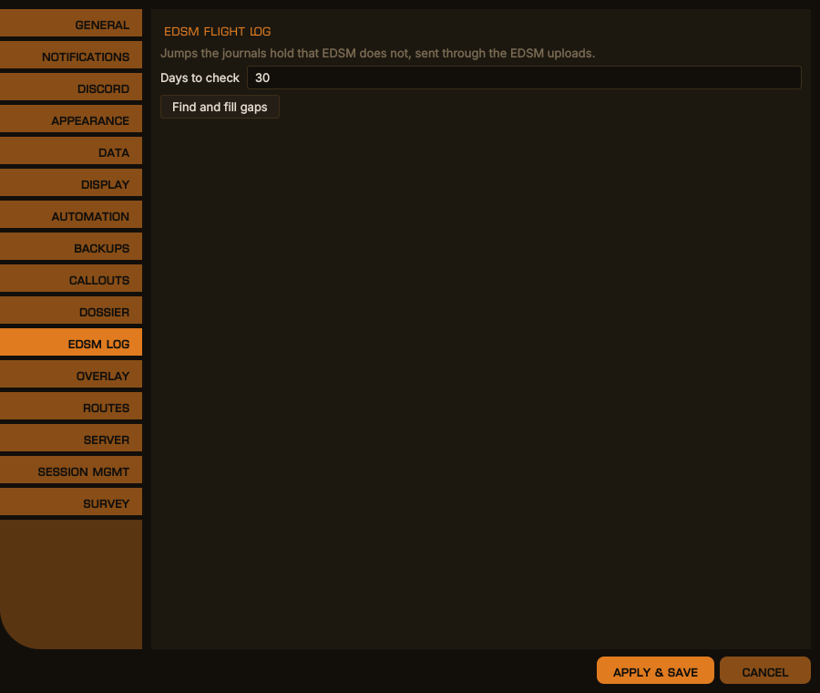
<br><em>Options → EDSM Log, desktop window</em>
</div>

<details>
<summary>The same in the terminal dashboard</summary>
<p align="center">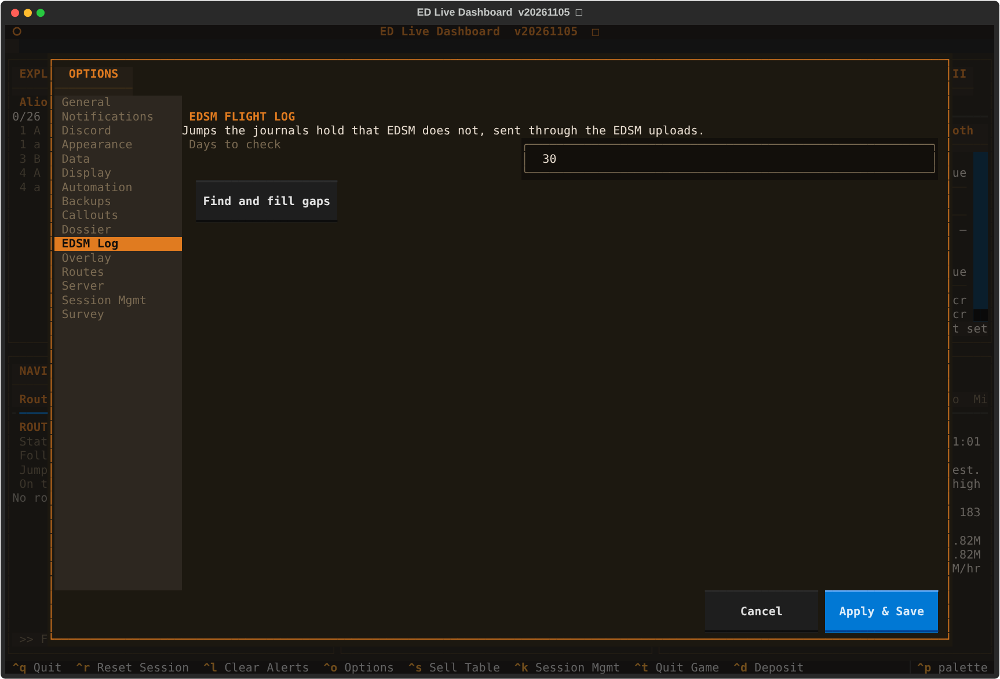</p>
</details>

## Automation — `[Automation]`

Off until you turn it on. See [AUTOMATION.md](AUTOMATION.md).

| Key | Default | Description |
|-----|---------|-------------|
| `Enabled` | `false` | Let EDLD press the game's keys at all |
| `AssumeFocus` | `false` | For a desktop that cannot say which window has the focus |
| `BindingsDir` | `""` | The game's `Options/Bindings` folder; blank finds it from the journal folder |
| `AutoHonk` | `false` | Honk on arriving in a system you have never honked or mapped |
| `HonkTrigger` | `"PrimaryFire"` | The trigger the discovery scanner is on |
| `HonkFireGroup` | `0` | Its fire group, 1–8; 0 uses the one selected |
| `AutoTarget` | `false` | After a supercharge on a neutron route, plot the galaxy map to the next stop |
| `PlotScript` | `""` | The galaxy-map key sequence; blank uses the built-in one |
| `AllowControl` | `false` | Let paired EDAM devices press keys from their Helm panel. EDLD's own Helm panel needs only `Enabled` |

<div align="center">
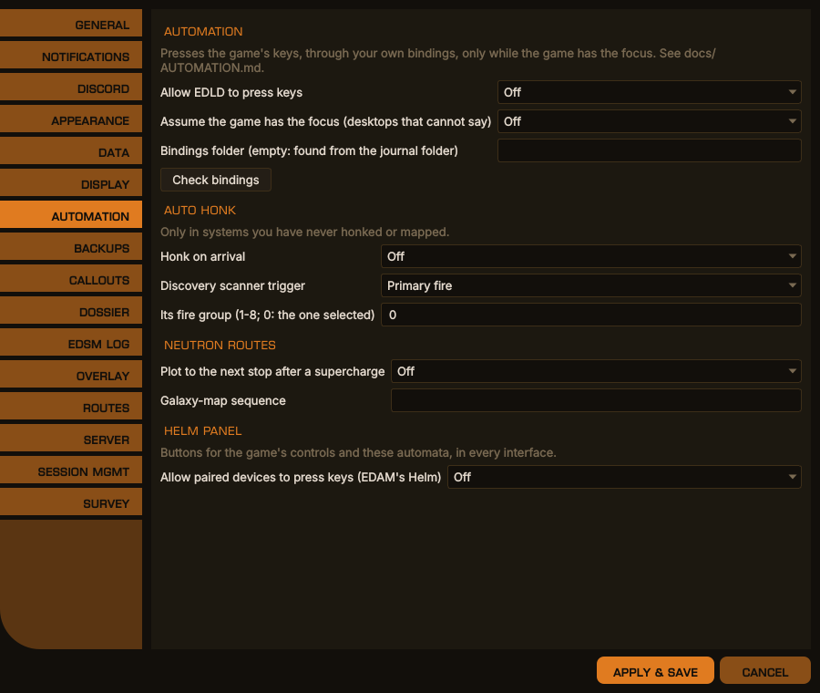
<br><em>Options → Automation, desktop window</em>
</div>

<details>
<summary>The same in the terminal dashboard</summary>
<p align="center">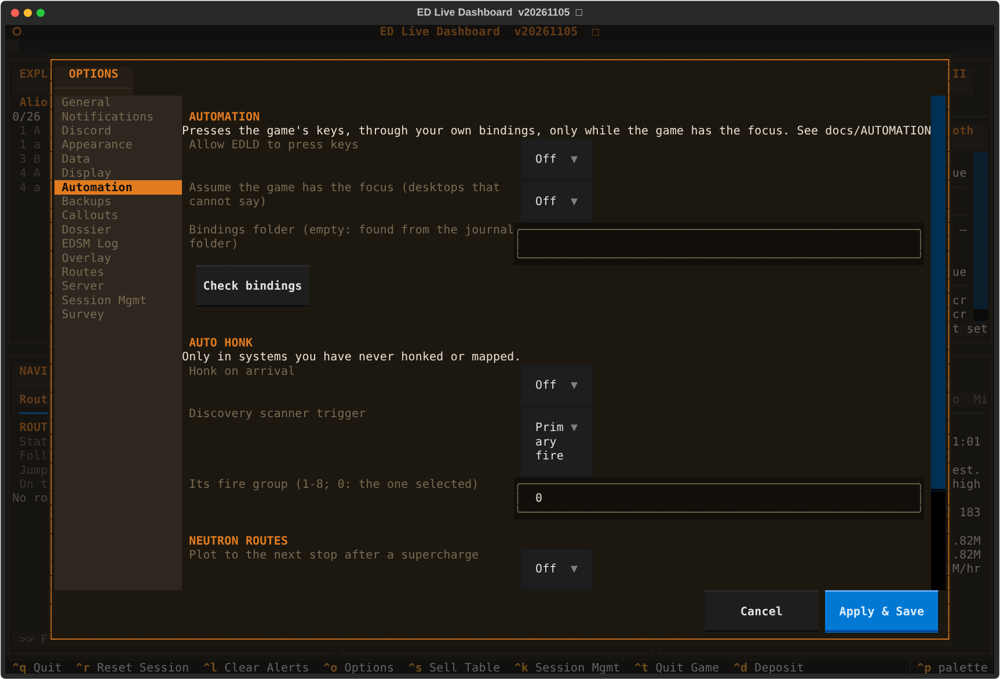</p>
</details>

## Commander dossier — `[Dossier]`

| Key | Default | Description |
|-----|---------|-------------|
| `Enabled` | `true` | Write the dossier: a web page and Markdown files about the commander, under `<data>/commanders/<FID>/dossier/` |
| `IncludeCurrentLocation` | `false` | Include where the commander, the current ship and the fleet carrier are now, and the carrier's jump history. Stored ships are always listed where they are kept |
| `IncludeBalance` | `false` | Include the credit balance, total wealth, and the carrier's bank |

Changes take effect without a restart. See [DOSSIER.md](DOSSIER.md).

## Server mode — `[Server]`

Full reference, pairing, networking and the protocol:
[SERVER.md](SERVER.md).

Serves this EDLD's dashboards to paired EDAM devices over TLS. Off unless
`Enabled = true` or `-s` is passed.

| Key | Default | Description |
|-----|---------|-------------|
| `Enabled` | `false` | Serve on every start, as if `-s` were passed |
| `Port` | `28510` | TCP port. Each profile that serves at the same time needs its own |
| `BindAddress` | `""` | Blank listens on every interface, IPv6 and IPv4 |
| `ExternalHost` | `""` | Name or address a device uses away from home, e.g. `yourname.duckdns.org`; put into the pairing code |
| `AllowEndSession` | `false` | Let a paired device end the game session (Solo only) |
| `PortMapping` | `false` | Ask the router to forward `Port` by NAT-PMP or UPnP |
| `DuckDNSDomain` | `""` | Keep this DuckDNS name pointed at your address… |
| `DuckDNSToken` | `""` | …with this token. Never written to any log |

All of these are also on the **Server** tab in Options, in both interfaces.
