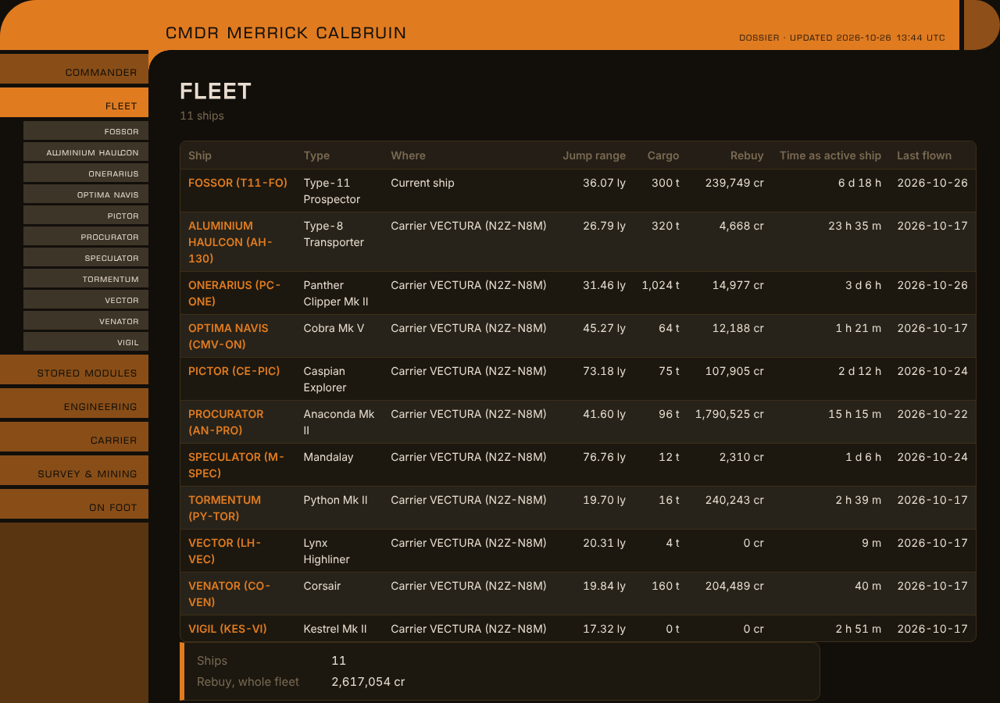
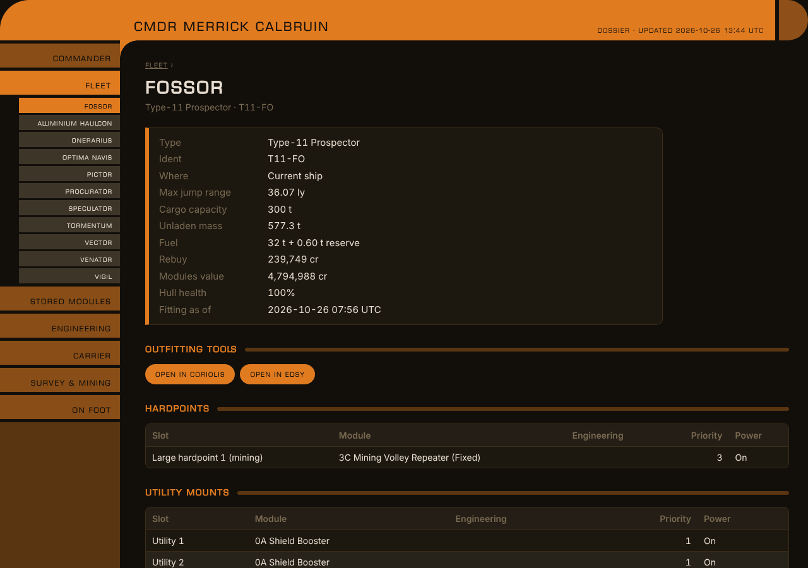
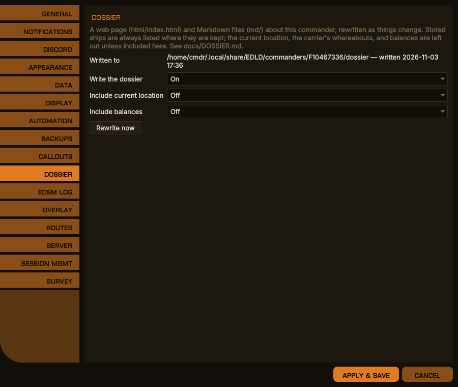
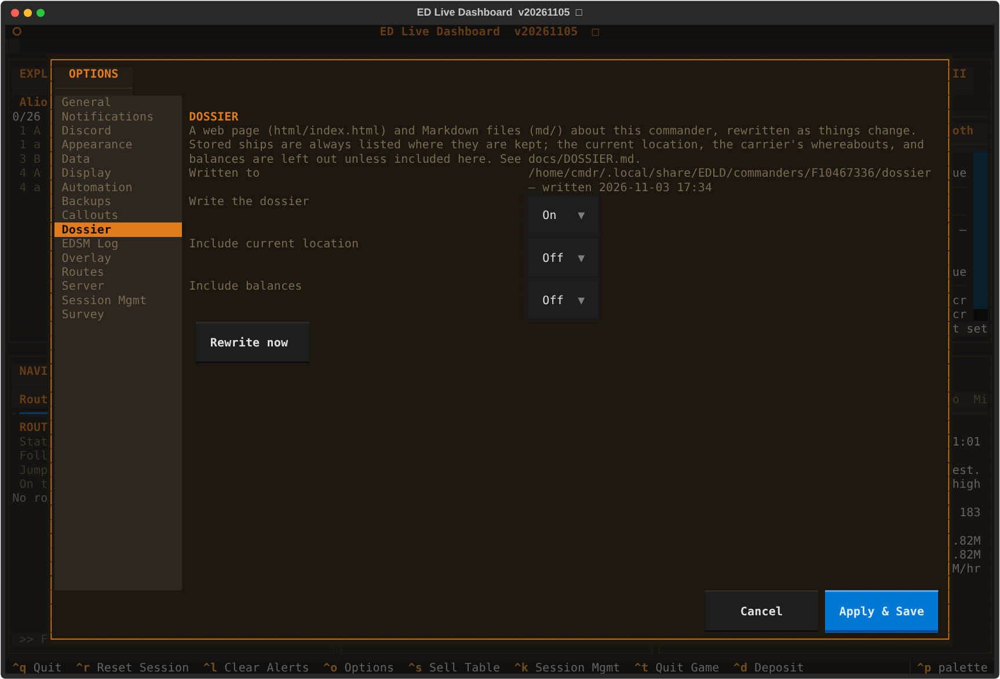

# Commander Dossier

EDLD writes a dossier for each commander: a set of documents about the
commander, their fleet with every ship's fitting, their stored modules,
engineering, fleet carrier, survey and mining, and on-foot kit. It is written
twice, as one web page and as Markdown files, and kept up to date while EDLD
runs. What you do with it — read it, keep it in git, put it on a web site — is
up to you. EDLD only writes it.

```
<data>/commanders/<FID>/
  data/dossier.json          what EDLD has learned, and how far it has read
  dossier/
    html/index.html          the whole dossier, one self-contained page
    md/index.md              the same, as Markdown
    md/commander.md
    md/fleet.md
    md/ships/<id>-<name>.md  one per ship
    md/modules.md
    md/engineering.md
    md/carrier.md            when you own a fleet carrier
    md/mining.md
    md/on-foot.md
```

`<data>` is EDLD's data directory: `~/.local/share/EDLD` on Linux,
`%LOCALAPPDATA%\EDLD` on Windows, `~/Library/Application Support/EDLD` on macOS.
Options → Dossier shows the full path.

## The pages

| Page | What it shows |
|---|---|
| **Commander** | Squadron and rank, Powerplay, the eight ranks with progress, superpower reputation, career statistics, and career income by source and spending by category |
| **Fleet** | Every ship: type, where it is kept, jump range, cargo, rebuy, time as the active ship, last flown |
| **Ship** (one each) | Jump range, cargo, mass, fuel, rebuy and values; the fitting by hardpoints, utility mounts, core and optional internals, with each module's engineering, experimental and engineer; cosmetics; engineering modifiers; links that open the fitting in Coriolis and EDSY; and the ship's service record — when it was acquired, named, transferred, destroyed, how long it has been flown, how far it has jumped |
| **Stored modules** | Every stored module, its engineering, and where it is kept |
| **Engineering** | Every engineer and your standing with them, and every engineered module across the fleet |
| **Carrier** | Name, callsign, docking, tritium, capacity, weekly upkeep, tariffs, services and crew, lifetime figures |
| **Survey & mining** | Ring hotspots you have mined, sorted by commodity and then by refinements per minute, best first; the surface deposits in your survey; and the hotspots you have found but not mined |
| **On foot** | Suit loadouts, suits and weapons with their classes and modifications |

<div align="center">

<br><em>The Fleet page of the web dossier, in the default theme</em>
<br><br>

<br><em>A ship page: figures, outfitting links, and the start of the fitting</em>
</div>

### Fittings of stored ships

Frontier's account data only carries the modules of the ship you are flying,
which is why EDLD's other fleet data showed stored ships without fittings. The
journals record a full `Loadout` every time a ship is flown, and a stored ship
cannot be outfitted or engineered, so the last `Loadout` stays true until the
ship is flown again. The dossier keeps it, and shows when it was recorded.

### Where ships are kept

A ship at a station is listed by station and system. A ship aboard a fleet
carrier is listed by the carrier — a carrier moves, so a system would go stale
the moment it jumped. A ship being transferred shows where it is going and when
it arrives.

### Refinements per minute

For a ring hotspot, the rate counts the hotspot's commodity refined while
mining: the refinements of a visit over the time from its first refinement to
its last. Visits shorter than five refinements over two minutes still count
toward the total refined, but not toward the rate. A visit is recognized when
the hotspot was your supercruise destination and you dropped into its ring.

## What is left out

Two things are left out unless you include them in Options → Dossier, or under
`[Dossier]` in config.toml:

| Setting | Includes |
|---|---|
| `IncludeCurrentLocation` | Where you, your current ship and your fleet carrier are now, and the carrier's jump history |
| `IncludeBalance` | Your credit balance and total wealth, and the carrier's bank, reserve and how many weeks of upkeep it covers |

Stored ships and modules are always listed where they are kept; that is the
point of the fleet list. Your FID, and any token or API key, are never in the
dossier, nor in `dossier.json`.

## When it is written

* Twenty seconds after startup, in the background, once the start is over.
* Fifteen seconds after anything changes that a page shows — a fitting, a ship
  stored, transferred or sold, a carrier update — so a burst of changes is one
  rewrite.
* When the dashboard theme or a `[Dossier]` setting changes. The web page uses
  the theme's colors, custom themes included.
* On request: **Rewrite now** in Options → Dossier.

The first run reads every journal, which takes a second or two. After that
EDLD keeps its place in each journal and reads only what is new. What it has
learned is kept in `dossier.json`, so a ship's fitting survives the journal
that recorded it being deleted. Delete `dossier.json` to have everything read
again from the journals still on disk.

## Settings

```toml
[Dossier]
Enabled                = true
IncludeCurrentLocation = false
IncludeBalance         = false
```

<div align="center">

<br><em>Options → Dossier, desktop window</em>
</div>

<details>
<summary>The same in the terminal dashboard</summary>
<p align="center"></p>
</details>

## The web page

`html/index.html` is a single file with nothing beside it: no scripts, nothing
fetched from the network, the heading font embedded. It opens from disk in any
current browser and works the same wherever it is copied. Each page has its own
address, so `index.html#ship-36` opens straight to that ship, and printing it
prints every page.

The only links that leave the page are the Coriolis and EDSY buttons on each
ship, which carry the fitting in the link itself, the same way EDMC builds
them.
