# EDCARS

EDCARS is EDLD's default interface: the desktop window drawn as a console. The
Dashboard layout (`--dashg` or `--gui`) shows every window at once; EDCARS is a
console. A header band across the top keeps
the essentials in view, a rail of pills down the left switches between
sections, and each section frames one to three windows at a size where they
can breathe. The same windows, the same data, the same keys — only the
arrangement differs.

EDAM, the Android app, draws EDCARS too, from what EDLD sends it.

<div align="center">
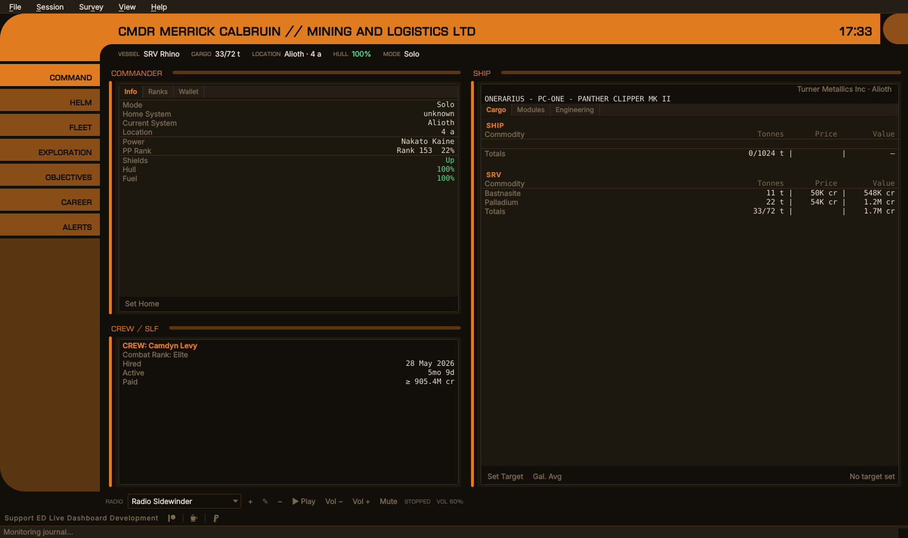
<br><em>Command — the commander, crew and the ship</em>
</div>

---

## Opening it

EDCARS is what EDLD opens by default, so a first `./edld.py` or the Windows
binary opens it, and the **EDLD EDCARS** shortcut always does. `--edcars` asks for
it by name. After that, a plain launch opens whichever interface you last
chose. The Dashboard layout is its own interface, with
its own flag (`--dashg` or `--gui`) and shortcut, **EDLD Dashboard**.

To make a plain launch open something else, start that interface once with
its shortcut or flag, or set **Options → Appearance → Interface**. Both are
kept in `config.toml`:

```toml
[UI]
Interface    = "edcars"   # or "gui", "textual", "terminal", "headless"
EdcarsAlerts = "pulse"    # or "switch"
```

The terminal dashboard (`--dasht`) cannot draw EDCARS's curves; it draws the
Dashboard's windows. EDAM draws EDCARS too.

---

## The header

The band carries the commander's name — followed by the squadron and its
tag when you are in one, `CMDR MERRICK CALBRUIN // MINING AND LOGISTICS LTD
[MALL]` — and the local time. A window too narrow for the whole title drops
the squadron's name and keeps its tag, `CMDR MERRICK CALBRUIN [MALL]`, then
the tag, and only then ends in "…"; the clock is never pushed off. Beneath it
a strip holds, left to right:

| Field | Shows |
|-------|-------|
| Vessel | The ship's name, ID and type — or the SRV, the fighter, or the suit on foot |
| Cargo | Used and total tonnage of whatever you are in |
| Location | The system, and the body or station within it |
| Fuel | The ship's main tank, colored at the fuel warn and critical thresholds |
| Hull | The ship's hull, or the SRV's while you are driving one |
| Mode | Solo, Open or the private group |

A field with nothing to say is left out: no fuel or hull on foot. On a narrow
window the vessel and the location give way, ending in "…", so cargo, fuel,
hull and mode are always shown whole. Credits are not in the header on
purpose; they are a tab away in Command.

The clock is the time of day where you are, whatever `UseUTC` says. That
setting is for the timestamps in the event log; this is the clock on the wall.

When an urgent alert arrives, it is repeated at the right-hand end of the
strip until you open the Alerts section.

---

## Sections

| Section | Key | Holds |
|---------|-----|-------|
| Alerts | `Ctrl+1` | The alert feed, with its Clear button |
| Command | `Ctrl+2` | The Commander window (Info, Ranks, Wallet), Crew / SLF, and the Ship window |
| Helm | `Ctrl+3` | The Helm panel: the game's controls and EDLD's automation, as buttons |
| Objectives | `Ctrl+4` | Missions and colonization |
| Exploration | `Ctrl+5` | Exploration / Exobiology beside Navigation |
| Mining | `Ctrl+6` | Ring Hotspots and Surface Sites, each a filterable table |
| Fleet | `Ctrl+7` | Ships, stored modules, the fleet carrier and the squadron carrier |
| Engineering | `Ctrl+8` | Fitting — each ship beside the build planned for it, the work left and its materials — and Materials |
| Career | `Ctrl+9` | Career / Session |

EDCARS opens on Command, though Alerts leads the rail.

### Engineering

**Fitting** shows one ship at a time, chosen from the list at its top: every
ship you own, then the builds you have planned for hulls you do not own yet,
then **New (Planned)…**, which asks for the hull and starts one. The slots run
down the window with what is fitted in one column and the target build in the
next; a module that differs is in red, engineering still to do in amber.
**Target…** (**Build…** for a planned build) takes an EDSY or Coriolis link,
long or short, an EDOMH link, or SLEF JSON exported by EDSY, Coriolis or EDSX;
a build for another hull is refused. A planned build has **Apply to**, which
makes it the target of an owned ship of its hull and drops the plan.

Under the slots, **Work left** lists each slot still to change: the module to
buy, or to take out of storage when you have that module stored, the grades
still to roll with the rolls they take, and the experimental effect.
**Materials** totals what that costs against what you hold, and
**Shopping list…** suggests the trades that cover a shortfall from what the
build does not need — within a trader's column first, since crossing columns
costs six times as much — with the nearest material trader of each kind.
Traders you have docked at come first, marked *traded here*, with their kind
learned from the trades you made there; Spansh names the rest, and only those
whose kind it states.

A grade takes as many rolls as its number, fifteen from nothing to a full G5;
a grade rolled only part way takes the rest of its rolls. Blueprint recipes,
EDSY links and EDOMH ships are read with the tables EDLD ships with,
`data/eddb.sqlite`. Every roll at an engineer in your journals is checked
against them, and where the two differ the journal's recipe is used and the
difference logged.

**Materials** is the materials you hold, by kind, as it was on the Ship
window: they travel with every ship rather than the one you are in.

Under the sections, the last pill on the rail is **Settings**, as on EDAM. It
is not a section: it opens Options (`Ctrl+O`, or **File → Options…**) over
whichever section is showing, and leaves that section showing when Options
closes.

<div align="center">
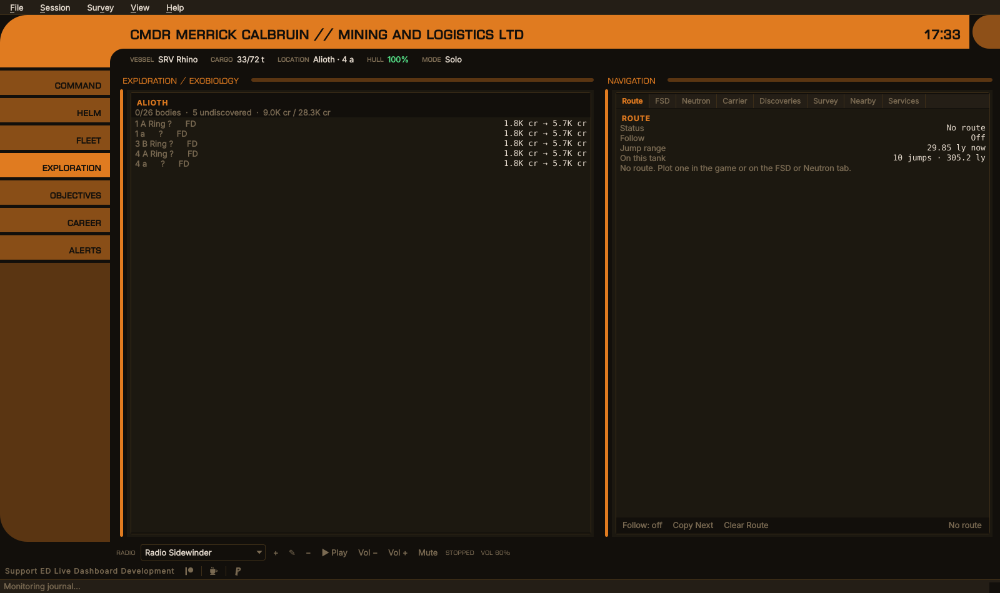
<br><em>Exploration — the system's bodies beside the route plotter</em>
</div>

<div align="center">
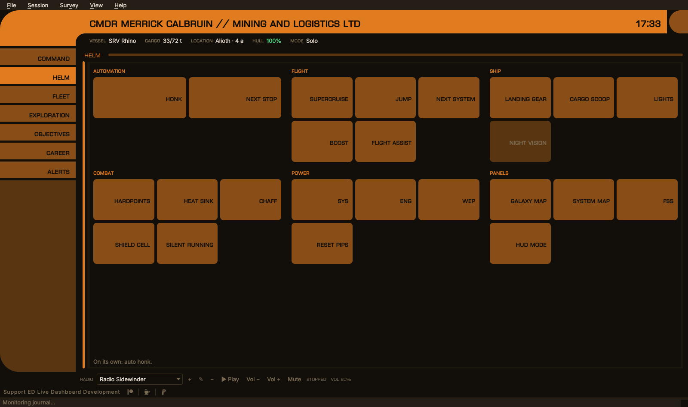
<br><em>EDCARS — every button EDLD can press for you, grouped by what it is for</em>
</div>

The Helm section is the Helm panel at its largest: the groups side by side as
many as fit, evened out over the rows, and the buttons growing to fill the
section. A button that cannot be pressed — automation off, or the control
bound to nothing EDLD can press — is grayed, and its tooltip says why. See
[AUTOMATION.md](AUTOMATION.md#the-helm-panel).

<details>
<summary>The other sections</summary>
<p align="center">
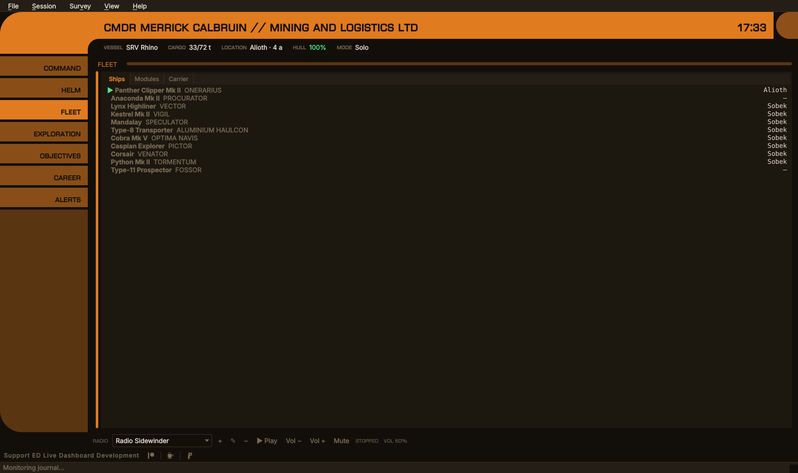<br><em>Fleet</em><br><br>
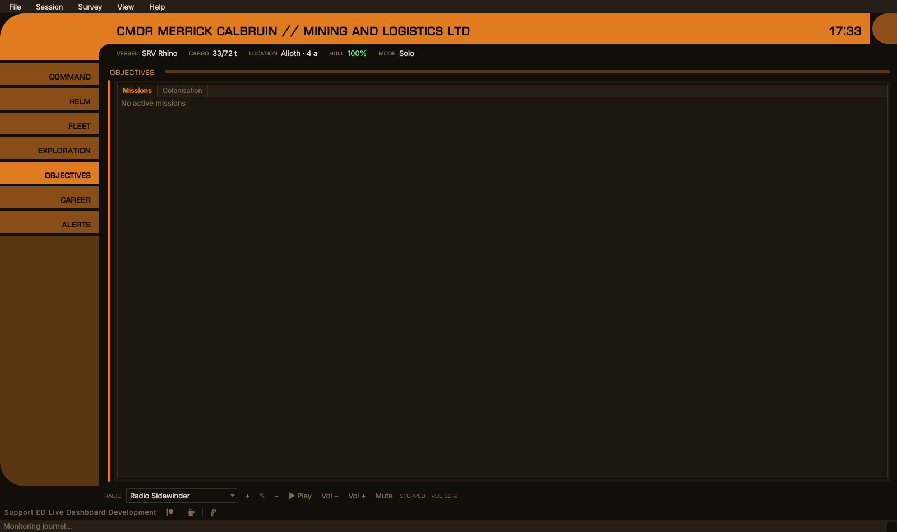<br><em>Objectives</em><br><br>
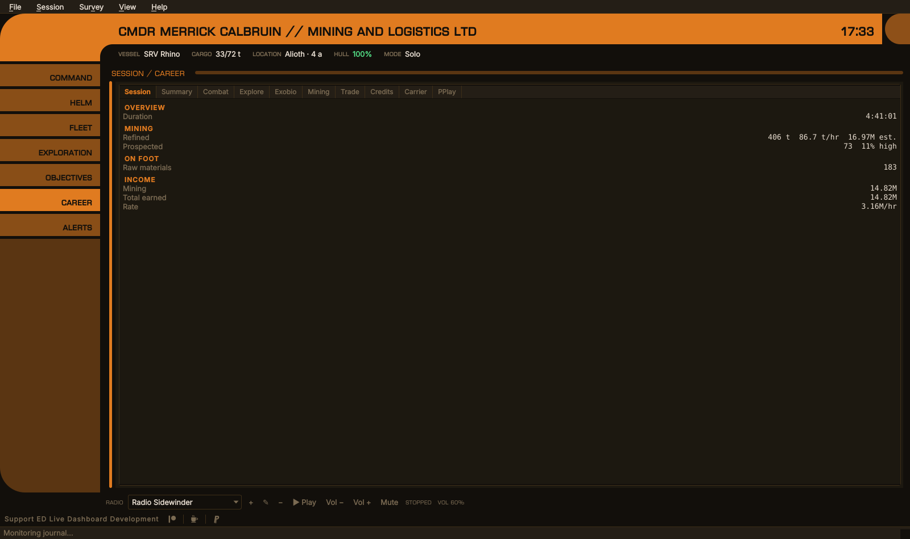<br><em>Career</em>
</p>
</details>

The radio has no section. It runs along the foot of the window as a single
strip — station, add, edit, remove, play, volume, mute — under whichever
section is showing, so the music never has to be looked for.

Crew / SLF shares Command rather than sitting with Objectives: it is about the
ship you are flying, and it is light enough that a section of its own would be
mostly empty. The Dashboard's Crew / Alerts window is split in two for the same
reason: the crew half goes to Command, the alerts to their own section.

EDCARS does not use the Dashboard's window layout (Options → Display,
`windows.json`). Its sections are fixed, so that the desktop window and EDAM
always agree on where a window lives.

---

## Alerts

Not every alert is urgent. Danger and loss are — shields down, hull damage,
fuel low, a fighter or the ship destroyed, cargo stolen, an attack, session
management ending the game. Status is not: a fleet carrier's jump schedule,
shields coming back up, an expired Frontier sign-in, a part of EDLD that
failed to load. Those are listed in the Alerts section as always, but they do
not call for attention.

When an urgent alert arrives:

- **`pulse`** (the default) — the Alerts pill flashes red and the alert is
  repeated in the header. After ten seconds the pill stops flashing and stays
  red until you open the section.
- **`switch`** — the same, and EDCARS also switches to the Alerts section.

Opening the section, or clearing the alerts, settles the pill.

<div align="center">
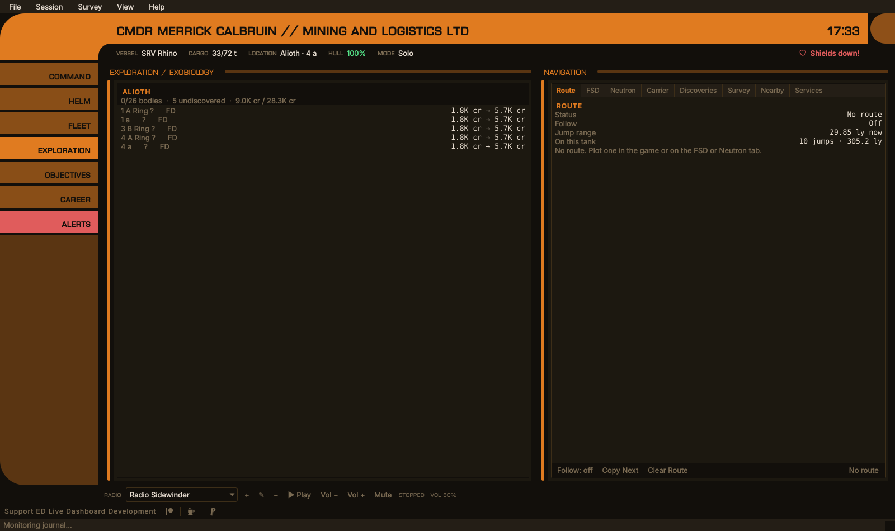
<br><em>An urgent alert while in Exploration: the pill is red and the alert is in the header</em>
</div>

<details>
<summary>The Alerts section</summary>
<p align="center">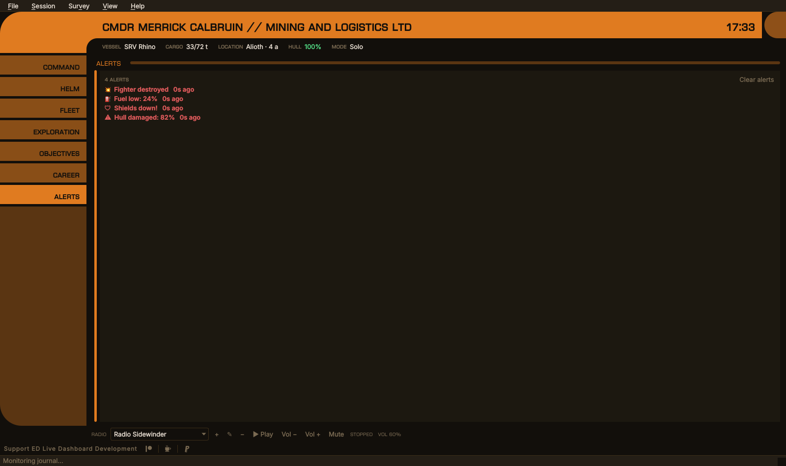<br>
<em>Urgent alerts in red; the carrier jump and shields coming back up are not urgent</em></p>
</details>

---

## Consoles

EDCARS can be drawn as four consoles. The layout is the same in all of them —
the band and the strip of facts, the rail of nine sections, the same windows
framed in the same places, the radio along the foot, the same shortcuts and
the same alerts. What differs is how the band, the pills and the frames are
drawn, and the faces the chrome is set in. **Options → Appearance →
*EDCARS: console*** chooses one (`[UI] Console`), from the next start.

| Console | | Chrome |
|---------|---|--------|
| **EDCARS** | The band and the elbow, pills down the rail | Euro Caps |
| **ORDER** | An Imperial fleet console: gray steel pills each with an indicator light, a black band over a rule of the accent, readouts behind chamfered black glass, a bank of panel lights over the rail | Rajdhani |
| **REBEL** | A Rebel ops board: a cream band between an orange elbow and an amber cap, cream console pills with round lamps, each window's screen set in a cream bezel under a label plate | Saira Condensed |
| **ROGUE** | An independent freighter's cockpit: worn plate and rivets, the title glowing on an amber CRT, each section a strip of masking tape with a lamp and a toggle switch, windows in rounded CRT bezels, a rust patch where the rail runs out | VT323, labels in Permanent Marker |

<div align="center">
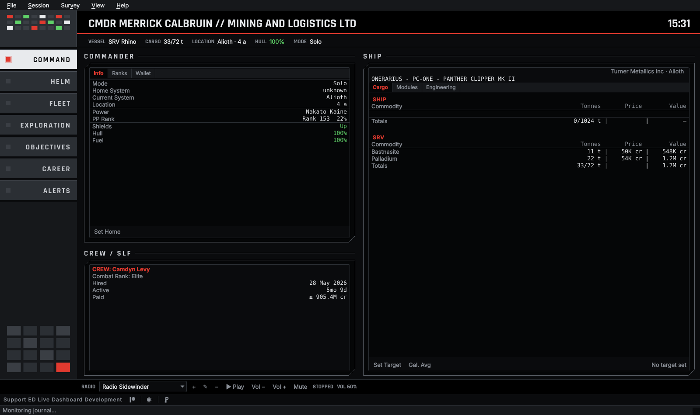<br><em>ORDER, with the order theme</em><br><br>
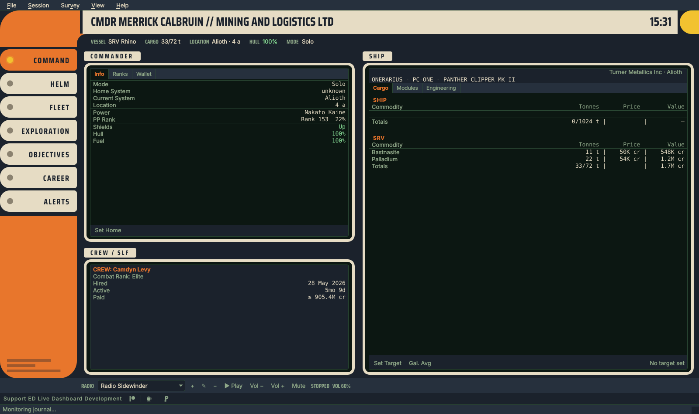<br><em>REBEL, with the rebel theme</em><br><br>
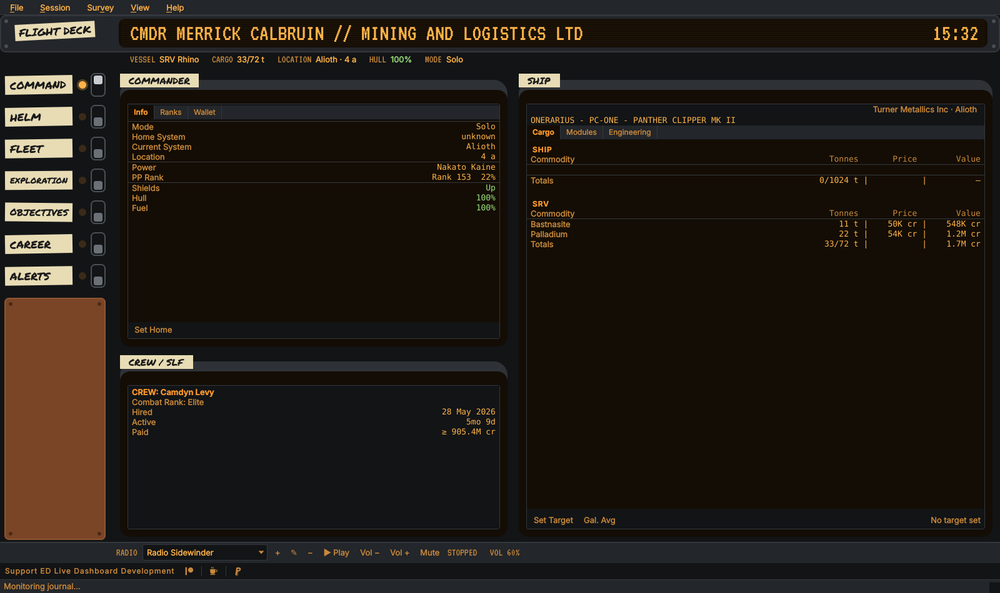<br><em>ROGUE, with the rogue theme</em>
</div>

A console's panels are its own paint: ORDER's steel, REBEL's cream and
ROGUE's plate, tape and rust stay as they are whatever the theme. The
lights, the screens and the text are the theme's, so any theme — custom ones
included — can be worn by any console, and each of the three has a theme of
its own name made to match it (see [THEMING.md](THEMING.md#built-in-themes)).
The section's pill lights its lamp, throws its toggle on ROGUE, and an
urgent alert turns the Alerts lamp red.

Options and every dialog opened from the window — the sell table, search,
the deposit form, About, the radio's station forms and the confirmation boxes —
are dressed as the console too: Options picks its pages from the console's
own pills, and every dialog's headings, Apply / OK / Cancel buttons and
scrollbars are the console's. Opened from the Dashboard, they keep the theme's
plain look.

The three names are homages, not borrowings: no insignia, no alien
lettering, no names from anywhere but Elite. The faces are free: Rajdhani,
Saira Condensed and VT323 under the SIL Open Font License, Permanent Marker
under the Apache License 2.0, each shipped in `fonts/` with its license (see
[THIRD-PARTY-NOTICES.md](../THIRD-PARTY-NOTICES.md)).

EDAM draws all four. Its **Settings → Console** follows EDLD by default —
the header says which console EDLD wears and names all four (`console`, see
[SERVER.md](SERVER.md#header)) — or keeps one of its own. In landscape and on
tablets each is drawn as the desktop draws it; in portrait the layout is
EDCARS's portrait one, in the console's paint and faces.

---

## Themes

EDCARS draws from the theme like everything else: the band, rail and frames are
the theme's accent, and the pills mix it toward the background. Custom themes
work with nothing extra to set. See [THEMING.md](THEMING.md).

<div align="center">
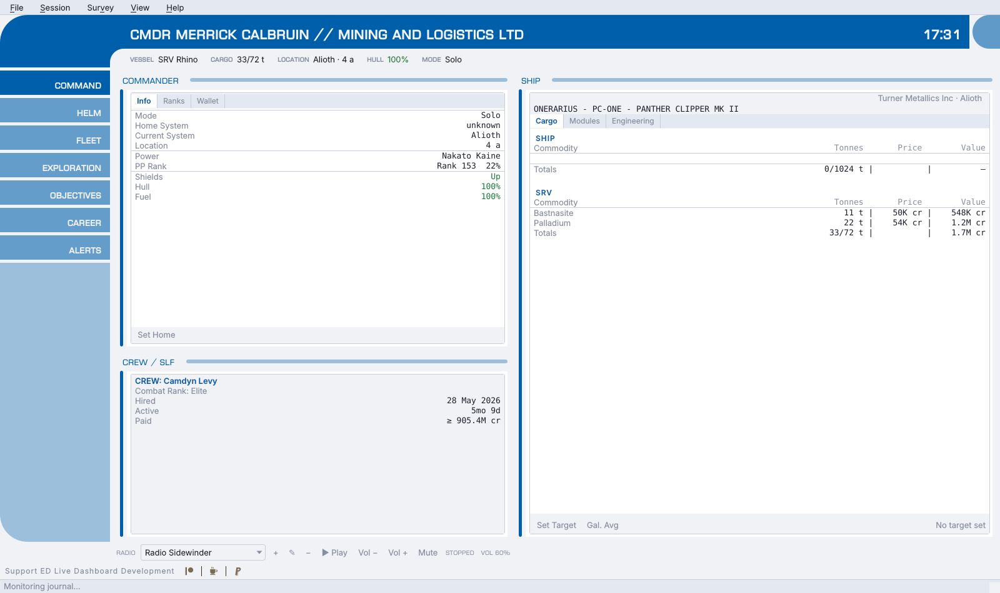
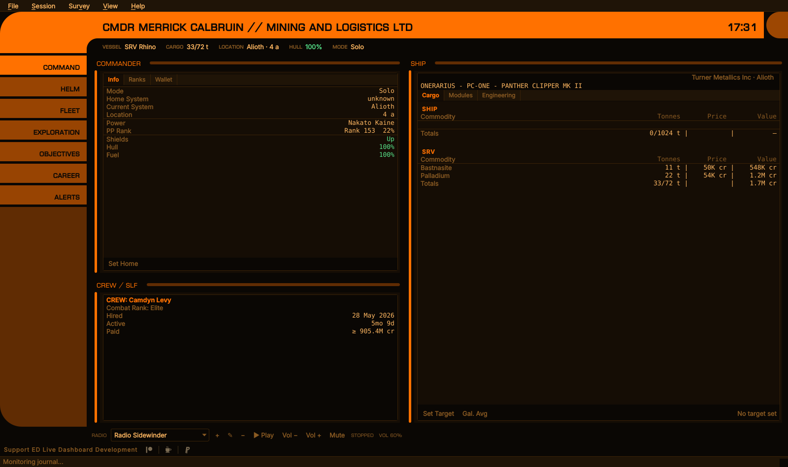
<br>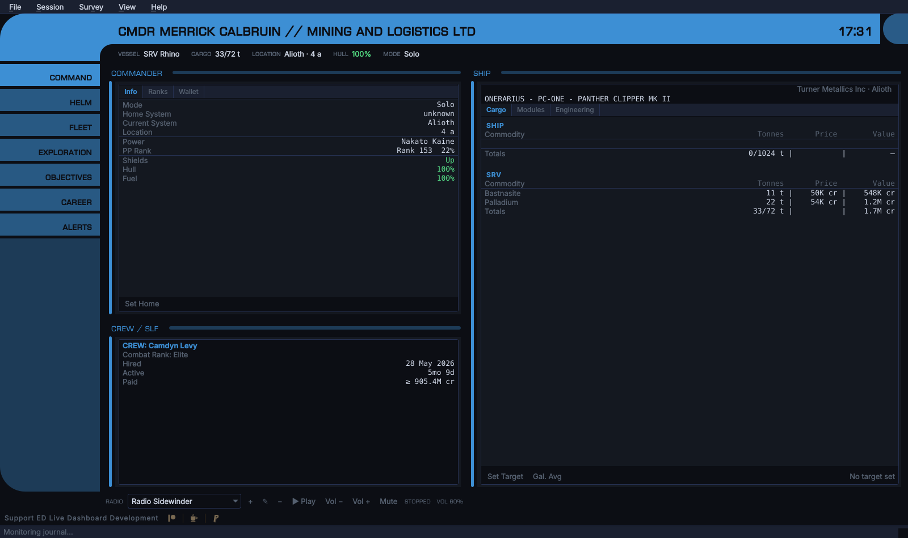
<br><em>EDLD Default Light, Elite Dangerous and EDLD Default Blue</em>
</div>

The section titles, pills and header are set in Euro Caps, which EDLD ships in
`fonts/`; it is free for any use. The band's title and clock, the strip's
labels and the pills are bold: Euro Caps is a thin face, and at the strip's
size, or on a pill's mid-tone color, the regular weight was hard to read.

---

## On EDAM

EDAM's **Settings → Style** offers:

- **Follow EDLD** — the default; EDCARS when EDLD is running as EDCARS, the
  Dashboard when it is running as anything else
- **Dashboard**
- **EDCARS**
- **EDCARS in landscape, Dashboard in portrait** — for phones where a portrait
  EDCARS is cramped

In landscape, and on tablets, EDAM draws EDCARS as the desktop window does —
the same elbow, band, cap, strip and rail, to the same measurements, and
each section's windows framed in the same columns at the same widths, tabbed
where the desktop's are, with the same tabs in the same order — the
Navigation forms after Route, the Materials tab's own tabs, tables in
columns, values in the desktop's colors, and the buttons along a window's
foot — with two differences: the radio strip along the
desktop window's foot is not there (the ad banner is), and the band carries
EDAM's connection status beside the clock, and the Settings pill at the end
of the rail opens EDAM's own settings rather than EDLD's Options. The Helm section draws the controls EDLD lets the device press
(Options → Automation → *Allow paired devices to press keys*), in the same
groups as the desktop; with none, it says why. An urgent alert flashes the Alerts pill for ten seconds and then
holds it red until Alerts is opened, as on the desktop. Both draw EDCARS's
scrollbars thin: a 3-pixel thumb, and only where there is more to see. In portrait the header shrinks to a short elbow
with the strip wrapping beneath it, the pills run along the bottom, and a
swipe moves between sections. The clock is the phone's own. The title and
the strip give way on a narrow screen as they do on a narrow window, and the
band, the strip and the pills keep their text at the size they are drawn
for, whatever the phone's font size; the sections follow it.

The sections, their order, which pages each holds, the name, and the
`EdcarsAlerts` setting all arrive with every snapshot (see
[SERVER.md](SERVER.md#header)), so EDAM and the desktop window cannot
disagree; so does every window, sent from the one model the desktop window
draws (`core/windows`), and a test fails if an EDCARS tab on the desktop has no
counterpart on a device. A page a newer EDLD sends that no section claims gets a section of
its own rather than being lost. An urgent alert that was already older than
two minutes when EDAM first saw it — on opening the app, say — is listed but
does not pulse.

---

## For developers: the name

"EDCARS" is spelled in exactly one place: `EDCARS_NAME` in `core/edcars.py`,
and "Helm", the panel's name, in one other: `HELM_NAME` in `core/helm.py`.
The consoles' names likewise: `ORDER_NAME`, `REBEL_NAME` and
`ROGUE_NAME`, beside `EDCARS_NAME`, stored and sent as their ids. How each
console draws is `gui/consoles.py`: one class per console, overriding the
band, the rail's foot, the pills, the frames and its style sheet.
Options, the wire and EDAM all take them from there, and a test fails if any
other source file writes either out. What `config.toml` stores and the wire
carries is the id `edcars`, which nobody reads, so a rename never has to
migrate a saved setting. EDAM has one
fallback for each name, `EDCARS_FALLBACK_NAME` in `ui/EdcarsScreen.kt` and
`HELM_FALLBACK_NAME` in `ui/HelmPad.kt`, used only before its first snapshot.

The sections themselves, and the header strip, are also defined once in
`core/edcars.py`, for the desktop window and the wire alike; the Helm panel's
buttons and groups in `core/helm.py`.
