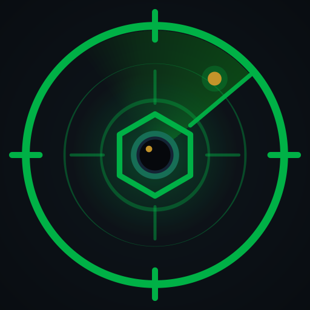
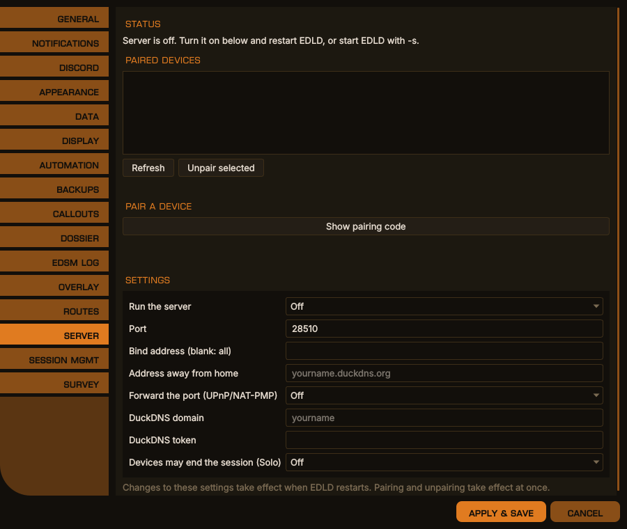
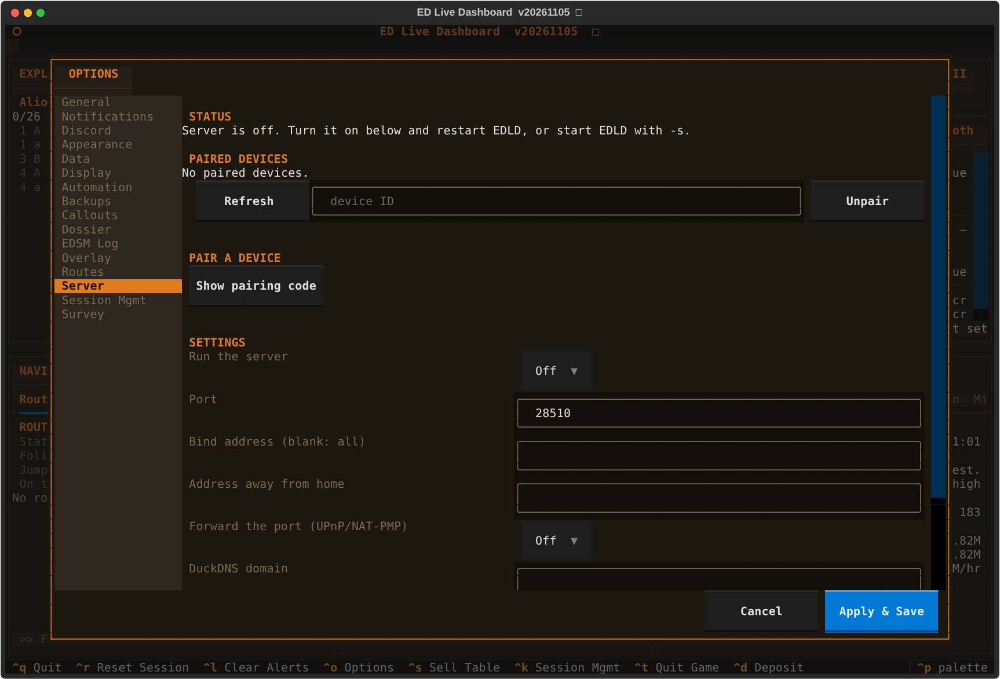

# Server mode — EDLD for the EDAM mobile client



EDAM is on [Google Play](https://play.google.com/store/apps/details?id=com.indevlin.edam).

EDLD can serve what it knows to your phone or tablet, and the EDAM app draws
it. In landscape and on a tablet, EDAM draws [EDCARS](EDCARS.md) as the desktop
window does: the same header, the same sections on the same rail, and in each
the same windows with the same tabs, tables and colors, sent from the one
model the desktop window and the terminal dashboard draw. The Navigation
window's forms — FSD, Neutron, Carrier, Survey, Nearby, Services and
Discoveries — are drawn by the app and run by EDLD, and the buttons along a
window's foot work from the phone: Follow, Copy Next and Clear Route, Set
Target and Gal. Avg, Set Home. In portrait, one section fills the screen and
swipes to the next. EDAM's Dashboard style is a drawer of pages instead —
Overview, Session, Career, Alerts, Commander, Crew, Ship and the rest.

It is made for glancing at: open the app, see where things stand, put the
phone away. EDLD's Options stay on the computer; EDAM has only its own
settings.

---

## Starting it

```bash
edld -s                  # what a plain launch opens (EDCARS by default), plus the server
edld -s --edcars           # EDCARS, plus the server
edld -s --dasht          # terminal dashboard, plus the server
edld -s --dashg          # desktop window, Dashboard layout, plus the server
edld -s --headless       # no interface at all, for running as a service
```

`-s` on its own opens whatever a plain `edld` would — `[UI] Interface`,
EDCARS unless you have chosen another — with the server beside it. Name an
interface and you get that interface and the server, in one process.

Server mode is a setting rather than an interface: **Options → Server →
Enabled** (`Enabled = true` in `[Server]`) runs it beside whichever interface
opens, every time — a plain `edld`, which opens EDCARS, or any of the launcher
shortcuts. That is why there are no server copies of the shortcuts: turn it on
once and every launcher serves.

`--headless` prints nothing after startup; diagnostics go to the log file named
on its first line. It is what to use for a service.

**EDLD-server** is the same program built without either dashboard: about a
fifth of the size, with no Qt and no Textual. It always serves, runs the
terminal event log by default, and takes `--headless`, `--pair`, `--paired`
and `--unpair` like EDLD. It is published for Linux and Windows beside the
EDLD downloads, and `scripts/build_local.sh --server` builds it locally.

Running as a service:

- **Linux:** a `systemd --user` unit running `edld -s --headless`.
- **Windows:** a Task Scheduler task triggered *At log on* for your own
  account, running `EDLD.exe -s --headless`. Not a Windows Service: a service
  runs in another session as another account and cannot see your Saved Games
  folder. Keep EDLD in the same folder across updates — Windows Firewall ties
  its rule to the program's path and will ask again if it moves.

If the server cannot start — the port is taken, a package is missing — EDLD
says so on the terminal, in the log and in the Alerts pane, and carries on
without it.

## Settings

```toml
[Server]
Enabled         = false
Port            = 28510
BindAddress     = ""        # blank: every interface, IPv6 and IPv4
ExternalHost    = ""        # e.g. yourname.duckdns.org
AllowEndSession = false
PortMapping     = false     # ask the router to forward Port
DuckDNSDomain   = ""        # keep yourname.duckdns.org pointed here...
DuckDNSToken    = ""        # ...with this token
```

All of these are also on the **Server** tab in Options, in both the
terminal dashboard and the desktop window. That tab shows what the server is
doing — listening, who is connected, the port forward, DuckDNS — lists the
paired devices with an Unpair button, and has a **Show pairing code** button
that puts the same QR code `edld --pair` prints on the screen.

Each profile is its own server, with its own identity and its own paired
devices, so two profiles running at once need two ports:
`EDP2.Server.Port = 28511` in the profile section.

<div align="center">

<br><em>Options → Server, desktop window</em>
</div>

<details>
<summary>The same in the terminal dashboard</summary>
<p align="center"></p>
</details>

## Pairing a device

Press **Show pairing code** on the Server tab in Options, or run this on
the computer, in a second terminal if EDLD is already running:

```bash
edld --pair              # or: edld -p PROFILE --pair
```

It prints a QR code, a one-time code, the server's fingerprint, the addresses
it found, and a link. In EDAM, choose **Add computer** and scan the code, or
paste the link. The app shows the addresses it will try and lets you add or
change them before saving, because only you know how your network is set up.

If `ExternalHost` is not set, `--pair` asks for the address to use away from
home; leave it blank for this network only. A PNG of the QR code is also
written beside the server's files, for a machine whose console cannot draw it;
it is deleted when the code is used or expires.

The code is valid for five minutes, works once, and is destroyed after five
wrong attempts. Running `--pair` again replaces it.

```bash
edld --paired            # list paired devices
edld --unpair hNzebMq-   # remove one, by the ID --paired shows
```

A running EDLD disconnects an unpaired device within a few seconds; nothing
needs restarting.

## Reaching EDLD

**On the same network** nothing else is needed, unless this computer's
firewall blocks the port — see *When a device will not pair* below. The app
tries the addresses in the pairing code in order.

**Away from home**, the app needs an address that reaches your computer from
the internet:

1. **A name that follows your address.** Your home address can change;
   [DuckDNS](https://www.duckdns.org) gives you a free name, such as
   `yourname.duckdns.org`. Sign in there, create a name, and copy the token it
   shows. Put the name in `DuckDNSDomain` and the token in `DuckDNSToken`, and
   EDLD keeps the name pointed at your connection while it runs. If your
   router or DuckDNS's own updater already does that, leave both blank and put
   the name in `ExternalHost` instead.
2. **A forwarded port.** Turn on `PortMapping` and EDLD asks the router to
   forward the port itself, by UPnP or NAT-PMP, and removes the forward when
   it exits. The Server tab says whether it worked. If your router has UPnP
   switched off, or you would rather not, forward TCP port 28510 (or whatever
   `Port` is) to this computer's LAN address in the router's settings instead —
   *port forwarding*, *virtual server* or *NAT rules*.
3. Pair again, or edit the address in the app.

If the phone works on Wi-Fi at home but not away, the forward is the thing to
check. If it works away but not at home using the DuckDNS name, your router
does not support *NAT loopback*; that is why the app keeps your LAN address
too and tries both.

With `PortMapping` on, EDLD also reads back the address the router thinks it
has on the internet. If that is a private address, EDLD says so on the Server
tab and in the Alerts pane: it means your provider or a second router is doing
NAT as well, and the next paragraph applies.

**If your provider uses CGNAT** — common with Starlink, 4G/5G home internet
and some fibre providers — no router setting can make your computer reachable
from outside. Some providers give you a public address on request. Otherwise,
install [Tailscale](https://tailscale.com) (free for personal use) on the
computer and the phone, and put the computer's Tailscale name or address in
`ExternalHost`. IPv6, where both ends have it, can also avoid the problem.

## When a device will not pair

**Read the app's message first.** It lists every address it tried and what
happened at each, in order. The first address — your LAN one — is the one that
matters at home.

| The app says | What it means |
|---|---|
| *no route to host* | This computer's firewall rejected the connection. |
| *no answer within 5 s* | This computer's firewall dropped it, or the phone cannot reach that address at all (another network, guest Wi-Fi, a VPN on the phone). |
| *refused* | Nothing is listening. Start EDLD with `-s`, and check the port. |
| *name not found* | The DuckDNS name is misspelt, or not being updated. |
| *answered with a different key* | Something else answered on that address, or EDLD's identity was reset since the code was made. Run `edld --pair` again. |

The same-network case is nearly always this computer's firewall. It lets
connections out and drops new ones coming in, so the phone waits and EDLD
never sees anything to log. That a phone and computer can already see each
other — Android Studio's wireless debugging, say — proves nothing here, because
there the computer connects to the phone, not the other way round.

**Linux.** `edld --pair`, the Server tab and EDLD's start-up line all check for
nftables, ufw, firewalld and iptables and print the command that opens the
port. Arch's stock `/etc/nftables.conf` accepts ssh and drops everything else,
so on Arch this is the expected first hurdle. EDLD can read that file and
says so outright; ufw keeps its rules root-only, so there EDLD can only say
ufw is active and give the command (`sudo ufw allow 28510/tcp`). For nftables:

```bash
sudo nft insert rule inet filter input tcp dport 28510 accept   # now
```

and to keep it, add `tcp dport 28510 accept` beside the `tcp dport ssh accept`
line in `/etc/nftables.conf`, then `sudo systemctl restart nftables`.

**Windows.** The first time EDLD listens, Windows asks whether to allow it. If
that was dismissed, or the network is set to *Public*, devices are blocked:
Windows Security → Firewall & network protection → *Allow an app through
firewall* → allow EDLD for *Private* networks, and make sure your home network
is set to *Private*.

**Checking from another computer on the network** takes the phone out of the
question. `nc -vz 192.168.1.100 28510` says whether the port answers at all;
`scripts/edld_client.py pair '<link>'` does exactly what the app does.

**On EDLD's side**, a device that reaches the port and gives up before
encryption starts is logged as *connected and closed before TLS started*, and
every pairing attempt, right or wrong, is logged with its outcome. Nothing in
the log at all during an attempt means the connection never arrived.

## Security

- Everything is encrypted with TLS 1.3.
- The phone trusts EDLD because the pairing code carried EDLD's public-key
  fingerprint. An impostor on the network cannot present that key, so the very
  first connection is safe even on public Wi-Fi.
- EDLD trusts the phone because the phone's own key was registered while you
  held a valid code. A device that was never paired, or has been unpaired, is
  refused during the TLS handshake, before it can send a single message.
- The only thing an unpaired connection can do is offer a pairing code, and
  only while one from `--pair` is open.
- **Ending the game session** from a device is off unless `AllowEndSession` is
  true, and even then only works in Solo, the same rule session management
  applies to its own triggers. The device must confirm, and the reason is
  recorded as *ended from <device name>*.
- **The buttons under a window** do on the computer what the desktop's do:
  Copy Next puts the next system on the computer's clipboard, Follow and
  Clear Route change the followed route, Set Target and Set Home search
  Spansh. A plot from a device's Navigation forms becomes the followed route.
  None of them presses a key.
- **Pressing keys** from a device's Helm panel is off unless both
  **Allow EDLD to press keys** and **Allow paired devices to press keys** are
  on under Options → Automation. Even then a device can press only the
  controls EDLD lists — landing gear, lights, pips and the like, never typing
  — and only while the game has the focus. See [AUTOMATION.md](AUTOMATION.md).
- EDLD never looks for devices, never scans your network and never contacts
  `ExternalHost`: it answers devices that come to it. Its own LAN address is
  found by asking the operating system which interface it would use, which
  sends nothing.
- Two settings, both off by default, add outgoing traffic, and only what they
  describe. `PortMapping` sends one NAT-PMP request to your default gateway
  and one UPnP search on the local network, then talks only to a router that
  answered from a private address — the same thing games and consoles do to
  open a port. `DuckDNSDomain` and `DuckDNSToken` make one HTTPS request to
  duckdns.org every ten minutes. The token is never written to any log.
- Nothing is sent anywhere else, and game data goes only to devices you
  paired. Indevlin runs no service in between.

Files, per profile, in `<data dir>/server/<profile>/`:

| File | What |
|---|---|
| `server.key` | EDLD's private key (owner-only permissions) |
| `server.crt` | EDLD's certificate, whose key the devices pin |
| `devices.json` | paired devices: name, key fingerprint, certificate, dates |
| `pairing.json` | the open pairing code, hashed; present only while one is open |

Deleting the directory unpairs every device and gives EDLD a new identity.

---

## Protocol, version 1

TLS 1.3 over TCP. One JSON object per line, UTF-8, no line longer than 1 MiB.
Every message has a type, `t`. `scripts/edld_client.py` is a working client.

### Pairing link

`edld://pair?v=1&n=<name>&fp=<fingerprint>&c=<code>&h=<host:port>[&h=...]`

`fp` is base64url (no padding) of the SHA-256 of the server certificate's DER
SubjectPublicKeyInfo. IPv6 hosts are bracketed. It is always 43 characters.

Pinning the *key* rather than the certificate is what lets the certificate be
re-issued over the same key without breaking a pairing, and what lets one pin
cover the LAN address, the DuckDNS name and IPv6 alike.

#### Test vector

Every client computes this value independently — EDLD in Python, EDAM in
Kotlin from `X509Certificate.publicKey.encoded`, `scripts/edld_client.py` in
Python again — and a client that computes it differently cannot pair, with
nothing to say why. Assert against this vector on both sides rather than
trusting that two implementations of the sentence above agree.

This is a self-signed EC P-256 certificate of the shape `edld -s` generates:

```
-----BEGIN CERTIFICATE-----
MIIBNzCB36ADAgECAgUA7R1+VzAKBggqhkjOPQQDAjAbMRkwFwYDVQQDDBBFRExE
IHRlc3QgdmVjdG9yMB4XDTIwMDEwMTAwMDAwMFoXDTQ1MDEwMTAwMDAwMFowGzEZ
MBcGA1UEAwwQRURMRCB0ZXN0IHZlY3RvcjBZMBMGByqGSM49AgEGCCqGSM49AwEH
A0IABNOgtrqE9BPoDo38YiNtN95jJc8T123lF0fVPiSlXsn3uE7eluiJYh/qQEVH
YwICy0bRfYxdWAETWDP6JGmc/wmjEDAOMAwGA1UdEwEB/wQCMAAwCgYIKoZIzj0E
AwIDRwAwRAIgRrtLDXxKo6c8nLR3AUS2pyomSqcnrKc7B5RQdP/NZyACIEwZJrds
1dlkD5jdq4+NpNO5yMjOQF4CqmECm8oPy/r4
-----END CERTIFICATE-----
```

| | |
|---|---|
| `fp` | `Ww-k_3c2NkupB5RICcUmQS8JmOb5ZxqdzmSxPeWgqFA` |
| `short_id` (what a person reads) | `Ww-k_3c2` |
| SHA-256 of the whole DER certificate | `341bf80add5df967e25f72e4bf0c22ee560cfbae36142ff98f8bde7ec1422d8d` |

The last row is **not** the pin; it is there so a reader who computes it by
mistake — `sha256(cert)` instead of `sha256(spki)` — recognizes the wrong
answer instead of hunting for it. Any `openssl` build reproduces the pin:

```console
$ openssl x509 -in vector.pem -pubkey -noout \
    | openssl pkey -pubin -outform DER \
    | openssl dgst -sha256 -binary | base64 | tr '+/' '-_' | tr -d '='
Ww-k_3c2NkupB5RICcUmQS8JmOb5ZxqdzmSxPeWgqFA
```

`tests/test_server_fingerprint_vector.py` holds EDLD to it.

### Pairing

On a connection presenting **no** client certificate, having checked the
server's key against `fp`:

```json
→ {"t":"pair","v":1,"code":"ABCDE12345","name":"Pixel 8","cert":"<base64 DER>"}
← {"t":"paired","device":{"id":"hNzebMq-","name":"Pixel 8"},
   "server":{"name":"EDLD on devstation01 (EDP1)","fingerprint":"..."}}
```

or `{"t":"error","code":...}` with `no-ticket`, `expired`, `wrong-code`,
`locked` or `bad-cert`. The server closes the connection either way. The
certificate must be EC P-256/384/521, RSA of 2048 bits or more, or Ed25519,
and inside its validity dates; self-signed is expected.

### Session

Connect presenting the device certificate, then:

```json
→ {"t":"hello","v":1,"app":"edam","appVersion":"20261105"}
← {"t":"welcome","v":1,"server":{"name":...,"edld":"20260923"},
   "device":{"id":...,"name":...},"features":["snapshot","panels","end_session","press","tool","action"]}
← {"t":"snapshot","v":1,"seq":12,"ts":"...","header":{...},"panels":[...]}
← {"t":"panels","seq":13,"ts":"...","upsert":[...],"remove":["id"],"header":{...}}
```

A `panels` message carries whole panels that changed, the ids of panels that
went away, and the header only if it changed. It is sent only when something
changed. Apply them in `seq` order; if one is missed, send
`{"t":"snapshot"}` for a fresh copy.

The client sends `{"t":"ping","id":n}` every 30 s (answered with
`{"t":"pong","id":n}`); a connection silent for 90 s is closed. Send
`{"t":"bye"}` before leaving.

### Header

```json
{"cmdr":"MERRICK CALBRUIN",
 "squadron":{"name":"MINING AND LOGISTICS LTD","tag":"MALL","rank":"Executive Director"},
 "ship":{"name":"Prospect","ident":"MC-01","type":"Type-10 Defender"},
 "system":"Sol","location":"Abraham Lincoln","mode":"Solo",
 "game":{"running":true,"lastEvent":"2026-09-24T18:52:15+00:00"},
 "monitorError":null,
 "endSession":{"available":false,"reason":"only available in Solo"},
 "controls":[{"id":"honk","label":"Honk","group":"automation"},
             {"id":"gear","label":"Landing gear","group":"ship"},
             {"id":"pips-sys","label":"SYS","group":"power"}],
 "helm":{"name":"Helm","section":"helm",
         "groups":[{"id":"automation","label":"Automation"},{"id":"flight","label":"Flight"},
                   {"id":"ship","label":"Ship"},{"id":"combat","label":"Combat"},
                   {"id":"power","label":"Power"},{"id":"panels","label":"Panels"}],
         "note":null}}
```

`tools` (below, under Commands) are the Navigation window's forms.

`controls` are the Helm panel's buttons: what this device may ask EDLD to
press, in the order EDLD draws them. It is empty unless the commander has
allowed it, and lists only controls bound to a key or a mouse button in the
game. `helm` names the panel and its groups, in drawing order, and `section`
is its section among EDCARS's. `group` is one of the groups' ids; a client
should show a group it does not know rather than drop it. While `controls` is
empty, `note` says why — automation off, devices not allowed to press keys,
or nothing bound — for the device to show in place of the buttons. Two
controls are sequences rather than one key: `honk` holds the discovery
scanner in its fire group, and `nextstop` plots the galaxy map to the next
stop of the route EDLD plotted; their answer can take several seconds.

`theme` is the theme EDLD is drawing with:

```json
"theme":{"id":"default-green","name":"EDLD Default Green",
         "colors":{"bg":"#0b0f0d","blockBg":"#141c18","titleBg":"#1a2420",
                   "fg":"#d4e4da","dim":"#567060","accent":"#00aa44",
                   "border":"#1e3428","green":"#57e389","amber":"#f8e45c",
                   "red":"#e05c5c","rowAlt":"#2b342f"}}
```

A custom theme arrives the same way, as the colors EDLD resolved from its CSS
file, so a device never needs to know the theme to draw it. EDLD's built-in
themes are also compiled into the app; `scripts/export_edam_themes.py`
regenerates that list from `core/palette.py`.

`style` is the style EDLD's desktop window uses, for a device set to follow
it, and `edcars` is what a device needs to draw [EDCARS](EDCARS.md) the way the
desktop window does — sent whatever EDLD's own style, because a device can
choose EDCARS by itself:

`console` is the console EDCARS is dressed as (Options → Appearance →
*EDCARS: console*; see [EDCARS.md](EDCARS.md#consoles)): `edcars`, `order`,
`rebel` or `rogue`. It is a field of its own rather than part of
`style`, which stays `edcars` for all four, so a device that knows only
EDCARS goes on drawing EDCARS. `consoles` names all four, in Options' order,
so a device offers the same choice without spelling a name itself.

```json
"style":{"id":"edcars","name":"EDCARS"},
"console":{"id":"order","name":"ORDER",
           "consoles":[{"id":"edcars","name":"EDCARS"},{"id":"order","name":"ORDER"},
                       {"id":"rebel","name":"REBEL"},{"id":"rogue","name":"ROGUE"}]},
"edcars":{"name":"EDCARS",
        "title":"CMDR MERRICK CALBRUIN // MINING AND LOGISTICS LTD [MALL]",
        "titles":["CMDR MERRICK CALBRUIN // MINING AND LOGISTICS LTD [MALL]",
                  "CMDR MERRICK CALBRUIN [MALL]","CMDR MERRICK CALBRUIN"],
        "sections":[{"id":"command","label":"Command",
                     "groups":["commander","ship","vessel","crew"],"panels":[],
                     "columns":[45,55],
                     "parts":[{"id":"commander.identity","title":"Commander","column":0,
                               "weight":3,"groups":["commander"],"panels":[],"tabs":true,
                               "header":"","tools":false},
                              {"id":"status.crew","title":"Crew / SLF","column":0,
                               "weight":2,"groups":["crew"],"panels":[],"tabs":false,
                               "header":"","tools":false},
                              {"id":"ship_info","title":"Ship","column":1,"weight":1,
                               "groups":["ship","vessel"],"panels":[],"tabs":true,
                               "header":"ship","tools":false}]},
                    {"id":"helm","label":"Helm","groups":["helm"],"panels":[],
                     "columns":[1],
                     "parts":[{"id":"helm","title":"Helm","column":0,"weight":1,
                               "groups":["helm"],"panels":[],"tabs":false,
                               "header":"","tools":false}]},
                    {"id":"fleet","label":"Fleet","groups":[],
                     "panels":["commander.ships","commander.stored-modules",
                               "commander.carrier","commander.squadron-carrier"]}],
        "strip":[{"id":"cmdr","label":"CMDR","value":"MERRICK CALBRUIN"},
                 {"id":"vessel","label":"Vessel",
                  "value":"Fossor (T11-FO) · Type-11 Prospector","shrinks":true},
                 {"id":"cargo","label":"Cargo","value":"66/1,024 t"},
                 {"id":"hull","label":"Hull","value":"100%","tone":"good"}],
        "alerts":"pulse",
        "omit":["status"]}
```

`style.id` is `dashboard` or `edcars`; the name is for display, and is the only
place a device should take EDCARS's name from. A panel belongs to the first
section listing its id, or a prefix of it, under `panels`; otherwise to the
section listing its group. A group no section claims should be shown as a
section of its own. `columns` and `parts` are the desktop window's layout of
the section: `columns` the relative widths of its columns, left to right;
each part a framed window, in `column`, taking `weight` as its share of that
column's height, under `title`. A panel in the section goes in the first part
listing it, or a prefix of it, under `panels`, then the first listing its
group, and otherwise the last part. `tabs` says whether the desktop shows
that window's panels as tabs or one under another. `header` names a panel
drawn as the line above the part's tabs rather than as a tab — the vessel's
name and type over the Ship window's — and `tools` that the Navigation forms
follow the part's panels as tabs, as the desktop's follow Route. `omit` lists
panels EDLD sends that EDCARS does not draw: `status`, whose hull, shields and
fuel EDCARS shows in Info and on the strip. A device that draws EDCARS as the
desktop does follows these; EDAM does in landscape. `title` is the band's
title: the commander, and the squadron and tag when they are in one.
`titles` is the title longest first — with the squadron, with its tag alone,
the commander alone — for a band too narrow for it: draw the first that fits,
and end the last in "…" when none does.
`strip` is the header strip in order — commander (drawn in the title, not on
the strip), vessel, cargo, location, fuel, hull, game mode — each with an
optional `tone` of `good`, `warn` or `crit`; the device adds its own clock.
A fact with `shrinks` (the vessel and the location) ends in "…" when the
strip is too narrow, so that the others are always shown whole. The `helm`
section has no panels of its own: a device draws the Helm panel there, from
the header's `controls` and `helm`.
`alerts` is `pulse` or `switch`: how EDLD is set to surface a new urgent
alert.

`location` is the body or station within `system`.

Any of these may be null while EDLD does not know yet. `game.running` is the
authority on whether Elite is running; show "game not running" from it rather
than guessing from the age of `lastEvent`. EDLD finds the game's process by
its command line, which works at the main menu and under Proton, and sends a
header update within a few seconds of the game starting or stopping.

### Panels

```json
{"id":"cargo","title":"Cargo","group":"vessel","order":30,
 "rows":[{"label":"Commodity","value":"","kind":"head","cells":["Tonnes","Price","Value"]},
         {"label":"","value":"","kind":"rule"},
         {"label":"Platinum","value":"120 t · 200K cr · 24.0M cr","kind":"cells",
          "cells":["120 t","200K cr","24.0M cr"]},
         {"label":"Totals","value":"144/300 t · 24.2M cr","kind":"cells",
          "cells":["144/300 t","","24.2M cr"]}],
 "actions":[{"id":"target","label":"Set Target","input":"Station name…"},
            {"id":"galavg","label":"Gal. Avg"}],
 "footer":"No target set"}
```

Every window's tabs are sent, one panel per tab, from the same model the
desktop window and the terminal dashboard draw (`core/windows`), so the three
cannot show different things. `group` says which page of the client the panel
belongs on; `order` sorts within the whole list, and within a window it is
the desktop's tab order.

| group | panels | desktop window |
|---|---|---|
| `status` | `status`: hull, shields, fuel (not drawn by EDCARS) | — |
| `vessel` | `ship`: the vessel's name and type; `cargo`, the hold priced as the Ship window prices it | Ship |
| `ship` | `ship.modules` by power group; `ship.engineering`, its seven inner tabs as `pages` | Ship |
| `alerts` | `alerts`: the Alerts pane | Alerts |
| `commander` | `commander.info`, `.ranks`, `.wallet`, `.ships`, `.stored-modules`, `.carrier`, `.squadron-carrier` | Commander |
| `crew` | `crew.crew`: the NPC crew and fighter | Crew / SLF |
| `exploration` | `exploration.system`: the current system, its bodies and their biology | Exploration |
| `navigation` | `navigation.route`: the followed route and the next legs | Navigation |
| `missions`, `colonisation` | `missions.missions`, `colonisation.colonisation` | Objectives |
| `mining` | `mining.hotspots`, `mining.sites` (both `filter`) | Mining |
| `session`, `career` | `session.session`, `career.summary` … `career.powerplay` | Career / Session |

A client should show a group it does not recognize rather than drop it: EDAM
lists unknown groups as pages of their own, so a window added to EDLD reaches
the phone without an app release. Panel ids are stable across title changes
(the module count, the system being explored), so a client may key on them.

Row `kind`:

| kind | meaning |
|---|---|
| `kv` | `label` and its `value` |
| `sub` | a sub-heading, in `label` |
| `line` | a full-width line of text, in `value` |
| `rule` | a dividing line |
| `head` | a table's column headings: `label` over the first column, `cells` over the rest, right-aligned |
| `cells` | a table row: `label`, then `cells` under the headings; `value` joins them, for a client that draws no tables |

A row's optional `tone` colors its value, line or cells: `crit`, `warn`,
`good`, `accent` or `dim`, as the desktop colors them. `rate` is an optional
right-hand figure such as `22.5 /hr`. An alert row carries `ts`, when it
happened, for the client to show as "4m ago", and `"urgent": true` when it
reports danger or loss — hull, shields down, fuel, a lost ship or fighter,
stolen cargo, an attack — rather than status such as a carrier's jump
schedule. Values arrive formatted; the client displays them as given; an
unknown kind should be drawn as `kv`.

A panel may also carry:

* `heading` — the line the desktop shows above the tab's rows
  (`MODULES — 2 damaged`);
* `pages` — inner tabs, `[{"id","title","rows"}]`, with `rows` then empty;
  a client that draws no inner tabs shows each page's rows under its title;
* `actions` and `footer` — the buttons along the foot of the desktop window,
  and the line beside them. See `action` under Commands. An action with
  `"row": true` is not drawn as a button: a row naming it in its own
  `action` runs it when tapped;
* `filter` — `true` when the client should offer a text filter over the
  rows (`mining.hotspots`, `mining.sites`). A filter keeps the `cells` rows whose label or
  cells contain the text, each with the `line` rows under it.

A row may carry `action`, the id of one of its panel's actions, or an id the
desktop handles itself (`edit:<id>` on the `mining` panels, which a client
that edits nothing ignores).

### Commands

```json
→ {"t":"cmd","id":1,"cmd":"end_session","confirm":true}
← {"t":"result","id":1,"ok":true}
← {"t":"result","id":1,"ok":false,"error":"refused","message":"only available in Solo"}
```

```json
→ {"t":"cmd","id":2,"cmd":"press","control":"gear"}
← {"t":"result","id":2,"ok":true}
← {"t":"result","id":2,"ok":false,"error":"refused","message":"the game is not the focused window (Firefox)"}
```

`press` takes a control `id` from the header's `controls`. Anything else is
refused. The answer comes when the press, or the sequence, is done; the
session goes on meanwhile. A pressed key is reported as pressed, not as having done anything:
the game shows that.

#### The Navigation forms

The header's `tools` describe the Navigation window's forms — FSD, Neutron,
Carrier, Survey, Nearby, Services, Discoveries — as the desktop draws them:

```json
"tools":[{"id":"fsd","title":"FSD","button":"Plot FSD",
          "fields":[{"key":"from","label":"From (current system)","kind":"text",
                     "choices":[],"default":"","onlyFor":[],"system":true},
                    {"key":"to","label":"To (e.g. Colonia)","kind":"text","choices":[],
                     "default":"","onlyFor":[],"system":true},
                    {"key":"range","label":"Jump range, ly — filled from your ship",
                     "kind":"text","choices":[],"default":"","onlyFor":[],"system":false},
                    {"key":"neutrons","label":"Use neutron and white-dwarf boosts",
                     "kind":"check","choices":[],"default":"","onlyFor":[],"system":false}],
          "values":{"from":"Sol","range":"48.12"},
          "intro":"…"}]
```

`kind` is `text`, `check`, or `choice` with `choices` as `[value, label]`
pairs; a check's `default` is true or false, or empty for false. A field with `onlyFor` is shown only while the form's `kind` field has
one of those values. `values` are what follow the game — the current system,
the jump range — to fill in until the commander types over them. Run one:

```json
→ {"t":"cmd","id":3,"cmd":"tool","tool":"fsd","values":{"from":"Sol","to":"Colonia","range":"48"}}
← {"t":"result","id":3,"ok":true,"pending":true}
← {"t":"toolResult","id":3,"tool":"fsd","status":"412 jumps · 22,001 ly","tone":"good",
   "rows":[{"label":"Waypoints","value":"","kind":"sub"},
           {"label":"Colonia","value":"412 jumps","kind":"kv"}],
   "route":true}
```

A plot can take minutes, so the answer follows the acknowledgment; the
session goes on meanwhile. `status` is the line under the form, with a
`tone`; `rows` are as in panels; `route` is true when the result became the
followed route, as a plot from the desktop does. An unknown tool is refused
at once.

#### The buttons under a window

A panel's `actions` are the desktop's footer buttons — on `navigation.route`
Follow, Copy Next and Clear Route; on `cargo` Set Target and Gal. Avg; on
`commander.info` Set Home System, a row action on the Home System row; on
`colonisation.colonisation` `clear:<market id>`, a row action on each site's
Stop tracking row — and each runs exactly what the desktop does. Copy Next copies to the clipboard of the computer EDLD runs on,
ready to paste into the galaxy map.

```json
→ {"t":"cmd","id":4,"cmd":"action","panel":"navigation.route","action":"copy-next"}
← {"t":"result","id":4,"ok":true,"message":"Copied Col 285 Sector NK-R b20-0"}
```

An action with an `input` prompt is a search, in two steps: send the text,
get back what matched, send the one chosen.

```json
→ {"t":"cmd","id":5,"cmd":"action","panel":"cargo","action":"target","input":"Jameson"}
← {"t":"result","id":5,"ok":true,"message":"",
   "choices":[{"id":0,"label":"Jameson Memorial  Shinrarta Dezhra"}]}
→ {"t":"cmd","id":6,"cmd":"action","panel":"cargo","action":"target","choice":0}
← {"t":"result","id":6,"ok":true,"message":"Target: Jameson Memorial"}
```

A choice applies to that device's last search for that button, once. The
change reaches every device in the next `panels` message.

EDLD's Options are not offered to a device: EDAM carries only its own
settings.

### Errors

`{"t":"error","code":...,"message":...}`: `not-paired`, `already-paired`,
`revoked`, `version`, `protocol`, `unknown`. After `not-paired` or `revoked`,
the device should forget the pairing and offer to pair again.
