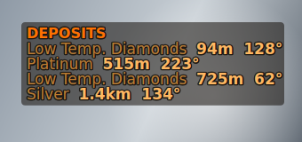
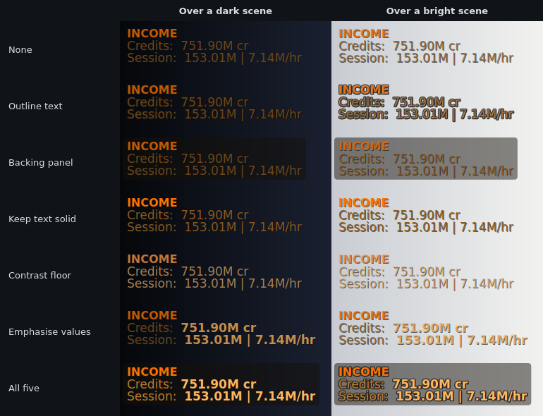
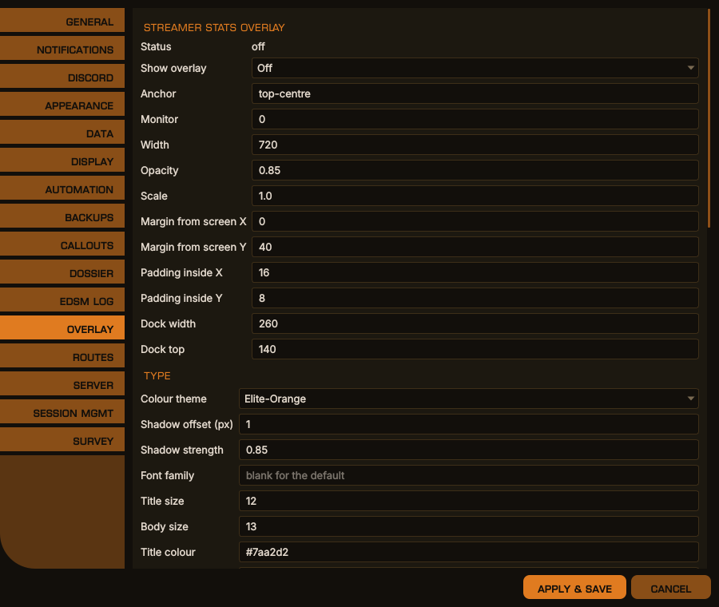
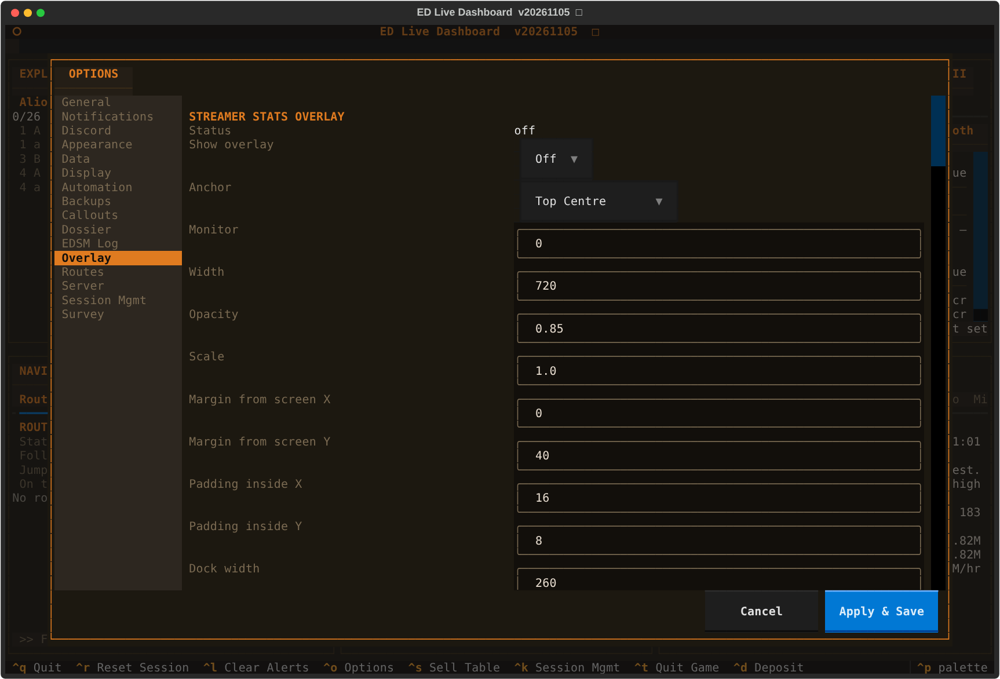

# Streamer Stats Overlay

An optional set of small, always-on-top windows that draw over Elite Dangerous
itself.

It is not a second dashboard. EDLD already is one, and it is better at it: a
second screen has room for everything and you can look at it whenever you want.
The overlay exists for the subset you cannot look away for — and for the subset
someone else is looking at, which is where the name comes from. If you are
streaming or recording, this is what puts your commander, your balance and your
session numbers on camera without a scene full of browser sources.

Off by default. Nothing draws over exclusive fullscreen on any platform — run
the game borderless windowed.

| Platform | Status |
|---|---|
| Linux / X11 | **Released.** Requires a running compositor — see below |
| Windows | **Experimental.** Untested; `--overlay-probe` reports what a machine can do |
| macOS | **Experimental.** Untested, and largely moot since Elite does not run natively there |
| Linux / Wayland | Not supported. A Wayland client cannot request always-on-top or place itself absolutely |

The compositor is a dependency on Linux, not a nicety: without one there is no
alpha channel to composite into. EDLD detects the case and falls back to an
opaque panel so the text is readable, but transparency needs `picom` or
equivalent running.

## Quick start

1. Options → **Overlay** → *Show overlay* → **On**.
2. In the panel list, set something to **On** — `commander` is a good first
   test because it needs nothing but a loaded commander.
3. **Apply & Save.** The overlay redraws without a restart.

If nothing appears, `python edld.py --overlay-doctor` walks the chain and names
the first link that breaks.

## Panels

A panel belongs to the component that owns its data, so what a panel can show
is whatever that part of EDLD already knows.

| Panel | Shows |
|---|---|
| `commander` | `CMDR <name>` as the header, then squadron and location |
| `ship` | Ship name and ident as the header, what you are currently in, type, value |
| `income` | Credits, and the session's earnings with its rate |
| `powerplay` | Your power and your rank — nothing at all if you are unpledged |
| `cargo` | How full the hold is; both holds when you are in an SRV |
| `survey_compass` | Distance and bearing to the nearest deposits recorded on this body, leaving out any marked depleted |
| `combat`, `exploration`, `exobiology`, `mining`, `trade`, `missions_session`, `odyssey` | That activity's figures |

<div align="center">

<br><em>The survey_compass panel with every visibility tweak on, over a stand-in background</em>
</div>

### Placement

Three zones across the top — **left**, **centre**, **right** — plus
**dock-left** and **dock-right**, separate windows against the side edges, each
a single stacked column. Every zone takes positions 1–9.

### Mode

**On** draws the panel whenever it has anything to draw. **Off** never draws it.
**Auto** lets the panel's own component decide — the survey compass appears
only when you are in an SRV near a recorded deposit, PowerPlay only when you are
pledged, cargo only when there is a hold.

`On` still needs content: it means *always show this*, not *invent something*.

### Shows — career, session, or both

Offered only on panels that have both kinds of figure, because choosing between
career and session where only one exists is a control that does nothing.

- **Session** — this session only. Absent until something happens.
- **Career** — lifetime totals. Drawn from the first frame, whether or not
  anything has happened today.
- **Career (Session: )** — the career figure with the session in parentheses,
  so you can see what today added to the total without doing the subtraction.

### Hidden panels

When an `auto` panel is not currently relevant, its stack either closes up or
holds the space:

- **Collapse** — denser, no wasted screen, but the panels below move when one
  appears or goes, and something that moves has to be re-found rather than
  glanced at.
- **Reserve** — everything stays where you put it, at the cost of gaps.
  Steadier to read, and the better choice with the overlay on camera.

## Appearance

### Spacing

Two layers, and they are different things:

```
Margin   monitor edge  →  window edge   (moves the whole overlay)
Pad      window edge   →  first glyph   (breathing room inside the box)
```

`MarginY` is what moves the top bar down the screen. `DockTop` is the same
measurement for the side windows.

### Type and colour

`FontFamily` takes any installed family by name, plus anything EDLD ships in
`fonts/` and anything you drop in `<data>/fonts/` — those are registered at
startup, so they work without being installed system-wide.

`ColourTheme` offers every EDLD palette plus **Elite Dangerous**, which matches
the cockpit HUD's orange; your own [custom dashboard themes](THEMING.md#custom-themes);
**Follow dashboard**, which draws with whatever theme the dashboard uses, custom
ones included; and **Custom**, which uses the three colour fields verbatim.
Picking a theme changes what is drawn but not what is stored, so switching back
to Custom restores what you had set.

The text shadow is derived from the text: it keeps the ink's hue and drops its
lightness, so it reads as depth rather than as a black fringe. `ShadowOffset` is
capped at 2px, past which it stops being depth and becomes a blurry second copy.

### Visibility tweaks

The overlay draws on whatever the game shows, which in one session is a black
starfield, a white station interior and a ring full of ice. A theme's colours
are chosen for the dashboard's solid background, and the dimmer ones — labels
above all — can all but vanish over the game. Five switches in `[Overlay]`,
under **Visibility Tweaks** in Options, each independent and all off by
default. Any combination works, with every theme.

| Setting | Label | What it does |
|---|---|---|
| `Outline` | Outline text | A ring round every letter, outside it, in the backing colour. A shadow only separates text from a dark scene; an outline separates it from a bright one too. |
| `BackingPanel` | Backing panel | A rounded, translucent panel behind each overlay panel, in the backing colour. The most reliable of the five over busy scenes. |
| `SolidText` | Keep text solid | `Opacity` fades the shadow, outline and panel, and the text is drawn at full strength. Off, `Opacity` fades the text itself. |
| `ContrastFloor` | Contrast floor | Lightens or darkens any colour too faint to read, keeping its hue, until labels and titles reach 5.5:1 and values 8:1. Measured against the outline or panel when either is on, otherwise against a dark scene, and allowing for `Opacity`. Applies to Custom colours and custom themes as much as to the built-in ones. |
| `EmphasiseValues` | Emphasise values | A labelled row is drawn as its label in the label colour and its value in the value colour, bold. Off, the whole row is drawn in the label colour, as before. |

The **backing colour** is derived from the value colour the way the shadow is:
near-black for a theme with light text, near-white for the light theme. So the
light theme gets pale panels behind dark text, and with the contrast floor and
no backing its dark text is lightened to read over space.

For the most readable result over anything the game draws, turn on all five.
For the lightest touch, Outline and Keep text solid.

<div align="center">

<br><em>The Income panel in the Elite Dangerous theme at 75% opacity, with each tweak on its own and all five together</em>
</div>

### Auto-hide

The whole overlay can step aside while you are busy, and come back when you
are not. Three switches in `[Overlay]`, under **Auto-hide** in Options, all
off by default:

| Setting | Label | Hidden while |
|---|---|---|
| `HideInCombat` | Hide in combat | the game says the ship is in danger or being interdicted, and for a while after the fight |
| `HideDocked` | Hide while docked | docked at a station, outpost or carrier |
| `HideOnFoot` | Hide on foot | out of the ship and the SRV |

## Settings

All of these but `MaxTargets` are on the **Overlay** tab in Options, in both
interfaces, and all take effect without a restart, whether changed there or in `config.toml`.

<div align="center">

<br><em>Options → Overlay, desktop window</em>
</div>

<details>
<summary>The same in the terminal dashboard</summary>
<p align="center"></p>
</details>

### `[Overlay]` — the windows and how they draw

| Key | Default | What it does |
|---|---|---|
| `Enabled` | `false` | Show the overlay at all |
| `Anchor` | `top-centre` | Where the top bar sits: `top-` or `bottom-` with `left`, `centre` or `right` |
| `Monitor` | `0` | Which screen, counting from 0 |
| `Width` | `720` | Width of the top bar in pixels. Its height grows to fit |
| `MarginX`, `MarginY` | `0`, `40` | Gap between the screen edge and the top bar |
| `PadX`, `PadY` | `16`, `8` | Gap between the window edge and the text inside it |
| `DockWidth` | `260` | Width of the docked side windows |
| `DockTop` | `140` | Gap between the top of the screen and the docked windows |
| `Scale` | `1.0` | Scales every size and position, for high-DPI screens |
| `Opacity` | `0.85` | How strongly everything is drawn, 0–1. With `SolidText`, it applies to the backing only |
| `FontFamily` | blank | Any installed family, or one from `fonts/` or `<data>/fonts/`. Blank uses the system default |
| `ColourTheme` | `elite-orange` | Any EDLD theme, a custom theme, `dashboard` to follow the dashboard, or `custom` for the three colours below |
| `ShadowOffset` | `1` | Drop shadow offset in pixels, 0–2. `0` turns it off |
| `ShadowStrength` | `0.85` | Drop shadow strength, 0–1, multiplied by `Opacity` |
| `Outline`, `BackingPanel`, `SolidText`, `ContrastFloor`, `EmphasiseValues` | `false` | The [visibility tweaks](#visibility-tweaks) |
| `HideInCombat`, `HideDocked`, `HideOnFoot` | `false` | [Auto-hide](#auto-hide) |
| `MaxTargets` | `4` | How many of the nearest deposits the `survey_compass` panel lists, 1–9. Not in Options |

### `[OverlayPanels]` — what goes where

| Key | Default | What it does |
|---|---|---|
| `HideMode` | `reserve` | `reserve` or `collapse` — see [Hidden panels](#hidden-panels) |
| `TitleSize`, `BodySize` | `12`, `13` | Text sizes in points |
| `TitleColour`, `LabelColour`, `ValueColour` | `#7aa2d2`, `#9aa4b2`, `#cfd6e4` | The colours used when `ColourTheme` is `custom` |
| `PanelZone_<panel>` | — | `left`, `centre`, `right`, `dock-left` or `dock-right` |
| `PanelOrder_<panel>` | — | Position in its zone, 1–9 |
| `PanelMode_<panel>` | `off` | `on`, `off` or `auto` |
| `PanelScope_<panel>` | `session` | `session`, `career` or `both`, on panels that have both kinds of figure |

`<panel>` is a panel name from the table at the top, for example
`PanelZone_income = "dock-left"`.

## Where it will not run

The overlay does not start, and says which rule applied, when:

- **Terminal mode** — a scrolling log has no window for an overlay to sit beside.
- **A secondary instance** (`PrimaryInstance = false`) — the overlay belongs on
  the machine running the game.
- **A headless session** — no display at all.

## Diagnostics

| Command | Answers |
|---|---|
| `--overlay-probe` | Can this machine carry an overlay? Reports platform, translucency, click-through, always-on-top, compositing, and the fonts it registered |
| `--overlay-selftest` | Does the renderer draw? A fixed frame for twenty seconds, with no config and no panels involved |
| `--overlay-doctor` | Why is nothing showing? Walks config, placements, available panels and position, and names the first link that breaks |

Under `--trace` the component logs its build and placement count at load, and
every frame with its element count per window.

### Compositing

Per-pixel transparency needs a compositor. i3 does not composite; install
`picom` and start it from your i3 config. Without one the overlay paints an
opaque background so the text is still readable — less pretty, and actually
there. EDLD detects which case applies rather than assuming.
