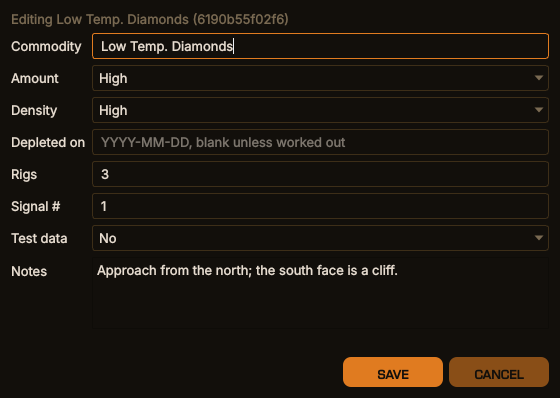
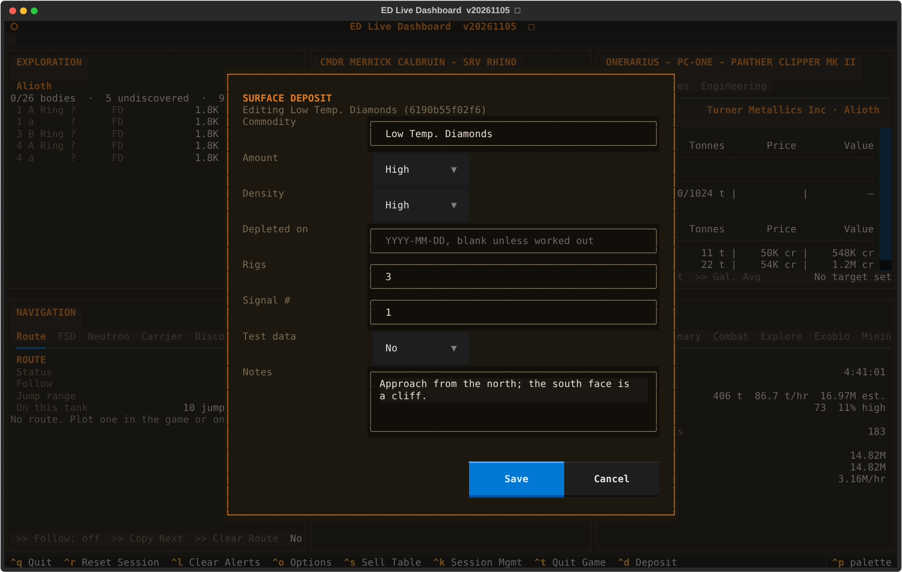
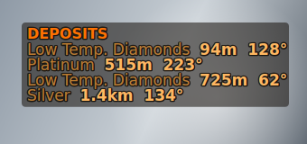
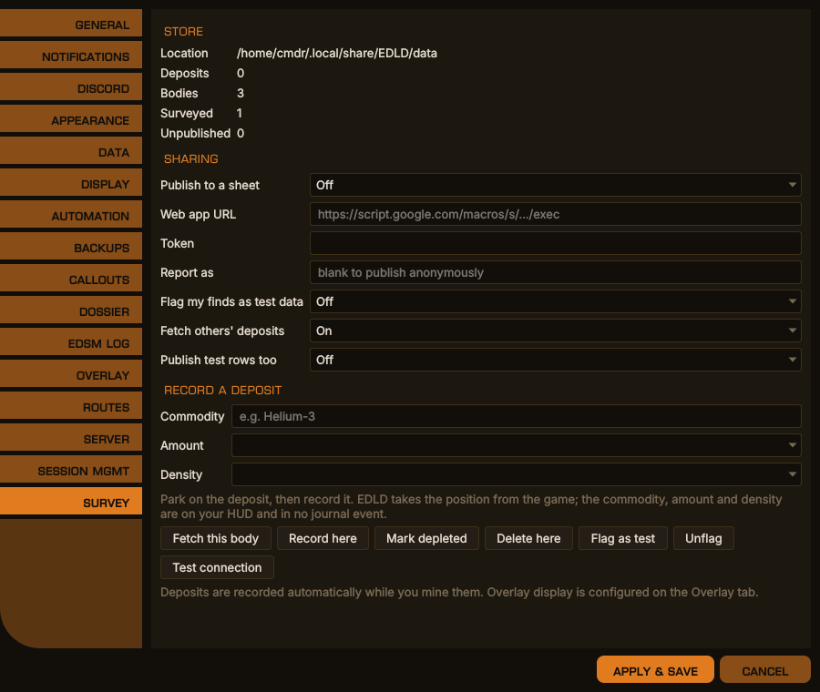
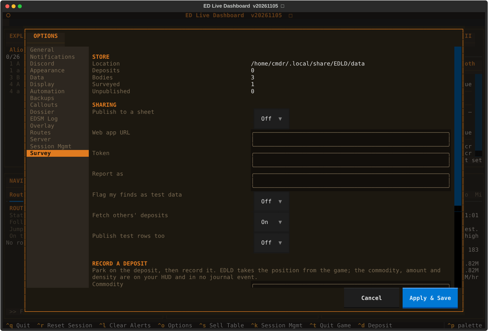

# Surface Mining Survey

A record of where planetary mining deposits are, what they yield, and when
somebody last stood on one — kept locally, and optionally shared with other
commanders through a Google Sheet.

## Why it works the way it does

Surface mining added no journal events. The whole feature rides on events that
already existed, and none of them carries a position: across a full journal
corpus the only events with a `Latitude` are `Liftoff`, `Touchdown`,
`CodexEntry`, `Location` and `ApproachSettlement`. None is a mining event.
Driving up to a deposit and parking on it produces nothing at all.

So a deposit's position comes from `Status.json`, joined to a `MiningRefined`
on time. A deposit cannot be refined from anywhere except on top of it, which
makes that join proof of a position and means most deposits are recorded
without anything being pressed.

What cannot be captured is what is on the HUD and in no file: how much is left,
how dense the seam is, how many rigs the site took. Those are typed.

## What is recorded automatically

| From | What it gives |
|---|---|
| `SAASignalsFound` | How many mining location signals a body has, before any has been visited |
| `MiningRefined` in an SRV | A deposit at the current position, with a running refine count |
| Driving within 25 m | Confirmation that a known deposit is still there |
| `Scan`, or the exploration catalogue | The body's class, gravity, radius, atmosphere and volcanism |

Depletion is kept as dated history rather than a deletion. "Empty on the
twelfth" is worth more to whoever reads it next than a missing row.

## Recording by hand

**Ctrl+D** opens a form for the deposit underfoot. One binding covers adding and
editing: which it is depends on where you are standing, resolved by proximity,
and you do not have to know before pressing it.

 <em>Editing a recorded deposit with Ctrl+D (example data), desktop window</em>

The same in the terminal dashboard

Amount, density, rig count, signal number and the depletion date are validated
against the game's own vocabularies, so a typed row and a captured one are
indistinguishable downstream.

**Amount and density** are what the HUD says the site holds when it is full:
Low, Medium or High. Once set they change only when you correct them. A later
refine or drive-by fills them where they are blank and never overturns them,
and a correction is stamped so that it — and not somebody's older copy —
wins on the shared sheet.

**Depleted on** is the whole record of a site being worked out. It is not an
amount, and setting it changes nothing else about the deposit: the amount stays
what the site holds when full. **Mark depleted** on the Survey tab stamps today;
the form's date field records a site worked out earlier, or corrects the date
already held. How long a site takes to refill is not yet known. When it is, the
refresh date will be calculated from this one, so it is worth getting right
rather than always being the moment somebody noticed.

**Notes** is free text for anything the next commander should know — the way
in, a hazard, what else is nearby — up to 1000 characters over several lines.
It opens holding the current note, so clearing it removes the note. Notes are
shared on the sheet, where the most recently written note wins, blank included.

It is published to the shared sheet and read back from it, because it is the
one fact about a deposit that any commander can contribute and every commander
needs — a site somebody emptied last week is a wasted trip, and only the person
who found it empty knows. The most recent date wins on a merge, unlike every
other field where local observation does: sites reset and are worked out again,
so the freshest sighting of an empty one describes the current state. An empty
field means *leave it alone*, not *set it to nothing* — editing the amount will
not blank a density recorded last week. Notes are the exception, as above.

The commodity cannot be changed on an existing deposit: it is part of the
deposit's identity, and altering it would leave the id pointing at something
else on every sheet that already has the row. A wrong commodity is retired by
flagging it as test data and recording the right one.

## Identity and duplicates

Two sightings are the same deposit when they share system, body and commodity
and lie within 200 m of each other; where two deposits are both in range, the
nearer wins. Coordinates are never compared for equality — re-scans do not
repeat floats, and rounding to a fixed precision draws an arbitrary grid across
the body with some deposits straddling a line.

The radius sits between two measurements. A site worked with several rigs is
not a point: the SRV refines wherever it picks up the fragments, and two refine
batches at one five-rig site have landed 180 m apart. Real deposits of one
commodity are 400–500 m apart at the closest, so 200 m covers a whole rig site
without reaching the next one.

The commodity is matched on the game's own symbol, whatever it was called when
it was recorded: the form takes the name the game shows — *Low Temp. Diamonds*
— and EDLD resolves it to the symbol a refine carries,
`lowtemperaturediamond`. Display names are learned from every refine and from
the market catalogue, so a commodity added to the game after this release is
resolved too once one has been refined or seen in a market.

If a store already holds one site as several deposits, EDLD folds them together
when it starts: the oldest keeps its id, position and notes, refine counts add
up, and the duplicates are removed from the shared sheet on the next publish.
A row another commander published for a site held here under a different id is
merged into the local one when it is fetched, rather than added beside it.

Each deposit keeps a stable twelve-character id derived from its first recorded
position and never recomputed. That is what the shared sheet matches on.

## Sharing — experimental

Publishing needs a Google Sheet with a small Apps Script bound to it. No Google
Cloud project, no OAuth, no client library: a URL and a token, which is also all
a squadron leader has to hand out. Setup is in
[`sheets/README.md`](../sheets/README.md). The sheet's owner pastes one file,
`sheets/Loader.gs`, once; after that the sheet installs and upgrades its own
code and layout from its **ED Dashboard → Upgrade…** menu, keeping its data,
URL and token.

It reads as well as writes. Arriving at a body, EDLD asks the sheet what is
known about it and merges the answer in, so the in-game compass can point at
deposits nobody running your copy has ever seen. It leaves out any deposit
marked depleted, whoever marked it; once the refill time is known, a site
returns to the compass on the day it should have refilled.

 <em>The overlay's survey_compass panel: distance and bearing to the nearest recorded deposits</em>

Some rules worth knowing:

- **Duplicate checking happens in the sheet**, not in EDLD. Only the sheet knows
  what is in the sheet, and several commanders writing to one of them cannot see
  each other's local stores.
- **Imported rows are never sent back up.** Otherwise every commander
  re-publishes every other commander's finds and the sheet spends its write
  quota echoing itself.
- **Local observation wins, until someone corrects it.** An imported row only
  fills fields yours does not have — except an amount or density somebody
  corrected more recently than yours, and a newer note.
- **Depletion dates merge by date.** The latest wins, whoever sent it.
- **Deposits publish when you leave a body**, or on **Ctrl+G**. Sheets allows
  roughly sixty writes a minute and one real session produced 608 refine events.
- **Nothing is marked published until the sheet confirms it.** A transport
  error, an error page, a bad token or a partial write all leave the rows
  pending for the next flush.

### A dashboard for the people reading it

Most of a squadron will open the sheet rather than run EDLD. For them there is
a template, `sheets/Mining_Dashboard.xlsx`: filter by system or commodity, sort
by any column, with the rows banded and depleted sites struck through, in one
of five HUD colour schemes or your own. Start the sheet from it instead of from
a blank one and the receiver writes into it unchanged. It is optional — the
sharing above works the same either way. The code the loader installs also
applies its colours and adds click-to-sort; setup is in
[`sheets/README.md`](../sheets/README.md#the-dashboard).

### Test data

Two switches, answering different questions. *Flag my finds as test data* marks
everything recorded from now on, for while you are setting up. *Publish test
rows too* decides whether flagged rows leave the machine at all. Individual
deposits can be flagged and unflagged from the Survey tab, which is how a bad
row is retired without deleting the evidence.

## Settings

`[SurfaceSurvey]`. Recording is always on; these govern sharing and
confirmation. All but the last three are on the **Survey** tab in Options.

 <em>Options → Survey, desktop window</em>

The same in the terminal dashboard

| Key | Default | What it does |
|---|---|---|
| `Enabled` | `false` | Publish to and read from a shared sheet |
| `WebAppURL` | blank | The sheet's web app address, from its deployment |
| `Token` | blank | The sheet's token. Never written to the log |
| `ReporterName` | blank | The name your finds are credited to on the sheet |
| `Fetch` | `true` | Read other commanders' deposits back when you arrive at a body |
| `IncludeTest` | `false` | Publish rows flagged as test data too |
| `MarkFindsAsTest` | `false` | Flag everything recorded from now on as test data |
| `BatchSize` | `200` | Most rows sent in one request |
| `AutoConfirm` | `true` | Confirm a known deposit when you drive onto it |
| `ConfirmMetres` | `25.0` | How close counts as onto it |

## Where it is stored

`<data>/data/mining.db` — shared across commanders, because a deposit is in the
same place whoever finds it. On Linux that is
`~/.local/share/EDLD/data/mining.db`.
