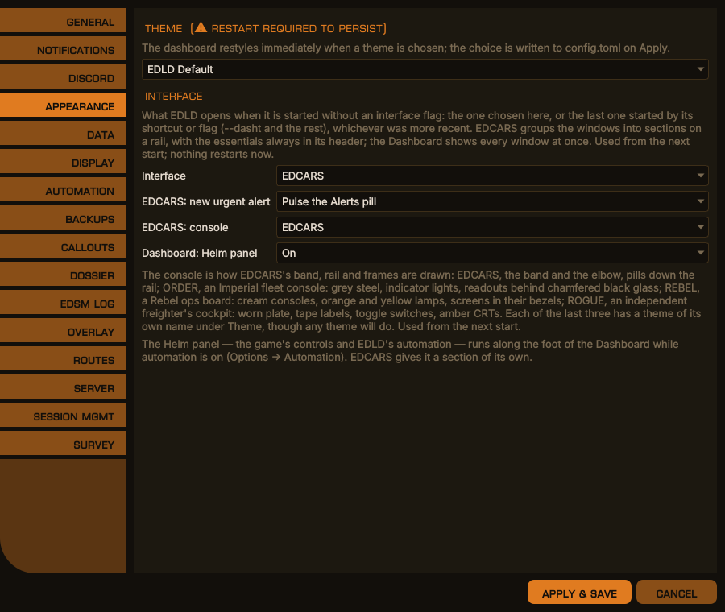
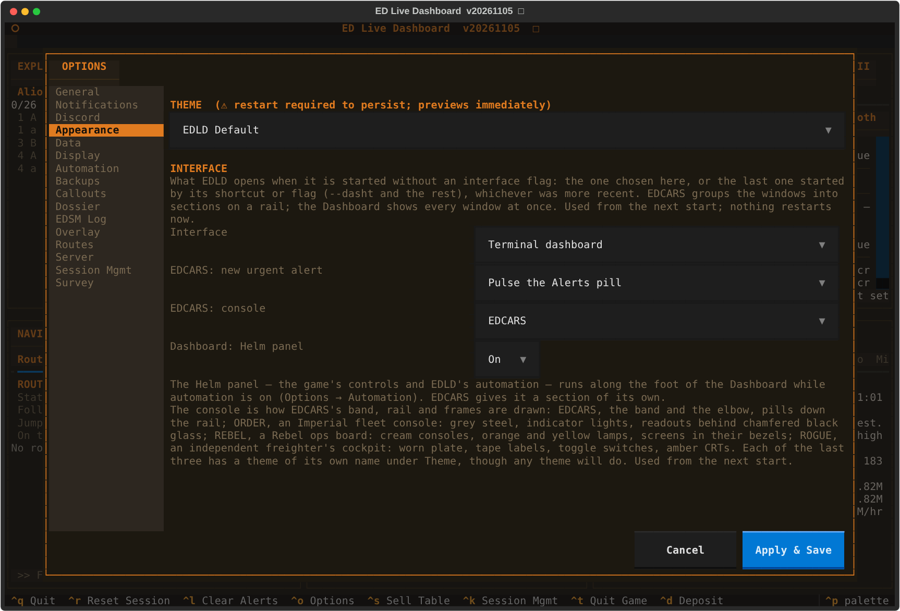
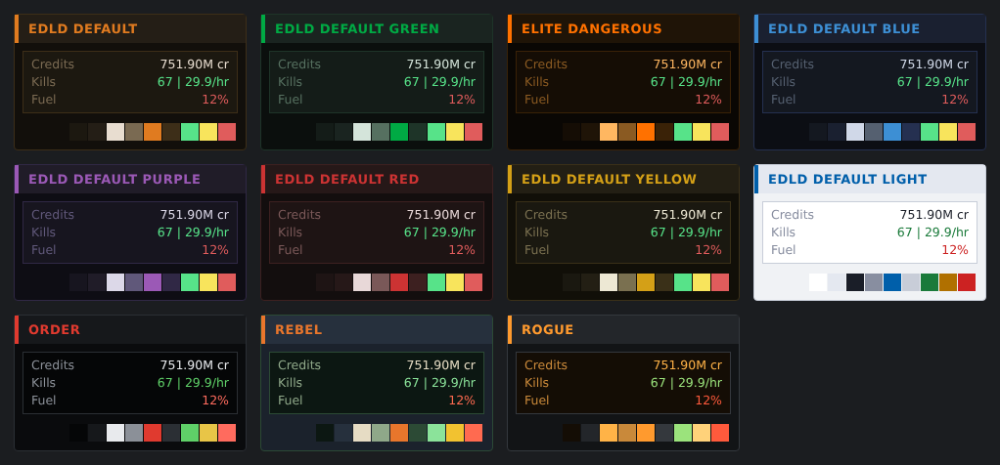

# EDLD Theming

EDLD ships twelve built-in colour themes and supports user-defined custom
themes.  A theme is just a palette — a small set of colour values.  All
structural rules (layout, spacing, borders) are fixed in the UI and are not
part of a theme, so switching themes only changes colours.

Themes apply to **both** interfaces.  The palettes live in `core/palette.py`,
which the terminal dashboard turns into Textual CSS and the desktop window
turns into a Qt stylesheet, so a theme is defined once and appears in both.
Custom themes work the same way in each.

The same palette also colours the [commander dossier](DOSSIER.md) — its web
page is regenerated when you change theme — and, if you choose **Follow
dashboard** for it, the [streamer overlay](STREAMER_STATS_OVERLAY.md).

[EDCARS](EDCARS.md), the desktop window's console style, draws from the same
palette: its header band, rail and frames are the theme's accent, and its
pills mix the accent towards the background. A custom theme reaches it with
nothing extra to set.

---

## Selecting a theme

Either set it in your config:

```toml
[UI]
Theme = "default-blue"
```

…or pick it from **Options → Appearance** (Ctrl+O), which restarts EDLD to
apply it. A paired EDAM device set to follow EDLD changes with it. The same
tab sets the **Interface** a plain launch opens — EDCARS, the Dashboard, the
terminal dashboard or the terminal text.

<div align="center">

<br><em>Options → Appearance, desktop window</em>
</div>

<details>
<summary>The same in the terminal dashboard</summary>
<p align="center"></p>
</details>

---

## Built-in themes

| Theme | Accent |
|-------|--------|
| `elite-orange` | Orange `#ff7100` on near-black — the game's own HUD colours |
| `default` | Orange `#e07b20` — Elite Dangerous orange |
| `default-dark` | Orange `#e07b20` — identical to `default` |
| `default-blue` | Blue `#3d8fd4` |
| `default-green` | Green `#00aa44` |
| `default-purple` | Purple `#9b59b6` |
| `default-red` | Red `#cc3333` |
| `default-yellow` | Yellow `#d4a017` |
| `default-light` | Light background variant |
| `order` | Red `#e03a2f` on black glass, white readouts — made for the [ORDER](EDCARS.md#consoles) console |
| `rebel` | Orange `#e8762c`, cream text on green-tinted screens in a navy room — made for [REBEL](EDCARS.md#consoles) |
| `rogue` | Amber CRT phosphor `#ffb347` on slate — made for [ROGUE](EDCARS.md#consoles) |

The last three are made for EDCARS's consoles of the same names, and work
anywhere: the Dashboard window and the terminal dashboard wear them too.

<div align="center">

<br><em>The built-in themes, each with a sample block and its ten colours</em>
</div>

These palettes are built into the dashboard; no external files are required.

---

## Custom themes

A custom theme is a single CSS file containing one `:root { }` block of colour
variables.  To create one:

1. Make a folder named `themes/custom` in EDLD's data directory and copy the
   template into it under the name you want. On Linux, from the EDLD folder:

   ```
   mkdir -p ~/.local/share/EDLD/themes/custom
   cp themes/custom-template.css ~/.local/share/EDLD/themes/custom/my-theme.css
   ```

   | System | Folder |
   |---|---|
   | Linux | `~/.local/share/EDLD/themes/custom/` |
   | Windows | `%LOCALAPPDATA%\EDLD\themes\custom\` |
   | macOS | `~/Library/Application Support/EDLD/themes/custom/` |

   With a packaged binary there is no `themes/` folder to copy from: take
   [`themes/custom-template.css`](../themes/custom-template.css) from the
   repository instead.

2. Edit the colour values in the `:root { }` block of `my-theme.css`. Both
   interfaces read the same file, so there is nothing further to do for the
   desktop window. The recognised variables are:

   | Variable | Purpose |
   |----------|---------|
   | `--bg-deep`  | Window background |
   | `--bg-mid`   | Block background |
   | `--bg-panel` | Title-bar background |
   | `--fg`       | Primary text |
   | `--fg-dim`   | Dimmed/secondary text |
   | `--accent`   | Accent (titles, highlights) |
   | `--border`   | Block borders |
   | `--green` / `--amber` / `--red` | Status colours (good / warning / critical) |

   Any variable you omit falls back to a sensible default.

3. Select it by stem name under **Options → Appearance** (it appears as
   `Custom: my-theme`), or in config:

   ```toml
   [UI]
   Theme = "custom/my-theme"
   ```

Custom themes are found when Options opens, so a new file appears without a
restart. EDLD also still reads `themes/custom/` beside its own code, where
custom themes lived before, for anyone running from source; if the same name
is in both places, the one in the data directory is used.

---

## On the EDAM app

A paired EDAM device follows the theme EDLD is drawing with: every snapshot
carries the theme's name and its colours, so a custom theme reaches the phone
as the colours EDLD resolved and needs nothing installed there. The built-in
themes are also compiled into the app; after changing `core/palette.py`,
regenerate that list with `scripts/export_edam_themes.py` (see
[SERVER.md](SERVER.md)).
