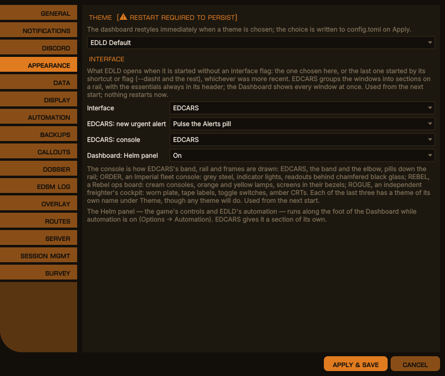
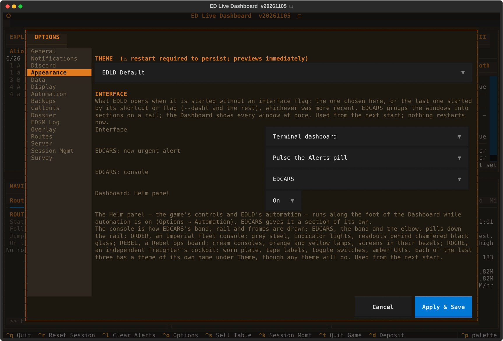
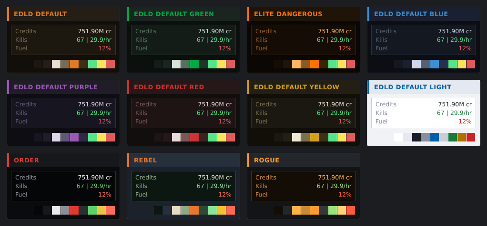

# EDLD Theming

EDLD ships twelve built-in color themes and supports user-defined custom
themes.  A theme is just a palette — a small set of color values.  All
structural rules (layout, spacing, borders) are fixed in the UI and are not
part of a theme, so switching themes only changes colors.

Themes apply to **both** interfaces.  The palettes live in `core/palette.py`,
which the terminal dashboard turns into Textual CSS and the desktop window
turns into a Qt stylesheet, so a theme is defined once and appears in both.
Custom themes work the same way in each.

The same palette also colors the [commander dossier](DOSSIER.md) — its web
page is regenerated when you change theme — and, if you choose **Follow
dashboard** for it, the [streamer overlay](STREAMER_STATS_OVERLAY.md).

[EDCARS](EDCARS.md), the desktop window's console style, draws from the same
palette: its header band, rail and frames are the theme's accent, and its
pills mix the accent toward the background. A custom theme reaches it with
nothing extra to set.

---

## Selecting a theme

Either set it in your config:

```toml
[UI]
Theme = "default-blue"
```

…or pick it from **Options → Appearance** (Ctrl+O), which restarts EDLD to
apply it. A paired EDAM device set to follow EDLD changes with it. The
**Interface** a plain launch opens — EDCARS, the Dashboard, the terminal
dashboard or the terminal text — is on the page above it, Options → Interface.

In the desktop windows the same page also sets the text and the rows, used as
soon as Options closes:

| Setting | `[UI]` key | |
|---------|-----------|---|
| Face | `FontFamily` | The face the windows' text is set in; Default is the system's |
| Figures face | `FigureFamily` | A fixed-width face for figures, which are padded into columns |
| Size | `FontSize` | 8–20 points; headings, tabs and menus follow it |
| Values | `ValuePlacement` | At the right edge, or Manual alignment, placed by the two below, so a figure stays near its name in a wide window |
| From the labels' left | `ValueFromLeft` | Manual: values start this far from the labels' left edge, left-aligned, or just past the longest label if that is further. `320` is pixels, `25%` a share of the window's width |
| From the right edge | `ValueFromRight` | Manual: values end this far from the right edge, right-aligned. With both set, the column runs between the two, values right-aligned in it |
| Alternate row shading | `RowStripes` | Every other row shaded, counting afresh under each heading, and every other row of the tables |

A console's own lettering — EDCARS's band, rail and frame headings, ORDER's,
REBEL's and ROGUE's alike — keeps its face and size, since the shapes are
drawn to fit it. The terminal dashboard is drawn in the terminal's own font,
and the overlay has type settings of its own (Options → Overlay).

<div align="center">

<br><em>Options → Appearance, desktop window</em>
</div>

<details>
<summary>The same in the terminal dashboard</summary>
<p align="center"></p>
</details>

---

## Built-in themes

| Theme | Accent |
|-------|--------|
| `elite-orange` | Orange `#ff7100` on near-black — the game's own HUD colors |
| `default` | Orange `#e07b20` — Elite Dangerous orange |
| `default-dark` | Orange `#e07b20` — identical to `default` |
| `default-blue` | Blue `#3d8fd4` |
| `default-green` | Green `#00aa44` |
| `default-purple` | Purple `#9b59b6` |
| `default-red` | Red `#cc3333` |
| `default-yellow` | Yellow `#d4a017` |
| `default-light` | Light background variant |
| `order` | Red `#e03a2f` on black glass, white readouts — made for the [ORDER](EDCARS.md#consoles) console |
| `rebel` | Orange `#e8762c`, cream text on green-tinted screens in a navy room — made for [REBEL](EDCARS.md#consoles) |
| `rogue` | Amber CRT phosphor `#ffb347` on slate — made for [ROGUE](EDCARS.md#consoles) |

The last three are made for EDCARS's consoles of the same names, and work
anywhere: the Dashboard window and the terminal dashboard wear them too.

<div align="center">

<br><em>The built-in themes, each with a sample block and its ten colors</em>
</div>

These palettes are built into the dashboard; no external files are required.

---

## Custom themes

A custom theme is a single CSS file containing one `:root { }` block of color
variables.  To create one:

1. Make a folder named `themes/custom` in EDLD's data directory and copy the
   template into it under the name you want. On Linux, from the EDLD folder:

   ```
   mkdir -p ~/.local/share/EDLD/themes/custom
   cp themes/custom-template.css ~/.local/share/EDLD/themes/custom/my-theme.css
   ```

   | System | Folder |
   |---|---|
   | Linux | `~/.local/share/EDLD/themes/custom/` |
   | Windows | `%LOCALAPPDATA%\EDLD\themes\custom\` |
   | macOS | `~/Library/Application Support/EDLD/themes/custom/` |

   With a packaged binary there is no `themes/` folder to copy from: take
   [`themes/custom-template.css`](../themes/custom-template.css) from the
   repository instead.

2. Edit the color values in the `:root { }` block of `my-theme.css`. Both
   interfaces read the same file, so there is nothing further to do for the
   desktop window. The recognized variables are:

   | Variable | Purpose |
   |----------|---------|
   | `--bg-deep`  | Window background |
   | `--bg-mid`   | Block background |
   | `--bg-panel` | Title-bar background |
   | `--fg`       | Primary text |
   | `--fg-dim`   | Dimmed/secondary text |
   | `--accent`   | Accent (titles, highlights) |
   | `--border`   | Block borders |
   | `--green` / `--amber` / `--red` | Status colors (good / warning / critical) |

   Any variable you omit falls back to a sensible default.

3. Select it by stem name under **Options → Appearance** (it appears as
   `Custom: my-theme`), or in config:

   ```toml
   [UI]
   Theme = "custom/my-theme"
   ```

Custom themes are found when Options opens, so a new file appears without a
restart. EDLD also still reads `themes/custom/` beside its own code, where
custom themes lived before, for anyone running from source; if the same name
is in both places, the one in the data directory is used.

---

## On the EDAM app

A paired EDAM device follows the theme EDLD is drawing with: every snapshot
carries the theme's name and its colors, so a custom theme reaches the phone
as the colors EDLD resolved and needs nothing installed there. The built-in
themes are also compiled into the app; after changing `core/palette.py`,
regenerate that list with `scripts/export_edam_themes.py` (see
[SERVER.md](SERVER.md)).
